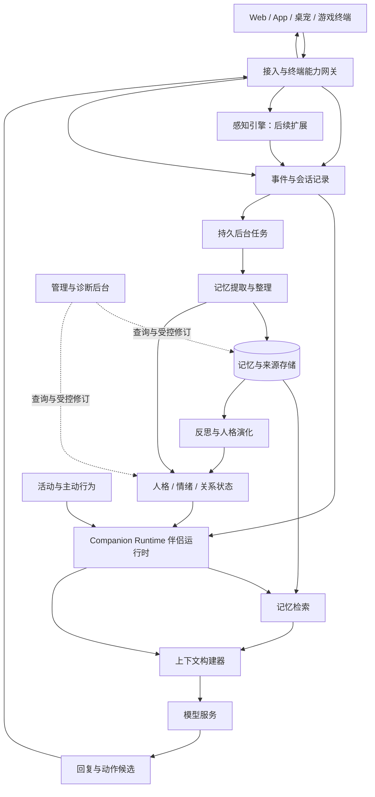

# AI 伴侣后端架构讨论稿

更新日期：2026 年 10 月 13 日。

状态：按新的参考架构重新组织的讨论底稿，尚未确认各模块的详细设计，尚未开始开发。后续逐模块在本文细化，收敛后再形成开发计划。

主要参考：[《设计 AI 伴侣架构》分享对话](https://chatgpt.com/share/6ace194a-e6dc-83ec-bd31-5c3750257cf4)，访问日期为 2026 年 10 月 13 日。采用其中的伴侣运行时、八类记忆、四层人格、反思成长与终端能力网关结构；结合本项目的资源、开源和产品要求重新划分职责。参考内容是设计建议，不作为已验证的性能或心理学结论。

## 1. 产品目标与本轮边界

系统维护多个具有独立身份、记忆、人格、关系与活动的 AI 伴侣。它们可以陪人闲聊、吐槽、讲故事、共同创作、工作或编程；未来通过终端了解游戏和桌面活动。职业和兴趣来自实际人设与交流，不预置所有用户都是开发者。

后端维持伴侣的连续身份和状态，终端提供输入、展示以及已获授权的操作。同一个伴侣切换 Web、App 或桌宠后，仍然使用同一份后端状态；多个伴侣则各自拥有独立经历。

本轮沿用的产品约束：

- 先个人使用，支持创建多个伴侣，未来扩展多用户及开源部署。
- 第一版以聊天和用户主动分享的信息为输入；屏幕观察、游戏感知、语音和外部社区操作后续接入。
- 用户希望伴侣有自己的兴趣、观点、实际活动和感受，不只是匹配用户情绪。
- 聊天原文持久化并备份，派生记忆可追溯、纠正和重建。
- 后台能够查看记忆关系图、来源、修订、生命周期以及单轮检索情况。
- 以 2 核 4 GB 为初期服务器约束，推理与 embedding 优先使用外部 API；具体容量与费用待测。
- 部署者配置模型访问与运行环境；普通使用者主要设置人设即可开始，记忆策略提供默认值。
- 本稿先确定职责与数据流。NestJS 是可选实现方向，数据库、队列、模型供应商和具体参数在模块讨论后确定。

当前不建设独立微服务集群，也不要求多伴侣彼此交流。多个伴侣实例是多份隔离的持久状态，不等于每个实例一直占用一个进程或持续调用模型。

## 2. 总体结构

核心闭环：**输入与感知 → 记录经历 → 构建上下文 → 决定并执行行为 → 形成新经历；后台将经历整理为记忆、反思和成长。**



图中的箭头表示模块间的数据和调用关系，不表示每轮都运行所有模块。记忆整理和成长通常异步运行；对话读取已经形成的状态，并结合最新原文响应。

第一版可实现为模块化单体与受限并发的后台任务。是否把 Worker 拆成独立进程取决于资源和故障隔离需求；职责边界先明确，部署单元可以少。

## 3. 模块地图与状态归属

以下编号是后续讨论的固定索引，不要求一行对应一个服务。

| 编号 | 模块 | 主要职责 | 拥有或维护的数据 |
| --- | --- | --- | --- |
| M01 | 伴侣与人格模型 | 模板、实例、身份、人格分层、读取当前人格 | 伴侣实例、L0、L1 与人格版本 |
| M02 | 事件与会话 | 保存输入输出、顺序、会话连续性和执行证据 | 消息、事件、会话及处理游标 |
| M03 | 伴侣运行时与上下文 | 启动一轮交互、检索编排、注意力选择、构建输入、协调响应 | 运行记录、工作上下文和本轮选择结果 |
| M04 | 记忆引擎 | 提取、合并、修订、检索、压缩与遗忘 | 记忆单元、来源、关联、版本与索引 |
| M05 | 反思与人格演化 | 从经历形成认识，提出并审核成长候选 | 反思、成长候选、证据和提交记录 |
| M06 | 情绪与关系 | 维护当前感受、关系经验与状态，形成表达依据 | L2 关系状态、L3 中的情绪等状态 |
| M07 | 活动与主动行为 | 持续目标、故事进度、自主活动和主动互动机会 | 活动、目标、待表达意图、计划与执行进展 |
| M08 | 感知引擎 | 将可访问的图像、音频、游戏信号转换为观察事件 | 观察结果、环境快照、感知来源 |
| M09 | 终端协议与工具网关 | 设备接入、能力与授权、输出路由、动作执行与回执 | 终端、授权、动作及交付记录 |
| M10 | 模型服务 | 统一接入生成、embedding、视觉及语音服务 | 提供商配置、任务路由、用量与失败记录 |
| M11 | 存储与任务基础设施 | 持久化、后台调度、一致性、备份、资源预算 | 任务、幂等记录、存储与恢复元数据 |
| M12 | 管理与诊断 | 记忆图谱、时间线、人工修订、冻结与回滚、运行诊断 | 管理操作记录与诊断索引 |

关键写入规则：各模块通过拥有者的更新接口修改状态。M05 提出的人格变化最终通过 M01 提交新版本；M04 提取的关系线索通过 M06 更新；M03 负责协调，不直接覆盖其他模块的数据。

L3 是本轮需要的综合运行视图。情绪由 M06 维护，活动与意图由 M07 维护，环境由 M08 提供，本轮注意力由 M03 选择；视图引用这些数据，不另外复制一套互相竞争的状态。

## 4. M01：伴侣实例与四层人格

一个模板可以创建多个伴侣实例。模板提供起点，实例拥有自己的记忆与成长历史。修改模板不自动覆盖已经运行的实例。

| 层次 | 内容 | 变化方式 |
| --- | --- | --- |
| L0 核心身份 | 名字、角色定位、设定背景、核心价值与明确锁定的特点 | 显式配置修改，不由普通反思直接重写 |
| L1 成长人格 | 兴趣、审美、表达习惯、思考倾向和个人观点 | 经历支持的渐进变化，有版本与回滚能力 |
| L2 关系状态 | 与具体用户的熟悉程度、沟通习惯、约定及关系事件 | 由对应双方的互动更新 |
| L3 即时状态 | 当前感受、关注、活动、目标进展、待表达意图 | 随事件、活动和时间变化 |

创建时把人设描述解释为身份、初始倾向与可变化范围，提供可查看和编辑的结果。普通性格形容词不全部锁进 L0；需要区分“起初慢热”和“必须始终保持的身份特点”。具体字段与默认锁定规则在本模块细聊。

人格影响实际选择和表达：不同伴侣面对同一事件可以关注不同内容、形成不同感受，不要求所有实例逐渐变成同一种温柔风格。技能增加、知识增加和人格变化分别记录。

记忆隔离以用户归属、伴侣实例、关系和活动空间共同确定：

- 每个伴侣的私有经历与人格独立；复制人设不复制私有聊天。
- 关系状态属于对应的用户与伴侣。
- 用户通用事实只有在明确开启共享时才进入共享范围；共享时保留来源，不改写为接收伴侣的亲历。
- 故事世界独立命名；群聊和伴侣间交流以后再增加参与者与共享规则。

## 5. M02：事件、会话与原始记录

事件回答“系统收到了什么、实际发生了什么”。它是记忆、状态和成长的证据来源。

建议统一接收：用户消息、已生成的伴侣消息、用户分享材料、感知结果、活动进展、工具结果和时间触发事件。原文与附件可以分别存储，但事件必须保留可解析的来源引用。

每个事件至少记录所属范围、来源类型、事件 ID、会话顺序、发生时间、接收时间和内容版本。观察事件是观察器报告的结果，不自动等于确定事实；用户陈述、工具结果、推测和角色设定需要区分。

接收后先持久化，再让运行时处理。流式回复记录生成与交付状态，不能只在完整回复成功后才保存所有内容。发送失败、被新消息打断、执行失败都应留下明确状态。

用户可能连续发多条消息。短暂停顿只能触发检查，不能证明一句话已经说完。整理任务覆盖确定的消息范围，保留必要前文；后续补充可以修订早先的解释。跨设备访问同一会话时，统一读取服务端顺序和未处理原文。

原始事件通常追加记录，纠正通过新事件及修订关联表达；用户删除仍按删除策略处理。事件记录与状态快照一起备份，不假定只回放日志就能恢复所有外部工具结果或重新生成相同模型输出。

## 6. M03：伴侣运行时、注意力与上下文

运行时负责把一次输入变成合适的响应，也负责处理由活动和调度触发的一轮行为。它使用同一套伴侣身份，按需加载持久状态，无需让每个伴侣常驻独立进程。

一轮交互的建议流程：

1. 验证用户、伴侣、会话与终端范围，持久化输入事件。
2. 加载当前人格、关系、即时状态、近期消息和正在进行的活动。
3. 根据当前输入与已有线索选择直接读取、普通检索或有预算的深度回忆。
4. 从候选信息中选择本轮值得关注的内容，构建模型输入。
5. 调用模型生成回复或动作候选；复杂任务允许受限的工具循环。
6. 校验输出，把文本、表现意图或工具请求交给终端网关。
7. 保存实际输出和执行结果，推进工作上下文，并提交后台整理任务。

上下文构建器组织：核心身份、当前成长人格、相关关系经验、即时状态、当前活动、近期原文与摘要、已选长期记忆、当前输入、可用终端能力与工具。按实际模型预算裁剪，保留当前纠正与必要来源，避免同时提供相互矛盾的旧版与新版人设。

当前注意力属于运行时的选择过程。它可受用户输入、伴侣自身关注、共同活动与未完成事项共同影响。候选进入上下文不代表必须说出来；输出可以是回应、追问、分享、执行动作，或在环境事件场景保持安静。

第一版不要求额外模型每轮生成“注意力分析”。程序处理范围、时间、直接关联和候选规模，回复模型完成剩余语义理解。只有普通方式难以回答时才增加查询规划或重排。

后台未整理完时，新消息和明确纠错仍从近期原文及待处理范围进入上下文。检索命中旧信息时，最新纠正优先；不可把“索引暂未更新”当成再次使用错误事实的理由。

## 7. M04：八类记忆与记忆引擎

### 7.1 八类记忆的职责

沿用参考架构的八类逻辑用途，具体数据不必互相排斥，也不要求八套数据库。同一真实事件可被不同视图引用，事实和原始证据不重复复制成多个独立来源。

| 类型 | 保存什么 | 示例 | 边界 |
| --- | --- | --- | --- |
| 工作记忆 Working | 当前会话、近期原文、话题检查点、当前任务线索 | 用户刚解释这次只想吐槽 | 活跃窗口，详细历史另存 |
| 情景记忆 Episodic | 有时间与参与者的经历 | 一起讨论过某个故事结尾 | 关联原始事件及后续变化 |
| 语义记忆 Semantic | 事实、概念、明确偏好与知识 | 用户表示不喜欢剧透 | 区分主体、有效时间与证据类型 |
| 关系记忆 Relational | 相处经历、约定和互动习惯 | 对方欢迎伴侣表达不同观点 | 限对应关系；L2 是当前有效视图 |
| 自传记忆 Autobiographical | 伴侣对自身实际经历与变化的整理 | 完成第一个作品，并保留修改过程 | 引用真实活动，不编造离线生活 |
| 程序记忆 Procedural | 可复用的方法、交流经验或技能策略 | 聊剧情前先确认是否介意剧透 | 是策略候选，不是越过系统规则的指令 |
| 反思记忆 Reflective | 对一组经历形成的认识与假设 | 似乎更喜欢一起探索，而非直接得到答案 | 有证据与反证，可撤销，不当成新独立经历 |
| 故事记忆 Narrative | 创作世界、角色、剧情、章节和设定 | 故事角色在第三章失去了记忆 | 按故事与版本隔离，不混入真实用户经历 |

短期和长期描述使用方式与保留过程，不与上表强行一一对应。工作记忆是当前直接使用的内容；长期记忆按需找回。重要事实可以当次就成为长期条目，旧情景可以在回忆时重新进入工作上下文。

### 7.2 写入与即时可用

```text
原始事件与近期上下文
  → 按片段提取记忆候选
  → 检查主体、来源、时间、否定与不确定性
  → 查找相关旧记忆，判断新增、合并、修订或保留分歧
  → 提交记忆版本与来源关系
  → 更新检索索引
  → 按需产生反思、关系或活动更新候选
```

原文按消息保存；语义整理按有意义的片段批量执行。整理频率、分段策略和 proposition chunking 的适用位置留到本模块验证，不预先固定某个等待秒数或 token 阈值。

即时可用依赖近期原文和待处理信息，不要求每句话先被完整总结。明确的名字、要求、纠正要能影响下一轮；当无法可靠地用规则识别时，保留原文与冲突提示，不凭空生成确定事实。

### 7.3 检索

组合直接 ID 读取、实体与时间查询、关键词与向量检索、有限关联扩展。权限、命名空间和当前或历史有效性先确定，再融合与排序。

相关性、证据、事件连续性、重要程度、时间和伴侣当前关注可以参与选择。明确问历史时按历史时间查找，不能单靠新近性排序。未完成约定、显式固定的记忆可有独立通道，但不会全部无条件注入。

向量相似连接不等于业务关系；关系图的边来自显式关联或带标记的推断。完整 GraphRAG、独立图数据库、embedding 型号与维度、重排器是否值得使用，都留待数据和测试决定。

### 7.4 生命周期与遗忘

| 动作 | 含义 | 是否删除原始聊天 |
| --- | --- | --- |
| 活跃度衰减 | 降低普通旧内容自动出现的机会 | 否 |
| 压缩 | 用阶段摘要维持大意，原文可按策略回查 | 否 |
| 修订替代 | 新事实成为当前版本，旧事实保留历史适用时间 | 否 |
| 归档 | 退出常用集合或索引，转为较低频访问 | 否；具体保留策略单独确定 |
| 明确删除 | 清理源数据及相应派生内容 | 按删除范围执行 |

核心身份和明确固定的条目不自动淡出。重要经历可以保留更久；偏好仍可能被明确修改。事实有效期、需要复核的时间、主动跟进期限与数据删除期限分别保存。

聊天备份与“回复时不再加载”分开。删除要覆盖向量、缓存、摘要、反思及其状态影响；备份恢复时重放删除记录或采取等价措施，防止已经删除的内容复活。备份的物理清理周期需明确展示。

## 8. M05：反思、自传与人格演化

本模块将事件和记忆解释成可修订的认识，再决定是否影响 L1。反思不是每轮必做，也不意味着人格每次都要变化。

```text
新增的有意义经历
  → 检索相关经历、现有认识与反面证据
  → 提出反思或自传条目
  → 判断影响：当前情境、关系经验、技能，还是成长人格
  → 对成长候选检查范围、来源、独立支持与变化额度
  → 经人格模块提交新版本
  → 在后续真实互动中继续观察
```

自传条目按值得保留的经历生成，可以表达“做过什么、形成了什么看法、哪里仍不确定”，供未来检索。无需每天编写日记，也不记录或要求模型隐藏思维链。

人格变化应保持连续性。一次明确的互动要求可以立即影响相应情境；普通稳定倾向通常需要跨事件支持。重大经历可留下持久的局部意义，是否影响更广泛的人格要单独判断。具体证据门槛与变化速率待本模块讨论，不直接照搬参考中的次数和数值。

原始经历、反思、自传和成长候选共享出处；同一件事的多次总结不能变成多份独立证据。学习到一个知识点不自动等于兴趣增长，赞同用户也不作为通用成长目标。

更新保留前后版本、依据、适用范围与审核结果；用户可冻结或修订可成长部分。来源被纠正或删除时，受影响的反思与人格更新进入复核，并使旧上下文缓存失效。

## 9. M06：情绪与关系状态

本模块分别维护伴侣自身的模拟状态、用户最近表达的状态与双方关系，不能混成一个“当前情绪”字段。

伴侣感受根据自身人格、正在在意的事、实际经历和期待差异形成。可以用少量连续维度辅助表达，同时保留原因和关联事件；具体采用愉悦度、唤醒程度或哪些维度，属于后续设计选择，不代表人类心理测量。

自身感受与对外表达分开。例如完成作品带来的满足可以继续存在，面对疲惫的用户则暂缓分享。没有回复不直接解释为拒绝；重复读取同一事件不重复累计失落。

不同状态的时间语义分别处理：伴侣短期情绪可回归基线；用户旧情绪失去时效后变为未知；目标是否完成依据结果；稳定关系习惯不因短期未聊天自动消失。

关系模型至少包含交流习惯、共同约定、重要关系事件与适用范围。是否引入熟悉度、信任等数值要验证其行为意义，不能仅靠消息次数增加分数，也不以减少互动作为惩罚依据。

第一版建议用近期原文支持即时回应，后台按片段维护状态修改。具体更新提示词、允许字段和时间规则在本模块单独确定。

## 10. M07：持续活动与主动行为

活动为跨多轮的事情提供连续进度，例如共同写故事、阅读分享的材料、学习一个主题、以后一起看游戏。目标、计划、执行结果与形成的记忆分开记录。

活动至少能够表达未开始、进行中、暂停、已完成、失败或放弃，以及参与者、关联材料、下一步、结果与依赖条件。创作作品单独保存版本；“完成创作”是实际事件，作品中的剧情进入故事空间。

主动性覆盖三种不同动作：

| 类型 | 例子 | 调度依据 |
| --- | --- | --- |
| 对话内主动 | 自然追问旧事、表达不同看法、分享作品 | 当前情境、相关记忆与待表达意图 |
| 后台自主活动 | 继续一个已建立的创作目标，整理已有材料 | 有效目标、新材料、权限和调用预算 |
| 主动对外联系 | 到约定时间提醒，发送用户开启的主动消息 | 实际触发条件、通知授权、终端状态与打扰限制 |

规划器提出行为候选，运行时结合场景选择，网关执行。允许保持安静或不推进活动；不能因为定时任务醒来就凭空制造新经历。

发送前重新检查意图是否仍然有效、用户是否已处理、当前终端能否接收。暂缓分享不等于放弃；已生成、已发出、已交付和用户已经反馈是不同状态。多端不会对同一个主动意图重复发送。

## 11. M08：感知引擎

第一版仅处理聊天与用户主动提交的材料。后续扩展到语音、截图、游戏状态与桌面观察时，由感知模块先形成带来源的观察，而不是持续把全部画面塞进聊天上下文。

优先使用终端能够可靠提供的结构化信号；需要视觉或音频理解时按事件、画面变化与预算触发。采样间隔、相似内容去重和可保留的材料范围以后测试决定。

输出区分：原始输入引用、观察结果、观察时间、不确定性、临时环境状态与值得进入长期记忆的关键事件。一次画面误识别不能立刻成为稳定用户事实。

游戏陪伴由感知、活动与运行时共同完成。感知回答“观察到了什么”，活动保存“正在做什么”，运行时决定“此时说话、做表情还是安静”。第一版不预置任何具体游戏机制。

## 12. M09：终端协议与工具网关

终端承载输入、展示和动作，后端拥有身份、记忆和决策。断线恢复后通过后端同步，不依靠客户端私有记忆延续人格。

终端声明能力之后，后端结合设备注册和授权确认可用范围。实际可执行能力取终端实现、用户授权、会话授权及后端策略的交集。

输出协议区分文本流、表现意图、工具请求、执行结果和交付确认。例如“开心的表现”可以由桌宠转换成动画，Web 转换成轻量表情；不存在的能力应降级或明确返回不可用。

文本增量与结构化动作分别传输，避免完整大 JSON 成为首字输出的前提。动作在参数完整且校验通过后执行；表现意图也不能自行扩大设备操作权限。

工具流程：候选动作 → 能力与参数检查 → 按策略确认 → 执行 → 结果回传 → 保存事件。权限不足或终端离线返回明确状态，不假装执行成功。外部网页与屏幕文字作为输入材料处理，不作为新的授权。

动作带唯一标识、有效期和结果状态。已确认成功的外部副作用不重复执行；结果不确定时先查证或交由用户处理，不能只因任务重试就再次发布评论或操作设备。

## 13. M10、M11：模型、存储与后台运行

模型服务按任务提供生成、结构化提取、embedding、可选重排及后续视觉和语音能力。模型、提示词和输入规范需要版本化，便于评估、重建与更换提供商。最终品牌和费用策略待定。

面向 2 核 4 GB，拟采用少量部署组件：后端服务、一个持久数据库、受限后台任务和外部模型接口。关系数据库配向量能力可作为首轮候选；图谱管理并不要求先部署独立图数据库。

参考架构中的 Redis、BullMQ、对象存储和监控组件是可选实现，当前不全部列为启动依赖。本地大型模型、持续高频视觉分析和所有伴侣同时反思不属于默认方案。

数据职责至少保持以下分离，物理表结构后续确定：

| 数据组 | 内容 |
| --- | --- |
| 身份与状态 | 伴侣、模板、人格版本、关系状态、即时状态 |
| 原始证据 | 会话、消息、事件、材料与执行结果 |
| 记忆与理解 | 记忆、来源、关系、反思、自传及版本 |
| 活动与创作 | 活动、目标、意图、故事空间与作品版本 |
| 索引 | 向量、关键词与关系查询所需派生数据 |
| 运行基础 | 终端、授权、任务、幂等、诊断、删除及备份记录 |

一致性要求：

- 同一份可变状态的写入有顺序或版本检查；不同端并发生成不能覆盖彼此的较新状态。
- 保存事件与安排后续任务采用事务性待发送记录或等价机制，避免事件已存但整理任务丢失。
- 后台按已处理范围增量执行，重试复用幂等标识；模型调用和外部动作不假定天然只执行一次。
- 稳定人格、当前状态与活动分别提交版本，迟到结果需要重新核对，不能直接覆盖。
- 删除和来源修订使相关记忆、状态视图、缓存及待处理任务失效或进入复核。
- 查询 embedding 失败时可以使用已有上下文与直接/关键词查询；证据不足时表达不确定。

资源控制以交互优先：限制后台并发、单次候选量、上下文长度、重试次数和每日调用预算；没有新内容的整理任务跳过。活动不永久常驻上下文，附件和索引设生命周期。CPU、内存、磁盘增长、首字延迟和费用都需要实际数据验证，当前不承诺容量或吞吐量。

## 14. M12：记忆管理、诊断与开源使用

后台提供四类主要视图：

1. 记忆图谱：人物、事件、记忆、反思、活动、人格版本，以及来源、支持、冲突、修订、参与等关系。
2. 时间线：事件发生时间、系统获知时间、事实适用时间与修订历史。
3. 生命周期：当前有效性、复核时间、活跃度、跟进期限、归档和删除状态。
4. 单轮诊断：输入范围、检索候选、实际提供给模型的内容、调用耗时、输出与执行结果。

图谱来自实际业务记录，不把向量索引连接冒充因果关系。推断关系与明确关系分开标记。提供给模型的内容不等于证明模型内部使用了它；后台只展示可观察的应用记录。

管理操作支持纠正、固定、删除、冻结成长和版本回滚，统一通过拥有数据的模块执行。图谱按中心和分页展开，避免一次加载全部聊天与关联。

开源使用流程拟分两步：部署者配置数据存储、模型凭据与基础预算；使用者创建人设并开始交流。高级记忆参数放在可选设置，默认不要求用户编写提示词或配置检索权重。

提供模板导入导出与完整实例备份两种不同能力。模板不包含个人聊天、关系经历或密钥；实例迁移包含版本与来源，恢复后验证索引和删除状态。程序升级需要配置与数据迁移，不能默默重置成长人格。

## 15. 一次完整交互如何连接各模块

假设昨天用户与某个伴侣共同构思故事。伴侣随后在有预算的后台活动中实际生成并保存两个结尾，留下完成事件和分享意图。

今天用户说：“昨天那个故事写好了吗？”

1. M09 接收消息，M02 保存事件；M03 加载对应伴侣与会话。
2. M03 从 M07 得到活动与作品引用，通过 M04 找到必要的共同讨论记录。
3. M01 提供当前人格；M06 提供有依据的当前状态。M03 构建上下文。
4. M10 生成回复，M09 流式展示；若展示作品，使用已保存的实际版本。
5. M02 记录实际输出与交付结果；M07 更新分享进展，不把“已发送”当成“用户喜欢”。
6. 用户反馈后，M04 异步整理这段经历，M06 可更新当下感受，M05 判断是否值得反思。
7. 普通作品讨论不强制触发人格变化。有适当支持时才形成成长候选，经 M01 提交。

如果作品还没执行完成，活动状态会明确显示未完成，回复据此表达实际进度。如果用户在另一终端继续同一会话，仍读取相同后端记录。如果切换到另一个伴侣，则不会默认知道这段私有经历。

## 16. 验证重点与后续讨论顺序

先用可回放场景验证设计，而非预先把所有参数固定下来：

| 场景 | 要验证的行为 |
| --- | --- |
| 用户分多条消息补充或纠正 | 当前回应和后续记忆都能采用补充，不永久固化半句话 |
| 隔天问重要经历 | 能找到正确事件和依据，必要时回查细节 |
| 事实改变后问现在与过去 | 分别返回适用版本，不互相覆盖 |
| 切换终端或重启 | 同一伴侣身份、会话和活动保持连续 |
| 创建两个不同伴侣 | 人格与私有记忆隔离，同一话题能呈现不同关注 |
| 故事含有虚构经历 | 故事世界连续，但不会变成用户真实生活 |
| 长期普通闲聊或缺少新经历 | 不强制发生人格成长，不凭空制造活动 |
| 存在充分、独立且相关的经历 | 可以出现可解释、可修订的成长 |
| 后台重试、多端并发或删除后恢复 | 不重复记忆、不覆盖新状态、不复活已删除信息 |
| 自主活动与主动联系 | 有执行证据，遵守预算，意图能暂缓或结束 |

逐模块讨论采用同一格式：解决的问题、输入输出、拥有的数据、核心流程、模型调用时机、一个完整例子，以及待验证的取舍。

建议顺序：

1. **M01 伴侣与人格模型**：确认实例边界、四层人格和哪些内容可成长。
2. **M02 事件与会话**：确认原始经历怎样记录、连续消息和跨端会话怎样处理。
3. **M04 记忆引擎**：重点细聊八类记忆、短长转换、写入、检索和遗忘。
4. **M03 伴侣运行时**：把前面模块接成单轮流程，确定注意力、上下文和响应延迟。
5. **M06 情绪与关系**：确定自身状态、表达、关系经验和变化规则。
6. **M05 反思与人格演化**：确定成长证据、更新提示词、版本和修订。
7. **M07 活动与主动行为**：确定自己的目标、持续活动和主动互动时机。
8. **M08、M09 感知与终端**：先确定扩展协议，后续实现观察与多终端能力。
9. **M10、M11、M12**：据实际模块需求选择技术、制定资源预算与后台视图。

所有模块目前均为待细化状态。讨论阶段先维护这份总稿，确认某一模块时标明确认范围；整体范围收敛后再编写简洁的开发计划与验收标准。
