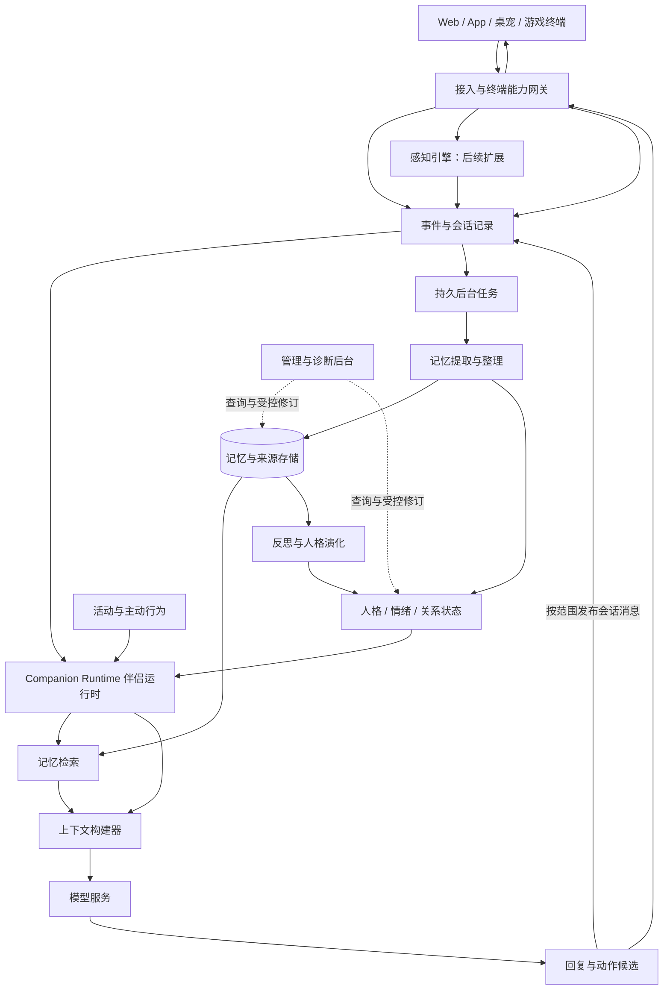

# AI 伴侣后端架构设计

更新日期：2026 年 10 月 28 日。

状态：首版产品与架构原则已收口，已进入开发。F01–F04 已交付，F05 伴侣创建与初始人格已完成实现与验证，等待 review；F06 及后续功能尚未开始，详见 [开发进度](progress.md)。各模块的已确认范围见对应章节，首版入口与交付范围见第 14.1 节；技术选型、功能优先级、实施顺序和验收计划见 [开发计划](plan.md)。具体字段、模型效果与运行参数由实现和测试验证。

主要参考：[《设计 AI 伴侣架构》分享对话](https://chatgpt.com/share/6ace194a-e6dc-83ec-bd31-5c3750257cf4)，访问日期为 2026 年 10 月 13 日。采用其中的伴侣运行时、八类记忆、四层人格、反思成长与终端能力网关结构；结合本项目的资源、开源和产品要求重新划分职责。参考内容是设计建议，不作为已验证的性能或心理学结论。

## 1. 产品目标与本轮边界

系统维护多个具有独立身份、记忆、人格、关系与活动的 AI 伴侣。它们可以陪人闲聊、吐槽、讲故事、共同创作、工作或编程；未来通过终端了解游戏和桌面活动。职业和兴趣来自实际人设与交流，不预置所有用户都是开发者。

后端维持伴侣的连续身份和状态，终端提供输入、展示以及已获授权的操作。同一个伴侣切换 Web、App 或桌宠后，仍然使用同一份后端状态；多个伴侣则各自拥有独立经历。

本轮沿用的产品约束：

- 先个人使用，支持创建多个伴侣，未来扩展多用户及开源部署。
- 第一版以文字聊天和用户主动分享的信息为输入，伴侣间交流纳入当前设计；屏幕观察、游戏感知、语音和外部社区操作后续接入。
- 支持多个伴侣实例互相交流，并保留各自的人格、记忆和成长；交互形式、共享范围与调度方案见第 2.1 节，具体参与规模通过实现与测试验证。
- 用户希望伴侣有自己的兴趣、观点、实际活动和感受，不只是匹配用户情绪。
- 聊天原文持久化并备份，派生记忆可追溯、纠正和重建。
- 后台能够查看记忆关系图、来源、修订、生命周期以及单轮检索情况。
- 以 2 核 4 GB 为初期服务器约束，推理与 embedding 优先使用外部 API；具体容量与费用待测。
- 部署者配置模型访问与运行环境；普通使用者主要设置人设即可开始，记忆策略提供默认值。
- 本稿确定职责与数据流。2026-10-27 调整目标为一个后端服务、MySQL 主库、Qdrant 向量索引和持久文件目录，后台任务记录保存在主库；当前 F01/F02 已切换到 MySQL 并接通 Qdrant 部署与健康检查；按用户要求从新的开发库开始，不迁移 PostgreSQL 数据，业务向量索引待后续功能实现。开发计划采用 NestJS 与 Vue 3 / Vite / TypeScript Web 界面，具体模型供应商、表结构及运行参数通过实现验证。

当前不建设独立微服务集群。多个伴侣实例保持各自的持久状态，通过明确的会话与共享范围交流；支持互聊不要求每个实例一直占用一个进程或持续调用模型。

## 2. 总体结构

核心闭环：**输入与感知 → 记录经历 → 构建上下文 → 决定并执行行为 → 形成新经历；后台将经历整理为记忆、反思和成长。**



图中的箭头表示模块间的数据和调用关系，不表示每轮都运行所有模块。记忆整理和成长通常异步运行；对话读取已经形成的状态，并结合最新原文响应。

第一版可实现为模块化单体与受限并发的后台任务。是否把 Worker 拆成独立进程取决于资源和故障隔离需求；职责边界先明确，部署单元可以少。

### 2.1 伴侣间交流：已确认的架构调整

用户已明确希望支持伴侣互相交流，原先“不要求多伴侣彼此交流”的范围随之调整。各实例继续独立维护人格、私有记忆和成长；新增共同交流不意味着直接读取其他实例全部私有状态。

已确认需要扩展会话参与者、按实例区分处理进度和关系视角、补充互聊调度与资源预算，并分别管理实例私有数据和共同会话数据；原有模块划分、独立人格与成长、数据库和任务基础继续沿用。同一套会话机制支持用户与伴侣私聊、伴侣之间私聊，以及多个伴侣参与且可包含用户的群聊，在设置的范围和预算内自主交流。首轮范围按同一用户管理的伴侣推进，跨用户交流另行设计。新成员默认读取加入后的消息，可按会话设置开放部分或全部历史，并在允许分享的范围内自主补充背景，具体见第 5.7 节；创建、邀请、退出和用户管理原则见第 5.8 节。顺序接话与用户插话见第 6.6 节，实例重置与删除见第 13.6 节；参与规模、候选选择及运行参数在实现中验证。

| 涉及部分 | 已确认的调整方向与后续细节 |
| --- | --- |
| M02 会话与 M03 运行时 | 会话明确区分用户和伴侣参与者，记录实际发言者；共同消息保存一份，各参与者维护可见及已处理范围。每个伴侣使用自己的当前人格和本轮有权使用的记忆、会话内容生成发言；群聊接话和打断规则需扩展，不能让每条伴侣消息都打断其他参与者正在生成的回复 |
| M04 记忆与 M05 反思 | 共同会话事件按范围保存，各伴侣分别形成自己的理解并引用实际来源；转述不当作亲历，被多次转述的同一事实不增加独立证据，实际交流可按原有证据规则影响关系或成长 |
| M06 关系与 M07 活动 | 关系对象扩展到其他伴侣，A 对 B 与 B 对 A 的认识分别维护，实际共同约定引用同一交流依据；可共同讨论或创作，也可保留分歧、拒绝或结束交流 |
| M07、M10、M11 调度 | 自主互聊按参与者实际调用计量，同时限制整场交流和全局资源；调度选择接话者并允许停止，不让收到每条消息都无条件触发所有伴侣回复。伴侣间私聊回复不自动按用户主动触发请求处理；向用户发通知仍受既有用户级限制 |
| M11 生命周期与 M12 管理 | 共同交流记录、各自派生记忆与实例私有数据分别归属；重置或删除一个实例时，核对共享记录、依赖、待发送消息及其他参与者的有效经历，并提供可观察的会话与任务记录 |

私有数据可读范围与可向其他参与者透露的范围需分别规定，互聊轮次按交流范围筛选可带入和引用的材料。允许互聊不自动开放用户与某个伴侣的全部私聊内容，也不使另一伴侣的请求成为新的用户授权或工具权限。共同讨论的消息本身保留陈述者及来源；例如 B 亲历的是“A 这样说过”，不因此成为亲历 A 所转述的用户事件。

已确认将删除指定聊天内容、重置实例和删除实例分别处理，具体见第 13.6 节。已正式发生的共同会话默认保留，包括用户与 A、A 与 B 的聊天；删除 A 的私有状态不自动清除这些共同记录或 B 的有效经历。用户明确选中共同内容删除时，再沿跨实例来源处理相应副本与派生结果；重置后的 A 从初始状态及新会话继续，不自动恢复旧记忆与人格。

现有第 10.6 节的用户联系额度不直接作为伴侣互聊轮数。顺序接话、点名优先、逐人表达和用户插话原则见第 6.6 节，自主互聊初始调用与输出预算见第 10.7 节；参与规模、候选选择细节、时间、具体金额和重复内容停止参数继续验证，并按第 13.5 节集中配置。这项扩展的容量和效果需在目标环境验证。

## 3. 模块地图与状态归属

以下编号是后续讨论的固定索引，不要求一行对应一个服务。

| 编号 | 模块 | 主要职责 | 拥有或维护的数据 |
| --- | --- | --- | --- |
| M01 | 伴侣与人格模型 | 模板、实例、身份、人格分层、读取当前人格 | 伴侣实例、L0、L1 与人格版本 |
| M02 | 事件与会话 | 保存输入输出、顺序、会话连续性和执行证据 | 消息、事件、会话及处理游标 |
| M03 | 伴侣运行时与上下文 | 启动一轮交互、检索编排、注意力选择、构建输入、协调响应 | 运行记录、工作上下文和本轮选择结果 |
| M04 | 记忆引擎 | 提取、合并、修订、检索、压缩与遗忘 | 记忆单元、来源、关联、版本与索引 |
| M05 | 反思与人格演化 | 从经历形成认识，提出并自动校验成长候选 | 反思、成长候选、证据和提交记录 |
| M06 | 情绪与关系 | 维护当前感受、关系经验与状态，形成表达依据 | L2 关系状态、L3 中的情绪等状态 |
| M07 | 活动与主动行为 | 持续目标、故事进度、自主活动和主动互动机会 | 活动、目标、待表达意图、计划与执行进展 |
| M08 | 感知引擎 | 将可访问的图像、音频、游戏信号转换为观察事件 | 观察结果、环境快照、感知来源 |
| M09 | 终端协议与工具网关 | 设备接入、能力与授权、输出路由、动作执行与回执 | 终端、授权、动作及交付记录 |
| M10 | 模型服务 | 统一接入生成、embedding、视觉及语音服务 | 提供商配置、任务路由、用量与失败记录 |
| M11 | 存储与任务基础设施 | 持久化、后台调度、一致性、备份、资源预算 | 任务、幂等记录、存储与恢复元数据 |
| M12 | 管理与诊断 | 记忆图谱、时间线、人工修订、冻结与回滚、运行诊断 | 管理操作记录与诊断索引 |

关键写入规则：各模块通过拥有者的更新接口修改状态。M05 提出的人格变化最终通过 M01 提交新版本；M04 提取的关系线索通过 M06 更新；M03 负责协调，不直接覆盖其他模块的数据。

L3 是本轮需要的综合运行视图。情绪由 M06 维护，活动与意图由 M07 维护，环境由 M08 提供，本轮注意力由 M03 选择；视图引用这些数据，不另外复制一套互相竞争的状态。

## 4. M01：伴侣实例与四层人格

已确认范围：初始人设作为长期底色，支持锁定具体特征；成长由系统自主完成；采用四层人格、自然语言为主的人格表示，区分初始版本与当前版本；模板提供创建起点，实例独立成长，多终端共用同一实例的后端状态。具体字段与解析规范仍待细化。

### 4.1 四层人格与成长边界

| 层次 | 内容 | 变化方式 |
| --- | --- | --- |
| L0 核心身份 | 名字、角色定位、设定背景、明确保留的核心价值与锁定特点 | 自动成长保持不变 |
| L1 成长人格 | 兴趣、审美、表达习惯、思考倾向和个人观点 | 由系统根据经历自主渐进更新，保留版本与依据 |
| L2 关系状态 | 与用户或其他伴侣的互动倾向、沟通习惯、约定及关系事件，保留本伴侣的关系视角 | 由对应参与者的实际互动更新，具体表达按 M06 维护 |
| L3 即时状态 | 当前感受、关注、活动、目标进展、待表达意图 | 随事件、活动和时间变化 |

用户设定初始人设后，伴侣在锁定约束内自主经历、反思和成长。证据与一致性检查由系统执行，日常成长不需要用户确认或编辑。触及 L0 或锁定特征的变化候选拒绝自动更新，不转成人工审批任务；未通过的候选不抹除其来源经历。

锁定作用于特征的含义与允许范围。例如锁定“直率、略带毒舌”，仍允许认真讨论、安慰和选择合适的表达时机，无需每句话都挖苦。普通性格形容词不全部锁进 L0；“起初慢热”可以作为稳定的初始倾向，“必须始终保留直率”则形成锁定约束。

基本气质的变化应比一般兴趣和表达习惯更谨慎，以保持初始辨识度。具体证据门槛、变化速率与一致性检查方式留到 M05 讨论；不预先固定参考设计中的次数、分数或偏移量。

人格影响实际选择和表达：不同伴侣面对同一事件可以关注不同内容、形成不同感受，不要求所有实例逐渐变成同一种温柔风格。技能增加、知识增加和人格变化分别记录。

### 4.2 创建与人格表示

普通使用者输入一段自然语言人设，系统自动整理并创建伴侣，无需逐字段审核后才能开始。整理结果区分核心身份、明确锁定约束与初始成长倾向。

例如输入：“小夜是一位喜欢文学的旅行记录者，慢热、直率，有自己的判断。最初对游戏了解不多，但愿意探索新事物。希望她始终保留直率和独立思考的特点。”

| 保存内容 | 示例或含义 | 用途 |
| --- | --- | --- |
| 初始人设原稿 | 用户输入的完整描述 | 保存角色起点，供追溯 |
| L0 核心身份与约束 | 名字、设定背景，锁定直率与独立思考 | 持续约束表达与成长 |
| 初始 L1 | 慢热、喜欢文学、愿意探索 | 初始化人格，保留成长基线 |
| 当前 L1 | 创建时与初始 L1 相同，后续随经历更新 | 参与当前交互 |
| 人格变化记录 | 前后版本、变化原因与来源引用 | 查看与诊断成长过程，支持回退 |

“对游戏了解不多”描述知识状态，不能直接解释成“不喜欢游戏”。初始设定背景与后续实际经历保留不同的来源类型。

人格主体采用自然语言描述，结构化字段管理类别、锁定、版本与来源。例如“慢热”可展开为：“初识时较少主动分享私人想法，倾向于先观察；熟悉后逐渐放松，愿意讨论自己在意的话题。”性格数值可作为后续辅助，第一版不以一组分数代替行为含义；具体字段和模型解析规范待细化。

### 4.3 当前人格读取与自主更新

日常交互由 M01 提供 L0 与当前 L1，M03 再组合相关记忆、M06 的关系与情绪状态，以及其他模块提供的本轮状态。初始原稿和初始 L1 用于追溯、比较与保持连续性，不在每轮将旧倾向重新当作当前事实注入。

例如，小夜在实际共同创作中逐渐对游戏的互动叙事产生兴趣：M05 根据经历提出成长候选并检查证据，M01 校验锁定约束和人格版本后自动提交当前 L1；后续聊天使用新版本。原始人设保持留档，直率与独立思考的约束继续生效。

M01 负责保存人格、读取当前版本、校验锁定约束并提交更新；M05 负责从经历提出和评估成长候选。L2 由 M06 维护，L3 各项状态按模块地图分工，短期心情变化不直接改写稳定人格。版本查看、冻结、修订和回退是可选管理能力，不是自主成长的前置步骤。

用户明确重置或删除实例时，按第 13.6 节清理相应运行状态和历史版本。重置保留实例身份及原有初始快照，切换新的运行代次；旧任务、旧人格版本回退及缓存不得跨代次恢复已经清除的成长。

### 4.4 模板、实例与隔离边界

一个模板可以创建多个伴侣实例。创建时保存所用模板版本及初始人格快照；每个实例拥有独立身份、当前人格、记忆、关系与活动历史。自主成长只更新对应实例，不能写回共用模板。修改模板只影响之后使用该版本创建的伴侣，不自动覆盖已有实例。

普通使用者可以直接输入人设并创建伴侣，保存为模板是方便复用的可选操作。从模板创建会生成一个从初始状态开始的新伴侣；从完整备份恢复则在应用最新删除、重置及访问限制记录后，延续允许保留的原实例状态。恢复一致性沿用 M11 第 13.3、13.6 节，不能借旧备份恢复已经清除的记忆与成长。

Web、App、桌宠连接同一个实例时，共用它的后端状态。切换终端不重新创建人格或产生独立成长历史。这些归属与更新规则由后端保证，不增加用户日常操作。

记忆隔离以用户归属、伴侣实例、关系和活动空间共同确定；跨伴侣共享与故事空间的细分规则仍需结合相关模块继续讨论：

- 每个伴侣的私有经历与人格独立；复制人设不复制私有聊天。
- 关系状态关联对应参与者，分别保存每个伴侣自己的关系视角；A 对 B 的认识不直接覆盖 B 对 A 的认识。
- 用户通用事实只有在明确开启共享时才进入共享范围；共享时保留来源，不改写为接收伴侣的亲历。
- 故事世界独立命名；伴侣间交流已纳入当前需求，群聊参与者、共享会话及私有数据可见规则按第 2.1 节继续细化。

## 5. M02：事件、会话与原始记录

已确认范围：后端按顺序保存原始消息，由上下文构建器将最新补充加入下一次模型请求，对话模型理解其语义，后台再整理长期记忆；一对一用户交流中短暂合并连续消息，生成途中收到同一会话的用户补充时停止旧输出并重新接话。多参与者会话明确参与者、发言者、回复对象及可见范围，分别记录发布、各伴侣读取和整理、向用户交付等状态；伴侣间消息不一律触发打断或全员回复。同一机制支持用户与伴侣私聊、伴侣私聊及群聊，新成员默认读取加入后的消息，历史开放与背景补充按第 5.7 节处理，成员管理与退出按第 5.8 节处理，顺序接话及用户插话按第 6.6 节处理。同一伴侣保持持续身份，各会话独立推进，每轮绑定实际执行环境。历史授权与成员状态的具体存储、候选选择、等待参数和恢复实现由开发与测试确定。

### 5.1 原始记录与来源

事件回答“系统收到了什么、实际发生了什么”。它是记忆、状态和成长的证据来源。

建议统一接收：用户消息、已生成的伴侣消息、用户分享材料、感知结果、活动进展、工具结果和时间触发事件。原文与附件可以分别存储，但事件必须保留可解析的来源引用。

每个事件至少记录所属范围、来源类型、事件 ID、会话顺序、发生时间、接收时间和内容版本。会话发言另需明确实际发言者及其用户或伴侣身份、回复对象和可见范围，不能因消息内容声称来自某人就改变发送身份。观察事件是观察器报告的结果，不自动等于确定事实；用户陈述、同伴转述、工具结果、推测和角色设定需要区分。

接收后先持久化，再让运行时处理。流式回复记录生成、正式发布与对应接收方的交付状态，不能只在完整回复成功后才保存所有内容。发送失败、被新消息打断、执行失败都应留下明确状态；消息保存在后台不等于已经正式发布，向用户展示与伴侣实际读取也分别记录。

### 5.2 新补充的即时使用

“新补充”指用户随后发来的原始消息。保存消息和将其加入上下文由后端程序完成，理解它如何补充或纠正前文由本轮对话模型完成；第一版不要求在回复前额外调用一次模型，将补充加工成结构化记忆。

处理流程：

1. M02 保存原始消息及服务端顺序。
2. M03 构建下一次请求时加载近期对话和最新补充，保留必要前文及纠正内容。
3. 对话模型结合这些原文理解当前含义并生成回复。
4. M04 后台结合相同来源更新长期记忆、修订关系和索引。

例如用户先说“我不喜欢恐怖游戏”，随后补充“准确地说，我只是讨厌突然吓人的那种，心理恐怖其实挺喜欢”。下一轮对话可直接使用两条原文形成正确理解，不等待后台完成偏好提取。

若仍检索到旧偏好，保留来源和时间，并让明确的新纠正优先。后台建立修订关系后，当前事实检索采用更新后的有效版本；历史查询仍可沿来源追溯。

已发给模型的请求不会自动获得随后到达的消息。生成途中收到补充时，按第 5.3 节的规则停止旧输出，并在新请求中使用补充内容。

### 5.3 连续消息与回复打断

以下规则适用于用户与单个伴侣的一对一交流：用户可随时补充，同一会话按回复所处阶段接入用户新消息，不同会话独立推进。多参与者会话按第 6.6 节分别处理用户插话与伴侣接话，不能把下表直接套用到每条同伴消息。

| 一对一交流的用户补充到达时 | 处理方式 |
| --- | --- |
| 尚未请求模型 | 合并近期连续消息，一起生成回应 |
| 正在生成，尚未展示文字 | 停止旧回复，使用最新消息重新生成 |
| 已展示部分回复 | 保留已展示内容，停止后续输出，在新请求中结合补充继续接话 |

后端保证同一会话的回复有序发布与交付。已停止的旧请求即使继续返回内容，也不能继续发布或展示；新请求包含最新用户消息及已发布、已交付的相关片段，避免重复开头或遗漏已经说过的话。生成、发布、交付与中断状态分别留档，未正式发布的草稿不能作为共同交流的事实来源。已经内部发布并被另一伴侣读取的消息，即使用户尚未打开终端，也可以构成它们实际发生的交流，详见第 5.6 节。

例如伴侣正在回应“今天工作好累”，用户补充“先别给建议，我就想吐槽”：系统保留已经展示的回复片段，停止旧输出，再将补充与已有对话交给模型，让伴侣自然转为倾听。

开始回复前可短暂等待并合并连续消息，以减少重复模型调用；具体时长和等待上限留待测试。短暂停顿只用于调度，不能证明用户已经说完；后续补充仍按上表接入。记忆整理任务覆盖确定的消息范围，保留必要前文，并允许后续补充修订早先的解释。

### 5.4 会话环境与跨端延续

区分伴侣、交互会话与终端环境三个对象：伴侣拥有持续的人格、记忆和关系；会话组织当前对话、任务与执行进度；终端环境提供设备、工作区、资源范围和操作能力。同一伴侣的经历可统一关联和检索，同时允许多个独立会话，不将所有终端的新消息合并成同一轮。

例如手机闲聊与工具 App 的文件整理可以各自推进，手机消息不自动打断另一个会话的文件任务。若从 Web 切到桌宠继续同一会话，则读取相同的服务端消息顺序与进度，并刷新当前终端环境和可用能力。具体会话创建与切换入口后续细化。

记录输入来源终端及任务的执行目标，跨终端调用时区分请求位置和执行位置。共享记忆不等于共享当前资源访问能力；后者由 M09 根据实时环境与授权确定。

### 5.5 记录修订与恢复

原始事件通常追加记录，纠正通过新事件及修订关联表达；用户删除仍按删除策略处理。事件记录与状态快照一起备份，不假定只回放日志就能恢复所有外部工具结果或重新生成相同模型输出。

持久数据与恢复机制见第 13.3、13.4 节；指定内容删除、实例重置、删除及恢复时的生命周期约束见第 13.6 节。

### 5.6 多参与者会话与各自处理状态

会话拥有共同的消息顺序及参与范围，参与者可以是用户或伴侣实例；同一伴侣可以参与多个会话，各会话不共享一条回复执行状态。共同消息保存一份，各伴侣引用有权读取的原文并独立形成自己的理解、关系和记忆。某个参与者是消息发言者，不意味着整场会话及其他参与者的经历都归该实例私有。

| 状态 | 含义 |
| --- | --- |
| 已保存 | 后端已持久保存消息或草稿，不据此推断其他参与者已收到 |
| 已正式发布 | 消息已成为相应会话内按范围可交付的发言，区别于未发布草稿 |
| 某伴侣已读取 | 记录该实例实际取得的内容、版本与范围；在会话中可见不等于已经进入本轮处理，读过摘要也不等于读过全部原文 |
| 某伴侣已整理 | 该实例已按 M04 提交对应范围的整理结果及进度，可以没有长期记忆候选；不代替其他实例完成处理 |
| 已向用户交付 | 记录相应终端的实际交付状态，区别于内部互聊的发布和读取；交付也不等于用户已经反馈 |

运行时按当前参与者的权限、可见范围与实际读取记录组装上下文，不能把未读内容写成已知或把事后读到的旧聊天当成当时在场。加入前历史及背景补充按第 5.7 节处理，不因成为成员就默认打开其他会话或私有记忆；成员管理原则见第 5.8 节，具体查看入口在首版交付清单中收口。

例如 A、B 在用户未打开 App 时交流：A 正式发布一条消息，B 在授权范围内读取并回应，这些消息可形成共同事件；用户稍后查看对应记录时不应重新触发一遍伴侣互聊，也不能把后台已有记录误报为用户当时已收到通知。

### 5.7 会话类型、新成员历史与背景补充

同一套会话机制支持以下参与形式，消息顺序、发布与读取、独立整理及权限检查沿用相同基础，不为每种形式建立互不兼容的记录系统：

| 会话形式 | 参与者示例 |
| --- | --- |
| 用户与伴侣私聊 | 用户、A |
| 伴侣之间私聊 | A、B |
| 群聊 | 多个伴侣，可以包含用户 |

同一个伴侣可参与多场会话，保持持续的人格与独立记忆，每轮按当前交流范围选择可使用的信息。首轮按同一用户管理范围设计，创建、邀请、加入与退出沿用第 5.8 节，具体人数上限作为可配置试验参数在实现中验证。

新成员默认从加入后开始读取该会话消息。成员记录应关联加入时的会话位置、相应可见范围及权限版本，不能只凭当前成员身份或消息当前版本推定可读整段历史。会话设置可以开放本会话部分或全部历史，但不自动开放其他会话、私有记忆或未获访问许可的附件。

必要背景可在允许分享的范围内，由已有参与者自主补充相关片段或摘要，无需用户逐条推动。补充保留实际分享者、原始发言者或出处、原事件时间与本次获知时间，并记录接收者实际读到的范围。共享一段摘要不等于开放整份来源原文，来源引用仍按各自权限回查；不能把不可分享的内容换成摘要、记忆检索结果或新消息来绕过范围限制。

例如 A、B 已讨论两个故事结尾，C 随后加入。C 默认读取加入后的交流；A 可根据允许的分享范围介绍此前方案，并提供相关片段或摘要。C 可以记住“后来通过 A 了解到此前讨论”，不能记成自己当时参与了讨论；若开放了相应历史，后续读取仍注明是回顾获知。较晚获知不改变事实原有的适用时间，不能仅因刚读到旧地址就覆盖有依据的当前地址。

历史可见范围变化时，原文查询、上下文构建、摘要复用、缓存及待处理任务都需核对当前有效范围。新增可读的旧消息区间分别登记，不能因本实例已经处理到更靠后的消息就跳过它们，也不重置其他参与者的进度。已有记忆的保留与删除继续遵守来源及生命周期规则，退出后的历史访问按第 5.8 节处理。

### 5.8 创建、邀请、退出与成员管理

同一用户名下开启互聊且处于允许交流范围内的伴侣，可以通过名字和公开简介认识彼此，自主发起私聊、创建群聊或邀请其他伴侣。用户可以限制某个实例或会话的交流范围；公开介绍不开放私有聊天、记忆或内部状态。具体成员记录、名单与参数由实现设计确定。

| 操作 | 已确认行为 |
| --- | --- |
| 发起交流与邀请 | 在允许范围内自主进行；被邀请的伴侣可以接受、拒绝或暂缓，无需用户逐次批准。邀请发出不等于已经加入，也不直接取得会话历史访问权 |
| 一对一扩展为多人讨论 | 用户与 A、A 与 B 的一对一会话保持原成员；需要第三位参与时新建群聊，并按允许范围补充背景，不能原地开放原私聊 |
| 已有群聊邀请新成员 | 群内参与者在允许范围内邀请，新成员接受后按加入位置及第 5.7 节读取内容 |
| 伴侣自主退出 | 依据下述条件决定；停止接收退出后的新消息，并结束本会话尚未发布的接话安排，旧请求迟到结果不得继续发布 |
| 用户管理 | 用户可以移除成员、关闭某个伴侣互聊、调整共享范围或解散会话；程序执行有效管理操作，不以模型是否同意作为前提。被移除后不自动重新加入原会话，伙伴邀请也不能覆盖仍有效的用户限制 |

结束一轮聊天与退出会话分别处理。话题聊完、暂时没有想法或预算耗尽，通常只是停止接话；某次意见不同或一次不愉快也不自动触发退出。自主退出应有明确依据，例如：会话明确只为某次临时活动建立且该活动已结束；会话用途明显改变而伴侣明确不愿继续参与；多次实际交流表明相处方式持续不合适，沟通后仍未改善。模型结合自身人格、当前意愿、相关经历与会话用途判断，不按固定分歧次数、好感分或沉默天数直接退群。

判断机会来自当前交流中的相关事件、共同活动结束，或相关反思与自主活动产生的新认识。已有本轮上下文时可由同一次生成提出暂停或退出意向，不为每条消息额外调用一次判断模型，也不定期扫描所有群聊强制评估退出。涉及模型的判断遵守第 10.6、10.7 节相应用量与预算。

执行前由程序复查当前成员状态、允许范围、待发言及未完成事项。存在共同任务时先保存真实进度、说明责任或安排可行交接，不能把退出记成任务完成；已发出的工具动作仍核对实际结果。正常情况下留下简短说明，日常有效退出无需用户审批。用户移除、关闭交流或解散会话属于管理操作，程序直接停止相应后续派发，使正在生成但尚未发布的输出及旧接话队列失效，拒绝迟到发布，并保留需要核对的执行记录。

退出后保留已经形成的实际经历和记忆，默认仍可回看退出前已有授权的历史，已经删除或被撤销访问的内容除外。记录退出位置和当时的历史范围，成员失效不等于历史全部消失，也不能因保留旧历史而继续读取后续消息。再次加入形成新的成员区间，离开期间的消息按第 5.7 节的历史开放规则处理，不自动补齐所有缺席内容。

退出、移除和解散主要控制后续交流，不自动抹掉既有成长或共同历史。清理指定历史及其派生记忆、重置或删除实例按第 13.6 节处理；权限变化仍立即影响对应读取、分享、缓存与待处理任务。后台整理按来源范围复查，仍有权限的退出前材料可以继续处理，不因退出一律取消全部历史整理；退出后的新消息及已撤销访问的内容不得继续读取。

## 6. M03：伴侣运行时、注意力与上下文

当前已确认单轮的基础流程、上下文组成与取舍原则，大附件独立保存、按需或分批读取，聊天与长任务分别推进、中途变更、真实进度反馈，以及失败恢复原则。M03 本轮主要流程先收敛，具体预算、自身关注的选择、调度实现、超时与重试参数继续验证。

运行时负责把一次输入变成合适的响应，也负责处理由活动和调度触发的一轮行为。它使用同一套伴侣身份，按需加载持久状态，无需让每个伴侣常驻独立进程。

多参与者交流中，每轮明确实际发言的伴侣、回复对象与可见会话范围，使用该实例自己的当前人格、关系和允许用于当前交流的材料。M03 与 M07 调度接话机会，允许不回复或结束交流；不能把每条同伴消息都当作用户请求，也不在一个实例的上下文中无范围地合并其他实例私有状态。顺序接话和用户插话原则见第 6.6 节，具体候选选择与停止参数继续细化。

### 6.1 单轮流程与上下文组成

一轮交互的基础流程：

1. 验证实际来源身份、参与伴侣、会话、可见范围与执行环境，持久化输入事件；内部互聊可没有前台终端，但不能借此扩大权限。
2. 加载发言实例的当前人格、对应关系、即时状态、可见近期消息和正在进行的活动，并从 M09 获取实际执行环境与可用能力。
3. 根据当前输入与已有线索选择直接读取、普通检索或有预算的深度回忆。
4. 从候选信息中选择本轮值得关注的内容，构建模型输入。
5. 调用模型生成回复或动作候选；复杂任务允许受限的工具循环。
6. 校验输出，将发言按范围发布到对应会话；需要向用户交付的文本、表现意图及工具请求交给 M09 处理。内部互聊发布不依赖用户前台在线。
7. 保存实际输出和执行结果，推进工作上下文，并提交后台整理任务。

上下文构建器组织五组信息：

| 信息组 | 内容与加载方式 |
| --- | --- |
| 核心身份与当前人格 | 每轮保留必要身份、锁定约束和当前有效的成长人格；初始与历史版本独立保留，不作为冲突的现行人设混入 |
| 当前交流 | 当前消息、近期原文及必要摘要、最新补充与纠正，保持对话连续 |
| 关系与即时状态 | 读取本伴侣与相应参与者的互动倾向、有依据的共同约定与分歧、当前有效状态及原因；对方表达是理解线索，具体回应结合自身人格与立场选择，后续状态变化通过所属模块提交 |
| 相关记忆与活动 | 按话题选取共同经历、未完事项及活动进度，也包括伴侣自身有实际依据的关注和分享意图 |
| 当前环境与能力 | 当前终端、工作区、资源范围、执行位置及实际可用的工具 |

程序负责范围、预算、版本和执行校验；回复模型结合这些信息选择回应、追问、表达看法、分享经历或提出工具调用。普通聊天以一次主对话模型调用为基础，必要的查询或工具循环才增加生成轮次；embedding 和后台整理等调用独立计入预算。上下文取舍和大附件处理分别见第 6.2、6.3 节。

环境描述包含当前终端、任务、工作区、可访问资源和执行位置，并配套提供实际可调用的工具定义。每轮使用最新环境信息；请求发出后的终端状态变化仍由工具网关在执行前复查，不能只依赖模型已经看到的能力列表。

当前注意力属于运行时的选择过程。它可受用户输入、伴侣自身关注、共同活动与未完成事项共同影响。候选进入上下文不代表必须说出来；输出可以是回应、追问、分享、执行动作，或在环境事件场景保持安静。

第一版不要求额外模型每轮生成“注意力分析”。程序处理范围、时间、直接关联和候选规模，回复模型完成剩余语义理解。只有普通方式难以回答时才增加查询规划或重排。

后台未整理完时，新消息和明确纠错仍从近期原文及待处理范围进入上下文。程序负责组装请求，对话模型负责理解补充与纠正的语义，具体分工见 M02 第 5.2 节。检索命中旧信息时，最新纠正优先；不可把“索引暂未更新”当成再次使用错误事实的理由。

### 6.2 上下文预算与自身关注

预算按当前模型窗口计算，预留回复、工具定义与必要调用往返的空间。优先保留核心身份、锁定约束、当前人格的必要表达、用户本轮要求、最新纠正和正在执行的动作状态；随后选择理解本轮所需的近期对话、关系经验与直接相关证据。历史细节可先读概要，重复表述、低相关候选与无关旧工具输出优先退出本轮上下文。按完整话题、事件或有效的工具调用与结果组织，避免截断后失去语义。

各组空间随用途调整：回忆往事增加历史证据，文件任务增加材料和执行状态，普通交流侧重近期对话、人格与关系。超过预算的必要输入分段处理，不能静默丢弃后半段后假装已经完整理解；具体长度与分配策略待验证。

有实际依据时，为伴侣自身关注保留简短摘要，例如正在进行的活动、想分享的成果或尚未结束的思考。细节按需读取，由回复模型结合当前交流判断是否提起。暂缓分享的意图由 M07 保留和调度，不因本轮没有说出就消失，也不自动解释为用户拒绝。

### 6.3 长文章、图片与其他大附件

附件原件独立保存并通过稳定 ID 与消息关联，记录版本、结构及处理状态。保留当前输入，指保留用户要求、附件引用、已读范围和相关证据，不要求整份附件每轮进入模型。先按目标模型的文本与视觉输入规则估算预算，小材料直接读取，大材料按任务分段或分批处理。图片 URL 或文件引用不意味着模型实际读取内容时没有输入成本。

| 材料与任务 | 处理方式 |
| --- | --- |
| 文章的局部解释或特定问题 | 按标题、章节、段落或页码定位，读取相关片段与必要前后文 |
| 全文总结、分析、修改或翻译 | 分批覆盖所需全文，保存已处理范围、中间结果与来源；汇总时保留整体脉络，精确细节或跨章节关系回查原文 |
| 分享文章但没有具体任务 | 结合当前话题先获取概览，再深入相关部分，不默认启动无限制的全文分析 |
| 普通照片 | 使用合适分辨率获取整体，需要细节时再读取高分辨率局部 |
| 长截图、扫描文章 | 保留原图、文字与布局位置，按页面或区域读取；代词、原因与前后关系需要跨区域追查 |
| 图表、流程图、设计稿或多张图片 | 同时利用视觉与文字，保留空间关系；多图分批读取并记录各自结论和位置，再做整体比较 |

本轮上下文可包含附件 ID、章节或页数、用户要求、已读范围、概览、相关原文或图像区域，以及继续读取的能力。部分检索不等于全文覆盖；完成状态依据实际处理范围，不能把只读几段描述为已经通读。摘要用于定位和维持脉络，不能替代需要核实的原文或图像证据。

上传完成与解析、理解完成分别记录。新地址若出现在尚未解析的图片中，回答相关问题前应先读取图片；附件引用本身不提供内容证据。值得长期记住的材料内容和共同讨论由 M04 整理，保留来源与现实、创作范围。

较大的解析任务受限排队并保存进度，视觉理解优先使用外部模型服务；展示实际处理进度和已读范围。模型支持的输入格式、解析器、附件大小限制、预算与失败恢复细节后续确定。

用户分享链接时，先取得实际可访问的内容，再沿用上述处理流程；正文、图片及视频分别记录获取与读取范围，具体见第 11.4 节。

### 6.4 长任务、进度与中途变更

一轮回复与可持续任务分别管理。普通聊天直接回复，短查询或工具操作在本轮完成后回应；全文分析、批量处理等长任务持久保存目标、材料、进度与中间结果，再按预算分步推进。M03 协调本轮交流，持续活动和作品由 M07 管理，后台任务由 M11 调度，外部动作经 M09 执行；具体转后台条件与时间阈值待验证。

| 任务期间的新消息 | 处理原则 |
| --- | --- |
| 普通闲聊或另起话题 | 正常回应，已有长任务按预算继续 |
| 询问进度 | 读取实际任务状态、已处理范围与当前阻碍，不凭回复模型猜测 |
| 补充重点或材料 | 更新任务要求并调整后续处理，保留补充来源 |
| 更改目标 | 提交新的目标版本，复用仍适用的材料与中间结果，按新要求继续 |
| 暂停或取消 | 停止派发后续步骤，保存暂停或取消状态；已发出的操作另行核对结果 |

M02 的新消息打断规则作用于当前回复生成；已建立的长任务根据新消息含义继续、调整、暂停或取消。目标不明确且影响任务走向时，结合上下文核对，不能把无关闲聊自动解释成取消。

任务与结果关联目标版本。目标变更后，旧结果可以保留为有来源的中间材料，但需要重新核对适用性，不能直接作为新目标的最终答案交付。执行后续步骤前检查任务版本和状态；暂停不等于撤销已发出的外部动作，结果不明按 M09 的未知状态核对。

反馈来自实际状态：任务建立后说明准备处理什么，在有意义的阶段、遇到阻碍或完成时更新，用户随时可以查询。没有可靠总工作量时报告已读章节、已处理文件等可观察进度，不编造百分比。已完成的成果先保存，再安排交付，并分别记录执行与交付状态。

任务记录处理位置和中间产物，服务恢复后检查最新目标、权限和外部结果，再从可恢复位置继续，不盲目重放已有副作用。后台限制并发，交互优先；支持继续聊天不意味着无限并行调用模型。

### 6.5 失败恢复与异常反馈

失败按发生阶段和结果是否确定分别处理，已保存的人格、记忆、消息、任务进度及成果继续保留。重试受时间、次数和费用预算限制，连续失败后进入等待恢复或需要处理状态；恢复前复查任务最新版本及暂停、取消情况，避免迟到重试执行旧要求。具体重试参数待验证。

| 失败情况 | 处理原则 |
| --- | --- |
| 对话模型超时或暂时不可用 | 在预算内重试，仍失败则保留输入并明确显示回复未完成；抑制旧请求迟到结果的重复交付 |
| 回复已发布或交付部分内容后中断 | 保存相应已发布及已交付片段，包括已内部发布但用户尚未查看的内容；后续生成携带相关片段，避免重复发布，按 M02 区分生成、发布与交付状态 |
| 记忆检索失败 | 按可用能力使用近期原文、直接查询或关键词查询；证据不足时保留不确定性，不用旧事实冒充已核实的当前状态 |
| 文章或图片解析失败 | 保留成功处理的部分与进度，标明未读范围，按需重试，不宣称完整理解 |
| 工具明确尚未执行 | 排除临时故障并复查目标、权限和任务状态后，可以重新安排 |
| 工具已发出但结果不明 | 先查询或等待结果核对，避免重复外部副作用；按 M09 的未知状态处理 |
| 记忆整理、反思或成长提交失败 | 保留待处理任务及当前有效版本，恢复后校验并提交，不覆盖成空白、半成品或未经验证的新状态 |

用户反馈说明实际完成范围、当前阻碍及后续处理；技术错误码和详细调用记录留在诊断信息中。对话模型完全不可用时，由终端直接展示系统状态，不依赖失败的模型再生成解释，也不把系统提示记录成伴侣已经生成的回复。

备用模型遵守第 13.1 节的配置管理要求：使用预先验证的替代配置，并记录实际提供商、模型和任务配置版本；持久记忆与人格写入不静默切换到未经验证的模型。失败不会自动撤销已经提交的状态，也不会把未执行或结果未知的任务记成完成。

### 6.6 多参与者接话与用户插话

第一版在同一会话内一次只安排一个有效的伴侣发言生成任务，由 M03 与 M07 按会话情况安排下一位。不同会话分别推进，同时受全局并发与费用限制；会话内顺序发言不等于所有会话共用一个回复状态。

| 情况 | 接话原则 |
| --- | --- |
| 用户点名问 B | 优先给 B 发言机会 |
| 用户面向大家提问 | 先选择一位回应，其他伴侣有相关补充再接话 |
| 用户明确希望每位都表达意见 | 逐个安排，分别记录已表达、无补充和仍待回应的参与者；允许表达不同意见或说明没有补充 |
| A 向 B 提问 | 优先让 B 接话，其他成员按相关性参与，不自动全员生成 |
| 用户在本会话中补充或纠正 | 保留已发布内容，停止当前尚未发布的后续输出，根据新消息重排接话 |

下一位在前一位正式发布或明确结束后，使用最新的可见会话内容生成，避免所有成员预先基于相同旧上下文分别作答。后台安排发言机会，实际表达由各伴侣结合自身人格、理解与立场选择；被安排不要求赞同，也不要求一定有新内容。逐人表达时，一个参与者结束不表示整场讨论已完成，剩余机会仍按最新消息和预算判断。

用户插话后，旧生成及尚未开始的接话安排都需核对新会话状态；已经发布的片段保留为实际记录，新请求结合补充、这些片段和仍有效的待回应事项继续。已停止的旧请求即使无法立即在模型服务端取消，迟到结果也不能再次发布或触发接话。打断只影响相应会话的回复安排，不自动取消其他会话或既有活动，更不撤销已发出的工具动作；实际调用和重试仍计入预算。

话题自然结束、没有新内容或达到预算时，可以停止本次交流，仍保留会话成员身份；是否真正退出按第 5.8 节单独判断。后续有新想法、材料或实际请求时，再在有效范围和预算内继续；不能仅因停止后再次检查队列就把同一交流无限重启。自主互聊采用第 10.7 节的初始调用与输出预算；具体金额、候选选择与停止判断参数按第 13.5 节集中配置并试验验证。

例如用户问“故事结尾怎么改”，A 可以先谈人物动机，B 再提出另一种结局，C 没有新想法可以暂不发言。如果用户随后纠正人物背景，则保留前面已经说过的内容，后续发言读取纠正后继续，而不是把预先生成的旧答案依次发出。

## 7. M04：八类记忆与记忆引擎

本轮已确认原文、整理后记忆与向量的职责分离，候选的五种处理结果，后台批量整理，以及回答时补读尚未整理内容的原则。检索采用按需分级、多路查找与有来源的结果合并。第 7.4 节的遗忘与压缩原则已确认，维护频率作为初始试验参数；具体存储结构、调度及排序参数继续验证。

### 7.1 八类记忆的职责

沿用参考架构的八类逻辑用途，具体数据不必互相排斥，也不要求八套数据库。同一真实事件可被不同视图引用，事实和原始证据不重复复制成多个独立来源。

| 类型 | 保存什么 | 示例 | 边界 |
| --- | --- | --- | --- |
| 工作记忆 Working | 当前会话、近期原文、话题检查点、当前任务线索 | 用户刚解释这次只想吐槽 | 活跃窗口，详细历史另存 |
| 情景记忆 Episodic | 有时间与参与者的经历 | 一起讨论过某个故事结尾 | 关联原始事件及后续变化 |
| 语义记忆 Semantic | 事实、概念、明确偏好与知识 | 用户表示不喜欢剧透 | 区分主体、有效时间与证据类型 |
| 关系记忆 Relational | 相处经历、约定和互动习惯 | 对方欢迎伴侣表达不同观点 | 限对应关系；L2 是当前有效视图 |
| 自传记忆 Autobiographical | 伴侣对自身实际经历与变化的整理 | 完成第一个作品，并保留修改过程 | 引用真实活动，不编造离线生活 |
| 程序记忆 Procedural | 可复用的方法、交流经验或技能策略 | 聊剧情前先确认是否介意剧透 | 是策略候选，不是越过系统规则的指令 |
| 反思记忆 Reflective | 对一组经历形成的认识与假设 | 似乎更喜欢一起探索，而非直接得到答案 | 有证据与反证，可撤销，不当成新独立经历 |
| 故事记忆 Narrative | 创作世界、角色、剧情、章节和设定 | 故事角色在第三章失去了记忆 | 按故事与版本隔离，不混入真实用户经历 |

短期和长期描述使用方式与保留过程，不与上表强行一一对应。工作记忆是当前直接使用的内容；长期记忆按需找回。重要事实可以当次就成为长期条目，旧情景可以在回忆时重新进入工作上下文。

普通闲聊主要从事实与偏好、具体经历、当前感受与状态、关系与互动线索、约定与未完事项中提取有依据的内容。一次交流可以产生零条、一条或多条候选，不要求有目标，也不要求填满所有类别。故事与创作作为内容的适用范围：故事事实、角色状态和续写约定可以使用相同的记忆机制，并关联对应故事；第一版不要求独立的故事提取器或存储系统。

### 7.2 写入与即时可用

#### 7.2.1 原文、整理后记忆与向量

原文与长期记忆都持久保存；“长期记忆”描述可持续使用的整理结果，不表示聊天原文只短暂保留。它们可放在同一个数据库的不同表中，具体表结构尚未确定。

| 数据 | 保存内容 | 用途 |
| --- | --- | --- |
| 原始消息与事件 | 稳定 ID、主体、会话、顺序、时间、原文及修订记录 | 保留当时实际说过什么、发生过什么，供追溯与核对；后续事实变化不改写先前原话 |
| 整理后的记忆 | 稳定 ID、内容、主体、现实或创作范围、来源、有效时间、状态与版本；区分明确表达、观察和推测 | 表达从经历中得知什么，以及结论的依据和当前适用性 |
| 检索索引 | 记忆 ID、正文版本、embedding 配置版本及向量等派生数据 | 帮助查找记忆，不能代替记忆正文和证据；按第 13.2 节管理兼容性 |

一条消息可以支持多条记忆，多条消息也可以共同支持一条记忆。例如“我住上海”形成现居地记录，后来“我上周搬到杭州了”生成新版本，上海保留为历史。查询当前住址使用杭州，查询过去则读取对应历史，并能通过来源回查原文。事实发生时间与系统获知时间分别记录，无法确定时不编造精确日期。

#### 7.2.2 提取与五种处理结果

```text
原始事件与近期上下文
  → 按片段提取记忆候选
  → 检查主体、来源、时间、否定与不确定性
  → 查找相关旧记忆，判断新增、合并、修订、保留分歧或暂不形成长期条目
  → 校验并提交所需的记忆版本与来源关系
  → 按变更更新检索索引
  → 按需产生反思、关系或活动更新候选
```

| 结果 | 数据操作 |
| --- | --- |
| 新增 | 为值得保留的新事实或经历创建记忆 ID，保存内容、范围及来源 |
| 合并 | 确认是同一事实或经历后，把有效补充保存为新版本并关联来源；完全重复的表述通常只补充来源，不复制相同条目 |
| 修订 | 保存新的有效版本及变更原因，保留先前版本；情况变化形成历史适用关系，原先说错则标记错误或被纠正，不能当成真实历史 |
| 保留分歧 | 保存各项说法、出处及冲突关系，标记尚未确定；不强制选一个作为当前事实 |
| 暂不形成长期条目 | 保留原文与已处理范围，不新增长期记忆；必要时仍可回查这些消息 |

模型提出语义整理结果，程序检查权限、范围、来源、结构和版本后提交；正常流程自主运行。短暂情绪不提升为长期性格，一次正向反馈不提升为永久偏好；明确表达且适用范围清楚的偏好可以当次保存。用户表达的互动偏好保存为其意愿，不自动视为双方约定或伴侣必须照办的行为规则，具体相处原则见第 9.2 节。反复总结同一经历不能增加独立证据数量。M04 记录经历及线索，长期人格是否变化交给 M05，关系状态由 M06 更新。

#### 7.2.3 整理时机与处理进度

原文按消息即时保存，下一轮上下文即时加入新内容；长期记忆按有意义的交流片段在后台批量整理，不为每条消息额外调用一次提取模型。

- 新消息持久化后标记尚未整理的范围。连续输入先积累，正常回复不等待整批记忆整理完成。
- 交流暂歇、未整理内容达到长度阈值或等待达到上限时触发后台任务，避免持续聊天导致整理一直推迟。具体等待、长度、并发及分段参数待验证，不预先固定秒数或 token 数。
- 暂歇只是触发条件，不证明句子或话题已经完整。半句话和缺少依据的内容保留不确定性，必要时等待后续补充。
- 每批使用新增内容、必要前文及相关旧记忆，不重复扫描全部历史。按接收伴侣实例、会话或事件流及其可见范围，分别记录连续完成进度与未完成区间；提交该实例的结果后才确认其处理完成，并保证重试不重复创建记忆。没有长期候选的片段也能标记已处理。共同会话中 A 完成整理不代表 B 完成，不能共用一个完成游标覆盖所有参与者。
- 反思与人格成长根据新的有意义经历另行触发，不与每条消息或每批提取一一绑定。后台积压与处理失败需要可观测，不能把调度延迟伪装成已完成。

#### 7.2.4 整理完成前的读取

每轮上下文包含当前伴侣相关的已整理记忆、可见近期原文及尚未整理的新消息。待整理范围由程序通过该接收实例的持久处理进度与可见范围确定，不依赖向量索引，也不需要先调用模型判断是否存在新内容。在授权范围内，同一伴侣跨终端或会话读取这些信息，不局限于当前终端展示的聊天；其他参与者完成整理不使本实例的待整理内容从补读通道消失。

例如旧记忆为“用户住上海”，未整理消息为“我已经搬到杭州了”，当前问题为“我现在住哪”。回复模型同时看到旧记忆和有来源、时间的新消息，采用杭州；后台随后更新正式记忆与索引。明确纠正的优先级以同一主体、用途、范围和有效时间为前提；“明天去杭州”不能直接覆盖现居地，询问过去也不能一律采用最新状态。

未整理内容在预算内时直接补入上下文；超过预算且问题依赖该范围时，先按需回查或补做整理。不能静默截断可能包含更新的内容，再把旧记忆当成确定的当前事实；无法核对时保留不确定性。

处理进度、记忆版本和索引进度需要衔接：记忆正文已提交但尚未建立索引的新版本，由数据库直接读取或待索引范围补齐，不能既退出待整理通道又无法被当前回答看到。检索命中旧版本时复查其有效状态。具体快照与进度实现待开发设计确定。

### 7.3 检索

共同会话原文是各参与者可按权限引用的来源，每个伴侣的派生记忆及理解分别归属。检索与缓存范围包含实际接收实例、会话可见范围和相关版本，不能因原文相同就跨实例复用带私有理解的结果。新成员的历史访问与获知时间遵守第 5.7 节，检索摘要不能绕过来源的可分享范围；范围变更后复查相关缓存和待处理区间。跨实例转述保留原始陈述与转述关系，源头纠正或明确内容删除沿实际依赖处理；新的交流事件不自动成为对原说法的新独立验证。

#### 7.3.1 触发与查询理解

普通陈述、情绪表达和活动事件也可以触发检索，不以问号或明确的回忆请求为必要条件。例如“豆包今天又不吃饭了”可以关联既往经历；简单附和或同一话题连续交流可以复用已有上下文。找回的内容用于理解与选择回应，不要求全部说出来。

查询结合当前消息、必要前文和已知对象，识别主体、事件或话题、时间要求及希望获得的信息。回复模型处理“它”“上次这样”等指代和语义，通过查询工具提出参数；程序校验对象、权限和范围，并按消息时间与用户时区转换明确的相对日期。缺少依据时保留未知或候选，不编造确定的对象和日期。

范围与权限约束始终执行；模型推测的对象、话题和时间条件可以在没有可靠结果时放宽重查。原始问题保留，改写不得擅自加入事实。普通查询不要求每轮先调用一个独立的查询规划模型。

#### 7.3.2 分级查找与相关性

| 档位 | 查询方式 | 使用场景 |
| --- | --- | --- |
| 直接读取 | 稳定 ID、对象与字段、当前状态或活动进度查询 | 目标明确且可直接定位；仍补读最新修订及待整理消息 |
| 普通检索 | 组合实体与时间查询、关键词和向量检索，合并有限候选 | 有实质内容的交流、话题联想与相关经历 |
| 深度回忆 | 按需改写或追加查询、有限关联扩展、重排和原文核对 | 明确追溯历史、证据不足、存在冲突或指代无法确认 |

独立检索可以受限并行，查询轮数、候选数量、关联扩展深度与上下文长度均有预算。重排只能调整已有候选；关键证据未被召回时，应调整查询或回查原文，不能只提高现有候选的分数。没有查到记录不等于事件没有发生。

相关性、证据、事件连续性、重要程度、时间和伴侣当前关注可以参与选择。明确问历史时按历史时间查找，不能单靠新近性排序。未完成约定、显式固定的记忆可有独立通道，但不会全部无条件注入。

#### 7.3.3 合并、去重与版本核对

此处整理本轮检索结果，不直接修改持久记忆。先按记忆 ID 与版本合并各路命中，保留渠道与排名；可用 RRF 等方法融合排名，不直接相加量纲不同的关键词和向量分数。具体算法及参数用代表性查询评估。

当前问题核对最新有效版本，历史问题选择对应历史；冲突和纠正保留关联。同一事件的摘要、补充和反思按来源与事件关系分组，减少重复表达，保留回答所需的互补细节。不同时间的相似经历、否定与肯定、新旧偏好不能仅因向量相似就去重。同一条记忆被多路命中仍只是一份证据。

向量相似连接不等于业务关系；关联扩展使用显式关系或带标记的推断，并可沿来源回查原文。最新纠正和待处理内容按第 7.2.4 节独立补齐，不因融合分数低而被旧记录遮蔽。

#### 7.3.4 效率、规模与参考方案

第一版目标采用 MySQL 保存权威记录、Qdrant 提供独立向量检索，部署与数据职责见第 13.3 节。为范围、对象、时间和词法查询建立适合的索引；中文分词、稀疏编码、名称及别名匹配需要专门验证。数据较少或过滤后范围很小时可以比较精确搜索；扩大规模后再评估近似索引的内存、延迟与召回损失，不能仅按总条数固定切换点。

查询模型往返和重排按需使用；候选数量先有限试验再调整。同一话题的有效候选与查询向量可以复用，缓存包含范围、配置及相关数据版本，修订、删除与授权变化使相关缓存失效。后台整理、索引构建与在线查询共同限制并发，优先交互。

索引正文应包含有证据的对象、时间和事件背景，减少孤立代词导致的漏查；可以利用已提取字段组装，不要求另加一次模型调用。背景说明仍保留来源与不确定性，不因进入索引就成为独立事实。

同时测量正确证据进入候选的比例、前列相关性、过时事实误用、P95 延迟、内存和每轮费用。验证集覆盖普通陈述、别名、模糊指代、历史时间、后续纠正、故事与现实隔离，以及带范围过滤的检索。Qdrant 需验证 payload 索引、过滤后召回、候选数量及精确搜索回退的成本；返回后到主库复核权限、删除与版本，避免异步索引尚未同步时使用失效内容。完整 GraphRAG、独立图数据库、embedding 型号和重排服务仍待选型，不预先承诺容量。

参考资料（2026 年 10 月 15 日查阅）：[pgvector 官方文档](https://github.com/pgvector/pgvector)、[Qdrant 混合与多阶段查询](https://qdrant.tech/documentation/search/hybrid-queries/)、[Anthropic Contextual Retrieval](https://www.anthropic.com/engineering/contextual-retrieval)。借鉴混合检索、排名融合、分阶段处理与片段背景补充的方法；外部实验的规模和收益不作为本项目的性能承诺。

记忆正文、来源与版本独立于向量保存。更换对话模型不要求更换 embedding；更换 embedding 时建立独立索引版本，具体兼容约束与切换流程见第 13.2 节。

### 7.4 生命周期与遗忘

第一版自主调整记忆的活跃程度、摘要与读取层级。事实是否有效、当前是否容易被想起、数据是否仍然保留分别管理，不用一个“遗忘分数”同时决定。以下原则已确认，维护频率按第 7.4.4 节先行试验，具体字段和最终阈值待验证。

#### 7.4.1 保留与淡出规则

| 动作 | 含义 | 是否删除原始聊天 |
| --- | --- | --- |
| 活跃度衰减 | 降低普通旧内容自动出现的机会 | 否 |
| 压缩 | 按事件或阶段生成有来源的摘要，具体细节仍可回查 | 否 |
| 修订替代 | 新事实成为当前版本；原先正确的事实保留历史适用时间，说错的内容标记为被纠正 | 否 |
| 归档 | 退出默认的活跃候选集合，保留摘要、元数据及明细访问路径 | 否；物理存储与索引保留策略另定 |
| 明确删除 | 清理源数据及相应派生内容 | 按删除范围执行 |

| 内容 | 建议规则 |
| --- | --- |
| L0、锁定约束、初始与当前人格及成长版本 | 由 M01 持久管理，不因记忆活跃度衰减重置；初始与历史版本保留可追溯性 |
| 明确固定条目、当前有效的稳定事实和互动偏好 | 保持直接可查，不因久未提及变为错误；按当前话题读取，明确变化时修订 |
| 未完成约定与进行中活动 | 由状态和调度维护，普通衰减不能将其清除或标记完成；到期未完成进入逾期、待处理或重新评估状态 |
| 重要共同经历、伴侣自身里程碑及成长依据 | 保留来源与持久关联，可以摘要或归档；一次重要事件也可保留，无需靠反复提及维持 |
| 普通旧经历与已完成活动的细节 | 随时间和话题变化降低自动召回优先级，按事件或阶段压缩；被明确追问时仍可查找 |
| 短时情绪和情境状态 | 到期后不再当作当前状态，必要时保留为历史经历；用户旧情绪失效表示当前未知，不自动推出已恢复或相反情绪 |

活跃度可以参考最后一次实际相关交流、与当前活动的关系和有来源的重要性判断。模型被动读到某条记忆不自动提高其重要性，生成的重复总结也不增加证据，防止少数常见记忆不断挤占其他经历。年代久远不等于可信度降低。事实有效期、复核时间、跟进期限与数据删除期限分别记录。

#### 7.4.2 压缩与重新找回

压缩以一段完整经历、活动阶段或已结束的话题为单位，而非把固定数量的任意消息拼成摘要。摘要保留参与者、事件时间、主要经过与结果、重要变化、未解分歧和来源 ID；名字、日期、否定、约定和作品版本等回答所需细节保持可定位。无法可靠压缩的内容继续保留原条目，不为达到长度目标强行省略。

摘要作为带版本的派生视图保存；校验来源、关键字段与矛盾关系后发布，生成失败不覆盖原有可用数据。后续压缩回到对应事实与原文核对，避免反复只压缩上一版摘要累积失真。来源被修订或删除时，相关摘要失效并按需重建，不能用摘要恢复已删除内容。

建议采用近期工作上下文、常用记忆和归档经历三种读取层级。归档仍保留可搜索的对象、时间、关键词或摘要，以及明细位置；必要时由摘要定位事件，再读取条目与原文。摘要可能遗漏查询线索，因此还需对象、时间和原文搜索的回查路径，不能把归档理解为彻底退出检索。

原文和已有成长依据默认不因压缩而删除。第一版优先改变读取优先级，暂不强制移除归档条目的向量；需要缩减索引时，再评估摘要索引、明细按需检索及恢复机制。压缩主要减少每轮输入和重复处理，存储增长仍通过容量监测、归档介质与备份管理。

旧经历被找到后可临时进入本轮上下文；是否重新成为活跃关注取决于新的真实交流或活动。回忆不会修改原事件发生时间，也不把同一经历重新计为一次独立成长证据。

#### 7.4.3 自主维护与删除

程序按状态到期、活动结束、新内容积累和预算安排增量维护，不每天扫描全部历史并逐条调用模型。语义重要性与摘要由模型按需处理；调度、保护规则、范围与版本检查由程序执行。正常淡出、压缩和归档自主运行，不增加用户逐项审批。具体周期、压缩长度和阈值用长期交流样本验证。

聊天备份与“回复时不再加载”分开。删除要覆盖向量、缓存、摘要、反思及其状态影响；备份恢复时重放删除记录或采取等价措施，防止已经删除的内容复活。备份的物理清理周期需明确展示。

用户明确删除指定内容、重置或删除实例时，执行第 13.6 节的范围及依赖清理。正常遗忘流程中对原文、人格和成长依据的保护，不作为保留用户已要求清除内容的理由。

#### 7.4.4 初始维护频率

采用“每天维护、普通经历按月淡出”的初始试验配置。以下时间用于筛选和调度，不是到期强制压缩、归档或删除的规则，也不代表已验证的最优参数。

| 项目 | 初始配置 |
| --- | --- |
| 后台维护 | 每 24 小时安排一轮，在低负载时小批增量处理；无合适候选则跳过模型任务 |
| 普通经历的时间优先级 | 时间加分每 30 天减半，仅作用于时间项，不把相关性、重要性或可信度整体减半 |
| 压缩候选 | 事件已结束，且约 30 天没有实际相关交流，再结合保护规则、完整性和压缩价值判断 |
| 归档候选 | 约 90 天没有实际相关交流，且没有重要性、约定或活动关联需要保护 |
| 短时状态失效 | 每次读取时校验有效期，不等待每日维护 |
| 人格、稳定偏好、重要经历和未完成约定 | 不套用普通经历的淡出周期，按第 7.4.1 节维护 |

时间项可在查询时根据时间戳计算，不必每天更新所有记忆。计时以事件发生或最近一次真实相关交流、活动为依据，单纯被检索命中或后台读取不刷新计时。维护筛选主要由程序完成，摘要生成才按需调用模型；具体容量和单批预算继续验证。根据旧事干扰当前交流的程度、明确回忆时的漏查、压缩失真与运行成本调整参数，并保留配置版本。

## 8. M05：反思、自传与人格演化

已确认范围：将真实经历解释成可修订的认识，按影响范围输出记忆、关系、活动或成长候选；新证据触发对旧认识的复盘，历史材料按相关性和预算分层读取。成长证据按变化影响范围分级，检查局部变化及近期累计变化，原则见第 8.6 节；自传的经历选择、来源区分与修订原则见第 8.7 节。常规反思采用第 8.5 节的初始试验频率；具体证据阈值、观察窗口、变化幅度与速率、提示词及输入预算仍待细化和验证。

反思可以形成新的认识、提出行为尝试，或在证据充分时影响稳定人格。三者不要求同时发生。按 M01 已确认的原则，候选生成、证据检查和成长提交均由系统自主执行，无需用户逐项确认；触及核心身份或锁定约束的候选拒绝自动更新。待观察表示等待新的实际证据，不创建人工审批任务。

### 8.1 流程与模型调用

```text
新增有意义经历、相关反例或来源修正
  → 程序安排任务，确定本轮主题与待处理范围
  → 检索相关旧认识、原始依据、反面证据及当前状态
  → 模型解释新经历，维持、限定、修订认识或保留疑问
  → 输出反思记录与零个或多个变更建议
  → 校验来源、范围、结构和状态版本；人格候选追加语义检查
  → 对应模块自主提交有效变化，记录每项实际处理结果
  → 从后续真实互动中获得反馈，再按需复盘
```

模型负责理解经历的意义、提出不同解释、判断证据与影响范围，以及生成候选。程序负责调度、检索执行、权限与范围约束、来源和字段检查、版本控制、持久化及后续事件记录。语义上是否构成反例仍需模型理解，程序不能仅凭时间新旧判定谁正确。反思使用 M04、M06、M07 已有的经历和状态线索，不为每条消息另发一次触发分类调用。

没有有意义的新内容且没有待复核事项时，跳过生成调用。普通反思可用一次生成调用同时完成解释、支持与反证整理、作用范围判断及候选输出；提出 L1 变更时，追加一次独立的验证调用，输入包含原始证据、当前人格和候选，不能只检查首轮模型的总结。第二次调用仍可能有系统性误判，不能替代来源检查、版本记录和后续修订。追加检索、历史分批检查等情况可能需要更多调用，受单任务及全局预算限制；embedding 等检索费用单独统计，已有向量按配置和内容版本复用。

### 8.2 输出、归属与生效

每轮保存反思处理记录，允许结论为维持原认识或暂未形成新认识。记录包括本次主题与处理范围、认识及适用对象和情境、支持与反面证据的来源、不确定性、与旧认识的关系，以及所依据的状态版本。反思正文由 M05 管理，M04 提供索引和检索；原始经历仍保留在其所属模块，不复制为新的独立事实。

| 输出 | 内容 | 接收与影响 |
| --- | --- | --- |
| 反思记录 | 有依据的认识或疑问、适用范围、支持与反证、与旧认识的关系 | M05 保存，供 M04 检索；M03 在相关对话中使用 |
| 记忆修正建议 | 哪条事实或总结存在误解，以及修正依据 | M04 检查后修订整理结果，保留原文及历史版本 |
| 关系更新建议 | 对双方习惯、立场、分歧或实际约定的新理解 | M06 更新对应关系视图；单方面意愿仍按单方面意愿记录 |
| 自传条目 | 值得保留的真实经历及其对自身的意义 | M05 保存，区分实际经过与后来的解释，供回顾和自我理解 |
| 尝试或活动意向 | 想尝试什么、依据是什么、希望观察什么 | M07 选择是否安排活动；实际工具执行经过 M09 的能力和授权检查 |
| L1 成长候选 | 拟调整的倾向、前后描述、范围、来源及检查结果 | 经 M05 评估后交 M01 检查约束和版本，提交当前人格的新版本 |

反思记录之外的输出均按需生成，不要求一次填满全部类别。模型建议与系统实际采用的变化分别记录；每项保留已采用、待观察、被拒绝、依据过期需重做或投递待处理等实际状态，失败重试复查来源和版本并保持幂等。提交成功后才推进对应处理进度；反思已保存而派生更新仍待提交时，继续保留未完成项，不能宣称整个变化已经生效。没有变更建议的批次也可正常完成。

成功写入的结果从下一轮开始由 M03 按相关性读取；未采用的成长候选不能充当当前人格。正在进行的生成不会自动获得后来提交的状态。当前消息中的新事实、纠正和即时感受仍按 M03、M04、M06 的机制参与回应，不等待后台反思。

自传条目表达做过什么、形成过什么看法及哪里仍不确定，不编造离线生活，不把活动意向写成已经发生的经历。无需每天编写日记，也不记录或要求模型隐藏思维链。

### 8.3 旧认识的复盘与冲突

之前反思过不表示认识永久成立。出现相关新经历、反例、原始来源纠正或删除时，重新取出受影响的认识和依据；没有新材料时，不定期重算全部历史。按主体、活动、主题、事件与来源关联配合语义检索，找到可能受影响的认识及其后续用途，再由模型判断是否存在实质冲突。

| 情况 | 处理原则 |
| --- | --- |
| 事情随时间变化 | 保留原来适用的历史状态，更新当前认识 |
| 情境不同而表面矛盾 | 区分情境，缩小原认识的适用范围 |
| 原来理解有误或来源被纠正 | 修正认识，并检查依赖它的反思、自传、关系或成长结果 |
| 单个反例尚不足以推翻原认识 | 保留反例与不确定性，继续观察 |
| 多个独立经历持续反驳原认识 | 重新形成认识；是否提出 L1 变化仍需检查影响范围与人格约束 |
| 双方持有不同观点 | 保存各自立场和分歧原因，不自动把较新的说法当成共同结论 |

较新的内容也需核对主体、时间、情境与依据。用户的一次评价或伴侣的一次情绪，不自动推翻长期认识。住址等事实更新通常由 M04 完成；影响对经历、关系或自身的理解时再进入 M05。

旧认识保留版本和依赖关系，后续复盘可维持、限定、修订、标记错误或保留争议。已经确认失效的认识先停止作为有效依据，并使受影响缓存失效；完整语义复盘随后调度。检查受影响结果时，其他独立证据仍充分支持的部分可以保留，不把来源纠正等同于撤销所有后续成长；涉及已提交 L1 的修订仍通过 M05 与 M01 完成。来源删除同时遵守第 7.4.3 节的派生清理规则，不能借历史摘要恢复已删除内容。

### 8.4 历史材料选择与输入预算

伴侣间交流可以作为反思材料，分别作用于各实例的认识与成长。A 经 B、C 转述后再次听到同一说法时，仍需回到原始来源核对，不能以转述次数作为多个独立证据；实际发生的新合作、分歧或结果则保留为对应交流经历。跨实例来源失效的复核沿用第 8.3 节，不直接改写其他伴侣的人格。

已反思经历继续留在可检索历史中，每轮按主题选择材料，不把全部历史放入模型上下文。与 M04 的分层读取和压缩规则衔接：

| 层次 | 保存与读取内容 | 用途 |
| --- | --- | --- |
| 当前认识 | 结论、适用范围、争议、证据索引及版本 | 定位这次需要审视的认识 |
| 经历摘要 | 完整事件或活动阶段的经过、结果、关键变化和来源 | 筛选值得重新检查的经历 |
| 原始记录 | 实际消息、行动、反馈及必要前后文 | 在冲突、摘要含糊或准备作重要变化时核对 |

本轮材料优先包含新增经历、直接相关的旧认识及关键依据、纠正与未解冲突，并寻找不同时间和情境下的支持与反面证据。反例查询有独立的检索机会，不能只取与旧结论最相似的几条。对象、时间与原文搜索保留回查路径，避免摘要遗漏线索后无法找回；检索没有发现反例，不等于反例不存在。

按原始事件和来源关系去重，同一事件的原文、摘要与多次反思不能累计成多份独立证据。不同时间实际发生的相似经历分别保留。材料的代表性、覆盖范围及尚未检查部分需可追溯，不能按检索命中数量推断某种经历在全部历史中的比例。

每次调用限制输入长度、追加检索次数和运行费用，预留输出及检查空间。相关内容超出预算时，按主题、活动、情境或时间阶段拆成可继续处理的任务；每批保留发现、来源、反例、未解决问题、已检查和待检查范围，最后综合必要结果。跨批的矛盾与互补证据仍需关联，摘要只作为带来源的中间结果，重要判断回查原始依据，避免反复只压缩上一版总结累积失真。

如果未检查材料可能改变拟采用的结论，保留待复核状态并暂缓相应的人格更新；局部材料可以支持局部认识，不能据此宣称全部历史支持一个广泛倾向。单轮预算耗尽后保存进度，由后续调度继续处理，不静默截断并标记完成。

复用仍然有效的认识、阶段摘要和检索结果，新增内容优先增量处理；缓存与中间结果关联来源和配置版本。来源修订、删除或相关状态变化后，只使受影响部分失效并复查，恢复分批任务时也检查材料版本。历史增长带来的索引、存储和检索成本继续由 M04、M11 管理并实测，不能把限制模型输入理解为总成本恒定。

### 8.5 初始反思频率

常规反思按以下参数先行试验，适用于每个伴侣实例；它们是调度和成本控制起点，不代表人格必须按这个频率变化，也不是已验证的最优参数。

| 项目 | 初始配置 |
| --- | --- |
| 常规检查 | 每 24 小时安排一次；没有有意义的新经历或待复核事项时跳过生成调用 |
| 事件触发 | 有意义的活动完成、重要理解被纠正、分歧得到处理或实际策略尝试获得重要反馈时，可以提前安排 |
| 合并与间隔 | 同一经历的连续补充合并处理，普通反思轮次至少间隔约 1 小时 |
| 初始轮次上限 | 每个伴侣每天最多 2 轮常规或事件反思，作为一轮常规加一轮额外事件的初始安排；余下工作保留待处理 |
| 旧认识复核 | 出现新的相关证据、反例或来源修正时进入相应任务，按影响与预算安排优先级 |
| 已确认失效的认识 | 标记失效及停止作为有效依据不等待每日反思，也不受普通反思轮次上限阻塞；完整复盘仍按优先级与资源预算调度 |

白天已经处理过的经历，不在当天常规任务中再次反思；后来出现相关补充时，只把增量与必要旧依据一起审视。一次反思轮次可能包含额外检索、分批处理和成长验证，轮次数不能代替模型调用、token、时间和费用预算。所有实例的后台工作共同受全局并发和资源预算约束，保留积压与恢复进度，优先保障交互。

根据重复处理、重要变化遗漏、历史复核覆盖、人格漂移和调用成本调整配置并记录版本。M04 的日常压缩维护与 M05 的反思分别调度，不因每天整理记忆就强制进行人格评估。反思可以长期不产生 L1 变化。

### 8.6 成长证据与连续性

成长所需证据根据拟改变内容的影响范围判断：局部认识可以先形成，稳定兴趣与广泛性格倾向需要更充分的支持。不设置出现固定次数就自动成长的规则，具体阈值和观察窗口用长期互动样本验证。

| 变化 | 建议所需依据 | 处理方式 |
| --- | --- | --- |
| 尝试一项新活动 | 来自当前人格或实际经历的好奇、兴趣线索 | 可以由 M07 安排尝试，先积累实际体验，无需先把兴趣写入 L1 |
| 形成特定情境下的认识 | 一次有意义的经历也可以支持 | 保留具体对象、情境、时间和不确定性 |
| 形成稳定兴趣或习惯 | 多个独立经历，在不同时间仍持续投入，并检查实际结果与反例 | 允许有依据地更新相应的 L1 倾向 |
| 改变较广泛的性格倾向 | 更长时间、更多情境的支持，并能解释与原有倾向的关系 | 更谨慎地逐步调整，避免局部经历被扩大为整体性格 |
| 改变核心身份或锁定项 | 受初始化约束保护 | 拒绝自动修改，不转入人工审批队列 |

一次明确表达的互动意愿可以立即进入情境理解，具体回应按 M06 的双方倾向与自主立场原则选择；普通稳定倾向通常需要跨事件支持。重大经历可留下持久的局部意义，是否影响更广泛的人格仍单独判断。

接触频率、技能表现、用户的喜爱或赞同，与伴侣自身形成兴趣分别解释。例如用户连续要求写故事，首先说明多次参与了写作；后来在有自主选择机会时仍愿意继续，并在实际活动中形成自己的关注点，可以提供更直接的兴趣线索。这些选择也受当前人格和上下文影响，需结合真实执行、过程和结果判断，不能仅凭模型反复声明喜欢就认定兴趣增强。

每项成长候选至少检查：

- 经历是否独立，是否与拟改变的倾向直接相关。
- 结论的适用范围是否与证据匹配，能否支持跨情境推广。
- 是否考虑反例、尚未解决的冲突和其他可能解释。
- 变化是否保持人格连续性，并符合核心身份与锁定约束。

更新优先调整有依据的局部倾向，同时检查近期累计变化，结合当前人格、历史版本及初始约束判断是否出现缺乏依据的大幅转变。单次修改幅度小不等于长期变化必然合理。具体观察窗口、变化幅度与速率继续验证，不直接照搬参考中的次数和数值；没有足够新依据时可以长期保持当前人格。

原始经历、反思、自传和成长候选共享出处；同一件事的多次总结不能变成多份独立证据。学习到一个知识点不自动等于兴趣增长，赞同用户也不作为通用成长目标。

例如，伴侣原来认为自己喜欢创作故事，后来在共同设计人物时持续投入、独自写长篇时多次失去兴趣。反思可以先把认识限定为目前更喜欢共同设计人物，保留任务太大或题材不合适等其他解释，再向 M07 提出有机会尝试独立写短人物片段的意向；本轮可以不修改 L1。后续实际经历提供足够支持时，再判断是否形成稳定兴趣。

更新保留前后版本、依据、适用范围与自动校验结果；用户可选择冻结或修订可成长部分，正常成长不依赖这些管理操作。证据阈值、变化节奏及用于验证这些判断的提示词与样本继续验证。

### 8.7 自传的记录与修订

自传保存对伴侣自身有意义的经历，以及对这段经历形成的理解，帮助回顾自身经历和解释认识如何形成。普通经历、反思与自传可以引用同一组来源，侧重点分别是发生了什么、从中形成了什么认识，以及这段经历对自身有何意义；不要求每个事件都生成三种条目。

| 记录 | 同一段共同创作的示例 |
| --- | --- |
| 普通经历 | 和用户共同修改故事结尾，最终完成作品 |
| 反思 | 这次分歧主要来自对人物动机的理解不同 |
| 自传 | 共同完成故事并经历创作分歧，开始关注怎样在合作中保留自己的想法 |

在完成作品、重要共同经历或改变某种理解等值得保留的经历出现时，反思可以同时生成自传候选。平常聊天也可能有意义，不要求达到固定事件数量、每天写日记或产生人格变化。候选按第 8.1、8.2 节检查后自主保存，不增加用户逐条确认。

条目分别记录事件经过与自身解释，保留参与者、关联活动、可确定的经历时间、原始来源及版本。发生时已有的认识与后来回顾形成的理解注明时间和依据，不把今天的新解释写成当时已经持有的看法。来源或感受尚不明确时保留不确定性，不为使叙述完整而补造细节。

后来形成不同理解时，为相关条目补充或修订版本，保留认识变化的依据。例如后来发现那次分歧并非不愿合作，可以记录新的解释；原先记错了事实则明确标记纠正，不把错误事实作为真实历史继续沿用。来源删除、缓存失效及下游影响复核沿用第 8.3 节和第 7.4.3 节规则。

初始人生背景继续作为 M01 的初始化设定及其版本长期保留，运行后的自传关联实际消息、活动与结果，并与初始背景衔接。两者保持可区分的来源，不能将初始化设定记成运行后实际发生的事件，也不为补齐人生经历凭空制造活动。后续经历和理解逐渐发展，初始版本仍可追溯。

自传由 M05 保存，M04 提供索引和检索；在相关话题、成长回顾或重新反思时按需读取，超出预算时沿用第 8.4 节的分层与分批机制。条目引用原始经历，不重复增加独立证据数量。生成或修订自传本身不直接改写 L1；需要改变人格时仍提出单独的成长候选。具体条目长度、选择提示词和长期样本效果在实现阶段验证。

## 9. M06：情绪与关系状态

已确认范围：区分伴侣自身状态、交流对象最近表达的状态与对应关系；M06 独立保存本伴侣的当前关系视图并引用经历依据，关系对象可为用户或其他伴侣。各自认识分别维护，具体回应结合自身人格和立场选择，单方面要求不自动成为共同约定。状态以描述、原因、来源和时间为主，即时理解、事件更新与长期关系整理分别处理；多人约定的具体表达、表结构、数值维度和时间参数待验证。

### 9.1 状态分类与模块关系

| 状态 | 内容与范围 |
| --- | --- |
| 伴侣自身状态 | 根据自身人格、实际经历、当前活动和期待形成的模拟感受，保留原因及相关事件 |
| 交流对象最近表达的状态 | 对方可以是用户或其他伴侣，依据其实际表达或有来源的推测，标记主体、时间及不确定性；不直接读取其他伴侣的私有状态，也不将推测当作确定的心理事实 |
| 对应关系状态 | 本伴侣与用户或其他伴侣之间的互动倾向、相处方式、共同约定、分歧与关系事件；A 对 B 与 B 对 A 的认识分别维护，不要求对称 |

M01 管理 L0 核心身份和 L1 成长人格，M06 管理 L2 关系状态及 L3 中的情绪部分；四层人格是整体分层，不表示全部由 M01 保存和更新。当前话题、活动与环境继续由各自模块提供。

M04 保存经历、关系线索、偏好与修订历史及其来源，M06 保存当前有效的关系与感受视图并引用这些依据。当前视图独立持久化，不在每轮重新解释全部历史；相关来源变化时再复核。M03 同时读取当前状态与最新原文，后台尚未更新时仍可理解用户新表达。M04 的线索通过 M06 更新接口提交，不维护另一份互不关联的当前关系。

短期感受和关系变化不直接改写长期人格。需要影响 L1 时，由 M05 结合经历形成并评估成长候选，再由 M01 校验约束和提交版本。

伴侣感受根据自身人格、正在在意的事、实际经历和期待差异形成。可以用少量连续维度辅助表达，同时保留原因和关联事件；具体采用愉悦度、唤醒程度或哪些维度，属于后续设计选择，不代表人类心理测量。

自身感受与对外表达分开。例如伴侣因创作受阻而挫败，同时可以积极回应用户的好消息，并在合适时机再聊自己的困难。没有回复不直接解释为拒绝；重复读取同一事件不重复累计失落。

### 9.2 双方倾向、共同约定与自主立场

关系认识分别表达对方实际表达的倾向、本伴侣愿意怎样相处，以及双方实际形成的默契或约定；对方可为用户或其他伴侣。共同约定需要相应参与者的实际表达或互动支持，不把单方面要求写成双方已经接受。多人交流需记录实际参与约定的对象，不能因某人发言就补出全员同意；具体群体约定结构继续细化。

用户偏好立即进入理解与决策，具体回应由伴侣结合当前人格、事情经过、自身感受和关系背景自主选择。可以体谅、配合、表达不同意见或说明自己的倾向；选择需有连续依据，不为制造个性随机反对，也不把取悦用户作为唯一目标。互动自主性不绕过锁定的人格约束或实际工具权限。

例如用户希望吐槽时先被倾听，可以记录为用户的倾向；若伴侣实际表达“愿意先听完整经过，但保留不同看法”，再将其记录为伴侣在这段关系中的表达意愿。双方是否接受这种相处方式继续依据实际互动更新，不直接记成已经达成的共同约定。

关系允许保留尚未解决的分歧；一次不同意见不自动降低关系，也不要求立刻修改某一方的倾向。关系变化不能简单按服从、赞同或消息数量累计，稳定相处习惯也不因短期未聊天自动消失。

### 9.3 状态记录与更新方式

第一版以状态描述、原因、来源和时间为主，数值可以作为辅助，不把整段关系压成一个好感度。每项状态明确主体与适用范围，并保留版本；以下为记录职责，物理字段和表结构另定。

| 信息 | 用途 |
| --- | --- |
| 主体与范围 | 标明属于伴侣自身、交流对象表达还是具体关系，并关联对应活动或情境，避免局部倾向被扩大到所有场景 |
| 状态描述与原因 | 说明当前感受或关系认识，以及它为什么形成；允许保留复杂感受与未解分歧 |
| 来源与关联对象 | 引用实际消息、事件、活动结果和记忆；对方实际表达与模型推测分别标记 |
| 产生与更新时间 | 记录起点和后续变化；适用时间、过期或复核条件按状态类型确定 |
| 变化依据与版本 | 保存可用于复核的后续事件、前后版本及来源；新方案、反馈或活动暂停等需实际发生后再判断影响 |

例如伴侣对故事结局有些挫败但仍想继续，原因可以关联两次未解决人物动机的实际修改；后续新方案、反馈或活动搁置提供新的判断依据。记录这些条件不等于预先假定事件会发生或状态必然按某种方向变化。

关系仍分别保存对方表达的倾向、本伴侣的倾向及相应参与者形成的默契、约定与分歧，逐项记录适用场景。“这次先把话说完”不能直接扩大为“以后任何时候都不接受建议”。是否增加熟悉度、信任等数值要验证其行为意义，不能仅靠消息次数增加分数，也不以减少互动作为惩罚依据。

| 更新情形 | 处理方式 |
| --- | --- |
| 当前消息带来的即时变化 | 回复模型直接结合最新原文理解，正常回应不等待后台提交 |
| 活动完成、出现分歧或重要反馈等事件 | 按需提出状态更新，保存对应原因与来源，不要求每条消息都产生变化 |
| 长期关系认识 | 后台结合一段互动逐渐修订，在已有视图上增量更新，不每轮重新推导整段关系 |

模型提出更新，程序校验来源、主体、范围、允许字段与版本后自主提交；同一事件重复处理不重复累计影响。更新仅作用于 M06 所有的状态，不能直接改写 L0 或 L1。发生提交冲突或失败时保留原有有效状态与待处理范围，按运行时恢复原则处理。

没有新信息时，伴侣短期情绪可以逐渐回归基线；用户旧情绪失去时效后变为未知；目标是否完成依据结果；稳定相处方式和已有约定继续保留。具体更新提示词、强度表达、衰减与复核参数在实现和长期交流测试中确定。

## 10. M07：持续活动与主动行为

已确认范围：活动可以来自用户委托、双方共同安排或伴侣自身的兴趣与认识；保存跨对话的真实进度，在已有能力、授权和预算内自主推进。活动执行与分享分别管理，普通闲聊不强制建立活动。后台结合事件触发、定时检查及有预算的自主探索机会，按可保存的步骤推进。主动联系先保存意向，结合发送条件与当前交流选择时机，保留暂缓、过期与未回复时的处理。频率与额度采用第 10.6 节的初始试验配置，并按第 13.5 节集中管理；具体活动优先级、无进展判断及最终参数继续验证。

### 10.1 活动的来源与建立

伴侣间交流可由实际话题、共同活动或自主联系意向触发。M07 与 M03 按第 6.6 节在允许范围内安排顺序接话、点名回应和逐人表达，允许暂缓、保持安静或结束，不把收到同伴消息一律转成必须回复的用户任务。互聊需同时控制各参与者实际调用、整场交流及全局预算，初始值见第 10.7 节，避免轮流发言无限延长；具体候选选择、人数与停止参数继续细化并集中配置。对用户的主动通知仍按第 10.5、10.6 节处理，内部发布消息不等于已经通知用户。

活动为需要跨多轮持续推进的事情提供连续进度，例如共同写故事、阅读分享的材料、学习一个主题、以后一起看游戏。普通闲聊照常进行，不把每次聊天、每个兴趣线索都转为正式任务。

| 来源 | 示例 |
| --- | --- |
| 用户委托 | 分阶段阅读长文章并整理内容 |
| 双方共同形成的安排 | 一起写故事，继续完善某个角色 |
| 伴侣自身的兴趣与认识 | 尝试写一段人物独白，探索新的表达方式 |

意向可以在日常对话中产生，也可以来自 M05 的反思；自身活动无需每次先修改人格。共同安排依据双方实际表达和互动，沿用 M06 的原则，不将单方面意愿自动视为双方约定。目标、计划、实际执行结果与形成的记忆分开记录，保存意向不代表活动已经开始或完成。

### 10.2 持续进度与自主推进

每项活动保存为什么想做及其来源、参与者、目标与关联材料、实际进度、下一步、依赖条件及产生的成果。活动至少能够表达未开始、进行中、等待条件、暂停、已完成、失败以及取消或放弃等情况；具体字段和状态枚举在实现设计中确定。

模型负责提出想法、选择下一步和判断活动结果；程序负责持久保存进度、安排调度、执行预算与权限检查，以及维护实际执行状态。M03 协调当前交流，M07 管理持续活动和作品，M11 调度后台任务，外部动作经 M09 执行。已有能力、授权和预算允许时可自主推进；缺少条件时保留等待原因和可恢复进度。

例如伴侣想为正在创作的故事补一段人物独白：先保存意向并关联角色和故事设定，条件允许时实际生成草稿并保存作品版本，后续结合自身判断或真实反馈继续修改。完成后记录实际活动结果，供 M04 整理经历和 M05 按需反思；草稿尚未生成时不能报告已有成果。创作作品单独保存版本，“完成创作”是实际事件，作品中的剧情进入故事空间。

新消息、目标变更、暂停、取消及恢复沿用第 6.4、6.5 节：普通闲聊不自动中止活动，结果关联目标版本，已发出的外部操作先核对实际结果。完成的成果先保存，再安排交付，执行进度与交付进度分别记录。

### 10.3 活动与分享分别选择

主动性覆盖三种不同动作：

| 类型 | 例子 | 调度依据 |
| --- | --- | --- |
| 对话内主动 | 自然追问旧事、表达不同看法、分享作品 | 当前情境、相关记忆与待表达意图 |
| 后台自主活动 | 继续一个已建立的创作目标，整理已有材料 | 有效目标、新材料、权限和调用预算 |
| 主动对外联系 | 到约定时间提醒，发送用户开启的主动消息 | 实际触发条件、通知授权、终端状态与打扰限制 |

模型提出行为候选，运行时结合场景选择，活动模块保存持续意向，实际外部动作经网关执行。允许保持安静或不推进活动；不能因为定时任务醒来就凭空制造新经历。

做了事情与向用户分享分别决定。作品可以先保存，当前聊天适合时再提起；主动发送通知遵守用户开启的通知范围与打扰限制。完成活动不自动触发外部消息，也不因本轮未分享而丢弃成果或解释为用户拒绝。

发送前重新检查意图是否仍然有效、用户是否已处理、当前终端能否接收。暂缓分享不等于放弃；已生成、已发出、已交付和用户已经反馈是不同状态。多端不会对同一个主动意图重复发送。

### 10.4 后台触发与分步推进

采用事件触发、定时检查与自主探索机会相结合的方式。程序维护等待条件和唤醒时机，模型在需要选择、理解或产出内容时参与；不为每次调度检查或终端心跳调用模型。

| 触发方式 | 示例 | 处理原则 |
| --- | --- | --- |
| 事件触发 | 收到相关新材料、上一步完成、所需工具恢复可用 | 检查对应活动是否具备继续条件 |
| 定时检查 | 到达约定时间、等待或暂停活动到达复查时间 | 程序检查最新状态，必要时调用模型；复查不自动解除明确的暂停或取消 |
| 自主探索机会 | 没有用户新任务，伴侣仍有自身兴趣或未完成的想法 | 在独立的机会与预算内，选择继续活动、尝试新想法或保持安静 |

没有新的用户消息也可以根据已有兴趣开展实际活动，自主探索不依赖每次出现外部新事件。它有单独的调用机会与预算，可以产生新的活动意向，也可以没有新决定；初始频率与额度见第 10.6 节，后续结合实际使用调整。普通等待条件未变化时的程序检查，与允许模型参与的自主探索分别管理，避免反复检查同一个阻碍消耗探索预算。

```text
事件、到期检查或自主探索机会
  → 程序核对目标版本、暂停状态、材料、能力、授权与预算
  → 需要判断或生成内容时调用模型，选择下一步或暂缓
  → 实际执行一个可保存的步骤
  → 保存产物、执行结果、进度及后续条件
  → 条件与预算允许则继续，否则保留进度等待下一次机会
```

一个步骤可以是写出草稿、读取部分材料或修改一段作品。保存结果后，预算与依赖允许时可以连续推进，不要求每一步都等到下一个固定周期。达到预算上限时停止派发后续步骤；已发出的操作仍按第 6.5 节和 M09 的规则核对结果，不能把调度暂停视为操作撤销。

没有变化的等待状态主要由程序检查，例如所需终端持续离线时等待连接变化或进行有限复查。活动需要有可判断的完成或暂停条件；反复自评、修改却没有实际进展时可以暂缓或重新评估，避免无限循环。活动完成以真实结果和目标要求为依据，不能用反复生成计划代替执行进度。具体无进展判断、复查间隔和重试参数待验证。

交互响应优先，同时在全局资源预算允许的范围内为自主活动保留有限份额，避免持续聊天使自身活动长期无法推进。独立探索预算与活动执行预算均受所有实例共享的并发、时间和费用上限约束，达到上限后保留待处理状态。M07 活动调度与 M05 反思频率分别管理，阅读、创作无需等待每日反思，M05 在后续按自身节奏理解实际经历。

用户关闭终端后，只要后端、所需材料与模型服务仍可用，纯后台活动可以继续。依赖已关闭终端的文件或工具的步骤进入等待状态；恢复时重新检查当前能力、授权、目标版本及已有执行结果。关闭终端不等于关闭后端，也不能据此假定所有活动仍具备执行条件。完成的成果先保存，分享时机按第 10.3 节另行选择。

调度频率和资源配额以第 10.6 节为初始试验配置，具体活动优先级与无进展判断继续验证。

### 10.5 主动联系与发送时机

主动联系先形成可持续保存的意向，再结合发送条件和当前交流决定是否执行。意向记录想联系的原因、相关内容或来源，以及是否有时效要求；保存意向不代表已经发送，也不要求一定发送。

| 原因 | 示例 | 时机依据 |
| --- | --- | --- |
| 已有约定或任务 | 到点提醒、任务完成反馈 | 实际约定与任务进展 |
| 想分享自身内容 | 新作品、新发现、对旧话题的新想法 | 内容时效、当前交流及自身关注 |
| 自然关心或闲聊 | 关心上次提到的事情，想聊某个感兴趣的话题 | 对应关系、近期交流和自身倾向 |

主动联系可以只是想聊几句，无需每次都有任务或新成果。内容仍需有实际依据，例如确实读取过文章后才能表达刚读到某篇文章；旧的用户情绪不自动当成当前情绪。正常相处仍遵循 M06 的自主立场与范围原则。

```text
形成联系意向，保存原因、相关内容与时效
  → 程序检查通知授权、用户时区下的静默时段、频率限制、渠道与已有发送状态
  → 模型结合近期交流选择现在说、稍后说、合并内容或结束意向
  → 发送前重新核对事情是否已解决、内容是否过期及当前发送条件
  → 实际发送，分别保存交付结果与用户反馈
```

这些步骤表达逻辑职责，不要求每步单独调用模型。通知范围和发送条件由程序执行，语义时机与表达结合当前人格和交流判断；用户已开启相应主动消息后，正常流程自主运行，无需逐条审批。约定提醒按原约定和有效配置处理，不因普通闲聊没有收到回复就自动取消。

暂缓的意向可以在后续合适交流中继续使用；内容已失去意义时可以结束，相关内容可以合并选择，不在恢复联系时一次性发送全部积压。重新唤醒和实际发送前均核对当前有效状态，避免用户已在另一会话解决事情后仍收到旧提醒。具体时效与过期条件按内容类型验证。

普通闲聊没有收到回复时先留出空间，不连续追问，也不通过多个终端重复发送同一意向。未回复不直接表示用户拒绝、产生负面情绪或关系下降；伴侣保留自己的关注与活动，出现新话题或合适机会时仍可再次选择联系。交付失败、结果未知与已经交付但尚未回复分别处理；失败和重试沿用 M09 的结果核对规则，不能借重试绕过跨端去重。

主动消息的频率上限、冷却时间及静默时段控制打扰程度，具体聊什么、怎样表达仍由伴侣结合自身人格选择。采用第 10.6 节的初始试验参数，后续结合实际打扰、漏提醒、重复发送及模型调用成本调整。

### 10.6 初始频率与预算

以下为已确认的初始试验值，均可集中配置，不写死在各模块逻辑中。数值表示上限、最短间隔或评估机会，不要求每天用满，也不代表经过相应时间就必须执行或发送；默认值、有效覆盖与配置版本按第 13.5 节管理。

| 项目 | 作用范围 | 初始配置 |
| --- | --- | --- |
| 自主探索 | 每个伴侣 | 每 6 小时最多一次，每天最多 4 次 |
| 单轮自主推进 | 每个伴侣的单轮活动执行 | 最多完成 3 个可保存的步骤，再让出调度机会 |
| 自主生成调用 | 每个伴侣的 M07 自主工作 | 每天最多 12 次，包含探索、执行中的生成与重试 |
| 后台模型并发 | 全局 | 先设为 1；交互请求独立限流并优先调度 |
| 普通主动联系 | 每位用户，跨伴侣与终端合计 | 每天最多 2 次，至少间隔 4 小时 |
| 普通联系未获回复 | 用户级普通主动联系 | 至少 24 小时后再考虑新的普通话题，同一意向不反复催发 |
| 默认静默时段 | 用户级主动联系 | 用户当地时间 23:00—09:00；任务反馈与明确提醒按各自约定和通知设置处理 |

探索次数限制选择自身活动的机会；已建立的活动在条件与预算允许时可以继续，收到相关新材料或工具恢复等事件也无需等满探索间隔。完成 3 个步骤后让出调度不表示活动结束，后续仍可排队继续，日额度不会因此重新计算。

步骤数与模型调用次数分别计量：一个步骤内可能有多次生成，实际发出的重试也计入调用额度；单纯重新检查队列不重复计次。普通主动联系所需的自主判断与生成也归入 M07 自主调用预算，同一次被复用的模型请求不重复记为多次调用。用户明确委托的任务与自主工作分别分配预算，不能因自主探索额度用完就直接停下用户任务；M04 整理、M05 反思也有各自预算，所有后台模型工作共同受全局并发和费用约束。

12 次调用仅作为初步限流，不表示固定费用。输入输出长度、工具用量和费用上限需结合 M10 的模型与价格配置另行确定并执行，不能只靠调用次数控制总成本。全局后台并发 1 初始覆盖记忆整理、反思、自主活动及后台用户任务中的模型请求；具体队列公平性、在线请求限额及非模型工作的并发另行验证。

普通主动联系按一次联系意向计量，跨伴侣与终端共享用户级额度和冷却；同一意向的分段文本、交付核对与重试沿用同一身份，不成为多次新的主动联系。未回复期间的延长冷却同样按用户级检查，不能换一个伴侣或终端继续催发；收到关联回复或恢复相应交流后再按普通间隔规则判断。正在进行的聊天正常回应，不消耗额外发起联系的次数；任务反馈和约定提醒按原任务与通知配置处理，不能仅由模型重新分类就绕过普通联系限制。

每日统计采用对应额度作用范围配置的时区，间隔按实际经过的时间计算；跨日不清除尚未结束的 6 小时、4 小时或 24 小时间隔。静默时段只约束主动联系，后台活动可以继续，用户主动发消息仍正常回应。静默结束后重新挑选仍有效的内容，不集中补发积压；冷却结束也只提供再次判断的机会。

### 10.7 自主互聊的初始预算

以下为已确认的初始试验值，按第 13.5 节集中配置。一场自主交流指围绕一个话题连续推进的一段交流，会话及其记录可以长期保留；预算边界不等同于删除或新建会话。

| 项目 | 作用范围与初始值 |
| --- | --- |
| 单场生成调用 | 所有参与者合计最多 6 次模型生成调用，不是每个参与者各有 6 次，也不是必须产生 6 条发言 |
| 单次输出 | 自主互聊生成调用先采用 500 个输出 token 的上限，按模型支持的输出限制配置 |
| 每日自主用量 | 各伴侣共用第 10.6 节已有的每日 12 次自主调用额度，互聊不另开一份额度 |
| 后台并发 | 沿用全局后台模型并发初始值 1；用户交互按对应限流与优先级调度 |

发言、用于本次互聊的模型判断，以及实际发出的重试、被取消或最终没有发言的请求，都计入对应实际调用范围。未调用模型的程序调度不计作生成调用。同一请求在同一计量范围内不重复计数，各参与者、单场和全局限制同时生效；没有新内容可以提前结束。

达到上限后保留已发生的交流与相关进度，不能立刻换任务或会话编号重开同一轮来绕过限制。用户实际发消息参与群聊时，回应按用户交互预算处理；已有自主用量不清零，伴侣生成的消息不能冒充新的用户请求获得额外额度。

调用次数和输出长度不等于固定费用，输入上下文及提供商实际计费项目也需统计。单场与全局金额上限结合选定模型和价格配置，真实调用启用前落实费用限制；达到任一有效上限即停止新的相关派发。记忆整理、反思及其他自主活动继续按各自任务预算执行，共同遵守全局限制。

## 11. M08：感知引擎

已确认范围：对需要解析的输入按需形成带来源、时间、覆盖范围和不确定性的观察；普通文字沿用现有对话流程，不增加每轮必经的感知模型调用。M08 提供观察，M03 决定如何回应，M04 判断哪些内容值得长期保存。第一版以用户主动提交的图片、文章，以及链接中可访问的正文和图片为主；按当前交流渐进读取并复用有效结果。识别错误沿用现有纠错流程，当前回应及时采用明确纠正，后台修订受影响结果并复核依赖。视频在具备相应读取能力后扩展，语音、自动屏幕观察及游戏接入也留待后续；具体解析器、采样、预算与保留参数待验证。

### 11.1 输入范围与模块关系

普通文字聊天直接进入现有 M03 对话流程，需要解析的材料再由 M08 按需处理。用户上传的照片、截图、扫描文章，以及所分享链接中可访问的正文和图片属于第一版材料输入；视频读取、自动截屏、持续屏幕观察、语音和游戏状态采集属于后续扩展，不因支持上传图片就默认具备持续采集能力。

M09 负责接入、终端能力与授权，M02 保存原始消息、事件及材料引用，M08 形成观察结果，M03 结合当前交流选择使用哪些内容以及如何回应。M04 按记忆写入规则评估可长期保留的信息；M07 可结合有依据的观察继续活动。获得一张截图不表示已取得对应终端的持续观察或操作能力，当前能力与在线状态仍由 M09 维护。

这些是逻辑职责，不要求每个模块独立调用一次模型。材料的文本与结构可按需由程序解析；图像理解可以由本轮具备视觉能力的模型完成并复用观察结果，OCR 或单独视觉调用按实际需要安排。沿用第 6.3 节的大附件预算、已读范围、分批处理和原文回查规则，不重复建设另一套附件处理流程。视觉、语音等模型能力由 M10 提供，具体模型与解析器继续选型。

### 11.2 观察结果与使用范围

| 信息 | 用途 |
| --- | --- |
| 原始来源 | 引用实际消息、材料或终端事件，保留可回查的位置与版本 |
| 观察内容 | 描述从相应材料中实际获得的信息，区分直接识别与推断 |
| 时间 | 保存观察时间，并与能够确定的材料或事件时间区分；不编造未知时间 |
| 覆盖范围 | 表明处理了哪些页、区域或片段，避免局部观察被当成完整理解 |
| 不确定性与适用范围 | 保留识别疑问、当前情境或材料范围，以及现实与创作的区别 |

原始输入引用、观察结果与当前环境状态分别表达。文章中的说法或图像识别结果保留来源，不自动成为已证实的用户事实；一张旧截图也不直接证明终端当前仍处于相同状态。可能值得记住的事件作为线索交给 M04 评估，M08 不直接决定稳定记忆或人格变化。

后续游戏陪伴仍由感知、活动与运行时共同完成：M08 提供有依据的观察，M07 保存正在进行的活动，M03 选择说话、表现或保持安静。第一版不预置具体游戏机制。

后续持续感知优先考虑终端能够可靠提供的结构化信号，再按需要使用视觉或音频理解。第一版先处理主动提交的材料与结果复用；连续输入的变化筛选和采样另行设计，具体采样间隔、保留范围和处理预算用实际样本验证，并按第 13.5 节集中配置。

### 11.3 按需读取与结果复用

分享材料本身可以构成交流，不要求用户先提出具体问题。结合当前话题先取得材料概览，再读取相关部分；普通分享不默认启动无限制的全文或全视频分析。需要完整总结、翻译或分析时，沿用第 6.3 节分批覆盖所要求范围，较长任务按第 6.4 节保存进度并继续。

后续交流可以在对应伴侣、用户及授权范围内复用仍有效的文字、布局、图像观察和摘要，再结合新问题补读。记录材料版本、处理配置与实际覆盖范围；已读一部分不等于整份材料都已理解。例如先看过猫的整体照片，之后询问角落标签的小字时，应读取相应区域，不能只凭先前概览推测。重复分享仍是新的交流事件，不能因材料相同就忽略用户本轮表达。

原始材料引用、已读范围与处理结果供后续定位和回查，不要求每轮全部进入模型上下文。内容更新、用户纠正或来源删除时，核对并更新或停用受影响的观察与摘要，不继续复用已知失效结果。材料处理记录与长期记忆分别管理，是否长期保存为共同经历、用户事实或其他记忆仍由 M04 按来源和适用范围评估。

### 11.4 链接中的图文与视频

链接是材料入口。先通过当前实际可用的网页读取工具获取内容，辨认正文、图片及嵌入视频，再安排各部分处理；收到 URL 不等于已经读过页面。工具接入、访问范围与执行状态沿用 M09，不能假定每个终端或模型都能打开链接、登录页面或取得视频。页面访问失败、媒体不可取得或当前缺少相应能力时，分别记录未读部分及原因，不把标题、预览图或链接引用当作正文或视频内容。

| 页面内容 | 处理方式与覆盖要求 |
| --- | --- |
| 正文 | 提取正文和章节；局部问题读取相关段落与必要前后文，完整任务分批覆盖所要求正文 |
| 图片 | 保留与正文的关联及来源，按当前交流查看相关图片；小字、图表或局部细节按需放大回查 |
| 视频，后续扩展 | 按能力获取字幕或语音转写，并结合带时间位置的画面理解；相关问题进一步读取所需片段，分别记录语音与画面的处理范围 |

字幕表明说了什么，不能完整证明画面发生了什么；抽取少量画面可能漏掉动作或细节。要求图文和视频完整总结时，需分批覆盖所要求的正文与视频时间范围，汇总时保留来源及处理方式；正文、配图、字幕和视频画面的覆盖分别记录，抽帧之间仍有未观察区间，不能因样本分布于全片就宣称逐帧理解。只看过字幕、部分画面或部分时间段时，明确其覆盖限制，不能宣称完整看过所有视听内容。精确视觉问题仍需回查对应片段。第一版视频不可读取时，可以回应已读图文，并明确视频尚未读取，不能把图文总结当作整页全部内容的总结。

记录原始链接、取得时间、本次实际取得内容的版本、正文与媒体的关联引用，以及各章节、图片区域、视频时间段的已读范围、摘要和不确定性。已取得并保留的材料沿用第 6.3 节的独立存储与回查方式；网页更新时区分新旧版本，旧观察只能作为对应版本的证据。后续交流复用有效结果并补读相关部分，不假定远程 URL 永远能够取回当时内容。具体材料保留范围和容量限制继续细化。

例如用户分享含正文、图片和 20 分钟视频的云南攻略，可以先基于图文概览交流；后续问到视频中的民宿名称时，再按可用能力定位并读取相关片段。若无法取得视频，应说明这一限制。材料中的酒店名单不自动全部成为长期记忆，用户在交流中表达的旅行意愿则可交由 M04 评估。

### 11.5 识别错误的纠正与影响复核

识别结果可以被后续补充或证据纠正，沿用 M02、M04、M05 已有的修订流程。明确纠正先随原始消息进入当前回应，不等待记忆批量整理或每日反思；适用范围仍需核对对应材料、主体、时间和情境，含糊或互相冲突的说法保留来源与不确定性，不因出现较新的说法就一律覆盖。

例如伴侣把照片中的猫认成豆包，用户补充“这是朋友家的猫”，当前交流立即采用这一补充。M08 为相关观察保存纠正依据和修订关系，停止把错误识别作为有效事实；如果 M04 已形成“豆包换了新窝”的记忆，则修订相应条目及受影响的摘要、缓存和检索结果。后台尚未完成时，当前读取仍通过第 7.2.4 节的近期原文、待整理范围及版本检查采用纠正，不能因旧索引命中而继续沿用错误结论。

沿来源和依赖关系检查受影响结果：普通观察或事实纠正无需强制触发完整反思；错误已影响对经历、关系或自身的理解时，再按第 8.3 节交由 M05 复核。已确认失效的结论先停止作为有效依据，完整复核按预算继续；其他独立证据仍支持的部分和无关记忆保留，不重算全部历史。涉及当前关系或已提交人格的修订仍通过 M06 或 M05、M01 各自的更新流程，M08 不直接改写这些状态。

原始对话保留当时实际说过的话，错误观察和派生结论标记被纠正并关联新依据，不能把错误内容继续解释为真实历史；用户删除时仍遵守既有删除规则。正常修订自主执行，无需用户手动编辑记忆或逐项审批。

## 12. M09：终端协议与工具网关

已确认范围：每轮交互加载当前终端环境与有效能力；跨终端调用区分请求来源和执行目标；后端维护在线状态，并在工具执行前再次检查；断线时区分待执行、已完成和结果未知，重连后核对执行结果。具体协议、心跳参数、自动恢复调度及工具授权细节仍待细化。

### 12.1 环境与动态能力

终端承载输入、展示和动作，后端拥有身份、记忆和决策。断线恢复后通过后端同步，不依靠客户端私有记忆延续人格。

终端声明能力之后，后端结合设备注册和授权确认可用范围。实际可执行能力取终端实现、用户授权、会话授权及后端策略的交集。

多参与者交流中的工具请求记录实际提出及执行请求的伴侣、来源会话和对应授权范围。同伴提出请求或转述“用户要求这样做”不替代真实用户授权，也不继承另一实例的工具能力；执行时仍核对目标环境和权限。

终端接入时登记设备、工作区、支持的工具、资源范围和在线状态。每轮交互向运行时提供环境描述及实际工具定义；工作区切换、授权变化或终端断线后更新能力视图。过去操作过某个文件的记忆，不构成当前仍可访问该文件的依据。

跨终端调用明确标注请求来源与执行目标。例如用户在 Web 发起请求，由在线且已授权的工具 App 执行文件操作，结果回到原会话。网关负责定位执行端、检查资源范围与参数，保存实际执行结果。

### 12.2 在线检测与断线处理

后端通过连接事件与心跳维护终端可用状态。终端正常退出或连接关闭时标记不可用；崩溃、断网或休眠通过心跳超时判定不可达。超时检测存在延迟，只能说明当前无法联系终端，不能据此断言用户主动关闭了应用。心跳间隔和超时阈值留待测试确定。

状态变化同时更新运行时的环境上下文与网关的可用能力。模型请求发出时终端在线，不代表调用工具时仍在线；执行前再次检查，不可达时返回明确状态，让伴侣依据实际情况回应。

| 断线时的操作状态 | 处理方式 |
| --- | --- |
| 尚未发送 | 保留为待执行，不报告已完成 |
| 已确认完成 | 保存实际结果，不重复执行 |
| 已发送但未收到结果 | 标记结果未知，待重连核对，避免盲目重复操作 |

终端重连后重新上报环境、能力与未回传的执行结果；后端核对任务状态并恢复可用能力，具体自动恢复调度后续细化。心跳与状态维护由程序执行，仅在状态变化影响正在进行的任务或需要回应用户时让模型参与，不因每次心跳调用模型。

### 12.3 输出协议与工具执行

输出协议区分文本流、表现意图、工具请求、执行结果和交付确认。例如“开心的表现”可以由桌宠转换成动画，Web 转换成轻量表情；不存在的能力应降级或明确返回不可用。

文本增量与结构化动作分别传输，避免完整大 JSON 成为首字输出的前提。动作在参数完整且校验通过后执行；表现意图也不能自行扩大设备操作权限。

工具流程：候选动作 → 能力与参数检查 → 按策略确认 → 执行 → 结果回传 → 保存事件。权限不足或终端离线返回明确状态，不假装执行成功。外部网页与屏幕文字作为输入材料处理，不作为新的授权。

动作带唯一标识、有效期和结果状态。已确认成功的外部副作用不重复执行；结果不确定时先查证或交由用户处理，不能只因任务重试就再次发布评论或操作设备。

## 13. M10、M11：模型、存储与后台运行

### 13.1 模型分工与稳定性

#### 13.1.1 第一版的任务分工

模型服务按任务提供生成、结构化提取、embedding、可选重排和视觉能力，语音后续扩展。主要用途分别配置如下：

| 用途 | 职责与调用时机 |
| --- | --- |
| 对话与行为 | 聊天、表达看法及选择工具调用；模型具备视觉能力时，可在同一轮理解图片并复用观察结果。额外检索、工具往返与独立材料处理按需要安排 |
| 记忆整理 | 对有意义的交流片段提取、合并和修订记忆；按 M04 的批量整理机制运行，不为每条消息额外调用一次模型 |
| 反思与成长 | 结合经历及已有认识形成反思、提出有依据的成长候选；按 M05 的触发、频率和证据规则运行，无有意义的新内容或待复核事项时跳过 |
| 向量编码 | 为记忆与查询生成兼容的检索向量，独立配置编码模型及索引版本，不承担人格或记忆正文的生成 |

在各自任务验证通过的前提下，第一版前三类用途可以共用一个生成模型，分别保存提示词、模型及配置版本、输入输出规范和预算；向量编码独立配置。人设初始化、关系更新及检索辅助等已有用途继续按对应任务配置，不因上述分类而省略其独立校验。最终品牌、型号、各用途预算和费用策略待定。

共用模型不等于共用一份可随意变动的任务配置。更换对话模型不会自动替换记忆整理、反思或 embedding 模型；同一个模型升级并影响多个任务时，分别验证各任务后明确切换范围，并记录每次调用实际使用的版本。各任务预算分别计量，同时遵守第 13.4、13.5 节的全局资源限制。

多个伴侣可使用相同模型服务，但实际请求分别关联调用实例、会话及任务用途，各自构建受范围约束的上下文。互聊的实际生成、记忆整理和反思分别计量，并受整场交流及全局限制；同伴接话不自动作为新的用户请求获得额外额度。互聊费用与容量需重新验证，不因共用模型而忽略调用增长。

模块分工不要求一条消息依次调用所有模型任务。例如用户分享猫的照片，本轮可能只需一次带视觉的对话调用；记忆稍后批量整理，反思按既定条件另行安排。共用生成模型也不取消第 8.1 节对 L1 候选的追加验证：验证请求仍需读取原始证据、当前人格和候选，不能把同一次生成同时视为提案与独立验证；使用同一模型的追加调用也不保证消除系统性误判。

#### 13.1.2 稳定性与升级约束

确定后应尽量保持稳定的是完整的任务配置：提供商、模型及可用的固定版本、提示词、输入处理、输出规范和生成参数。提供商支持时优先使用固定模型版本；仅记录一个可能自动升级的模型别名不能保证行为稳定。固定配置也不保证每次生成完全相同。

| 环节 | 稳定性要求 | 原因及更换约束 |
| --- | --- | --- |
| 记忆与查询 embedding（M04、M10） | 每个索引版本固定兼容的编码配置；不随意更换 | 不同模型的向量通常不可直接比较，即使维度相同；升级须按第 13.2 节建立新索引并成套切换 |
| 反思、自传、人格演化及其中的语义校验（M05、M01） | 最高优先级保持稳定 | 会改变对同一经历的解释和长期成长方向；用固定的人格与经历样本比较证据判断、锁定约束和变化幅度，再用于后续成长，不因换模型重算并覆盖历史人格 |
| 记忆提取、合并、冲突判断与长期摘要（M04） | 高优先级保持稳定 | 会改变哪些内容被保留、如何理解主体和时间，以及哪些旧结论被修订；升级重点验证遗漏、否定、纠错和不确定性，已有记忆保留来源与版本 |
| 持久关系状态更新（M06，如使用模型判断） | 高优先级保持稳定 | 判断尺度变化可能造成关系状态突变；以相同经历和关系快照比较结果，沿用已保存状态继续更新，不重新推导整段关系 |
| 日常对话与行为生成（M03、M10） | 同一伴侣尽量稳定，允许评估后替换 | 直接影响语气、幽默、人格遵循与工具使用；使用同一人格、记忆和代表性对话比较，换模型后仍读取原有成长状态，但不能保证表达效果完全相同 |
| 人设初始化解析（M01） | 随模板及创建配置固定版本 | 升级可能把相同人设解析成不同初始特征；新配置用于后续创建，已有实例不重新解析初始化，也不覆盖当前人格 |
| 仅用于检索的查询改写、重排与查询规划（M03、M04） | 相对容易替换，仍需效果评估 | 主要改变找回哪些记忆；验证召回、排序、延迟与费用。若同时承担持久记忆或成长判断，相关部分按上述更严格要求管理 |

“尽量固定”不等于永久不能升级。模型退役、效果或成本变化时，可以通过版本化升级替换。评估使用固定样本和隔离状态，不把试跑输出写进真实记忆、关系或人格；切换后记录所用配置，便于定位变化。回退模型配置不会自动撤销已经提交的状态变化，后者须通过相应模块的版本修订处理。

持久状态写入任务失败时保留待处理状态，不静默换成未经验证的模型继续写入；如设置备用模型，应预先验证、明确路由并记录实际版本。这些是模型配置升级与故障恢复规则，正常记忆整理和人格成长仍由系统自主执行，不增加用户逐项审批。

消息顺序、权限、终端心跳、版本检查、存储与备份由程序实现，不依赖模型判断。视觉模型及后续语音能力的配置变更，按其观察结果是否进入持久记忆检查影响，保留来源与处理版本；仅更换当前读取模型不自动重算并覆盖已有记忆。

### 13.2 向量版本与模型切换

向量是可重建的检索数据，不是人格或记忆正文。不同 embedding 模型得到不同数值，是否覆盖由存储键和写入方式决定；不能只给每条记忆保留一个没有模型版本的向量字段。

- 向量关联稳定的记忆 ID、正文版本及 embedding 配置版本。配置记录提供商、模型版本、维度、输入处理及查询/文档编码模式等影响兼容性的参数；同一条记忆允许同时有 A、B 两套向量。
- 每次检索使用与目标索引兼容的查询编码配置，通常是同一模型的配套查询/文档模式。不能把 B 的查询向量直接拿去搜索 A 的向量，也不能仅凭维度相同认定兼容。
- 升级时保留 A，使用已保存的记忆正文建立 B；构建期间同步新增、修订与删除，防止新索引遗漏变化或恢复已删除信息。重建向量不重新提取记忆或推导人格。
- 验证 B 的数据覆盖、删除状态和检索效果后，将查询编码配置与目标索引作为一组切换。回滚窗口内保留并同步 A，或在回滚前补齐其变化；不能回退到过期且遗漏删除的索引。
- 仅更换对话模型、提取模型或 API 地址，不自动触发向量重建；是否需要重建取决于 embedding 编码配置及已索引正文是否改变。地址变更也应核实实际模型与配置是否保持一致。

### 13.3 持久数据与迁移

2026-10-27 用户确定独立向量库采用 Qdrant，当前主库已改用 MySQL 8.4.9，Qdrant 1.18.3 已接通部署与认证健康检查；开发阶段不迁移旧 PostgreSQL 数据。目标保持一个后端服务和持久文件目录，推理与向量编码继续通过模型接口提供。新增存储服务后重新实测初期 2 核 4 GB 环境的内存、连接数、索引规模和后台并发，不据此预先承诺可支持的数据量或吞吐量。

| 部分 | 职责 |
| --- | --- |
| 后端服务 | 处理聊天、调用模型和工具，按预算领取并执行数据库中的后台任务；业务模块保持各自职责 |
| MySQL | 保存聊天原文、记忆正文、初始人生与人格版本、成长、关系、活动、任务进度、配置及索引 outbox，作为权威数据源 |
| Qdrant | 保存可重建的检索向量、记录 ID、版本与范围过滤字段；按 embedding 配置隔离向量空间，不覆盖人格与成长记录 |
| 持久文件目录 | 保存图片、附件、已取得并保留的网页材料及作品文件；数据库记录稳定 ID、版本、来源和位置，目录独立于临时文件及应用进程生命周期 |

原始材料与数据库引用共同纳入备份；服务重启后，通过保存的文件、任务目标和已读范围继续处理。Qdrant 通过主库 outbox 异步更新并处理重试、删除和版本核对，查询同时补入最近原文及未索引变更。图谱视图使用实际业务记录及其关系，不要求另外部署图数据库；图片本体存文件目录或对象存储，图片向量可单独索引。

参考架构中的 Redis、BullMQ、对象存储和监控组件是可选实现，当前不全部列为启动依赖。本地大型模型、持续高频视觉分析和所有伴侣同时反思不属于默认方案。

数据职责至少保持以下分离，物理表结构后续确定：

| 数据组 | 内容 |
| --- | --- |
| 身份与状态 | 伴侣、模板、人格版本、关系状态、即时状态 |
| 原始证据 | 会话、消息、事件、材料与执行结果 |
| 记忆与理解 | 记忆、来源、关系、反思、自传及版本 |
| 活动与创作 | 活动、目标、意图、故事空间与作品版本 |
| 索引 | 向量、关键词与关系查询所需派生数据 |
| 运行基础 | 终端、授权、任务、统一配置与版本、额度及冷却记录、幂等、诊断、删除及备份记录 |

共同会话的消息与成员范围独立于任一实例的私有状态归属，各伴侣的派生记忆、关系视角及处理进度分别保存。实例重置或删除需检查共享引用、其他参与者的有效经历及待发送任务，不能仅按实例关联级联删除所有共同记录；默认保留与明确内容清除的范围按第 13.6 节执行。

迁移保留初始人设原文、L0 与锁定约束、初始及当前 L1、人格版本、关系与活动状态，同时保留原始经历、已形成的记忆与反思、出处及修订关系。涉及共同会话时，还需保留迁移范围内必要的参与者引用、可见范围与各自处理状态，不能将其他实例的私有数据自动打包到单实例导出中；具体共享记录导出与恢复方式继续细化。模型产生的持久记录关联生成时的任务配置版本；提供商会话 ID 只作辅助引用，不能成为唯一的数据来源。

导出格式应独立于模型供应商与数据库产品，例如带 schema 版本的 JSON/JSONL 加附件，保留稳定 ID、关联关系、文件清单与校验值。备份需要对应一致的恢复点，覆盖数据库、关联文件、后台处理进度及删除记录；恢复后验证引用、当前人格版本和删除状态，避免未完成任务重试导致重复写入。

迁移直接恢复允许保留的既有理解与当前状态，必要时重建索引，不把全部历史交给新模型重新解释后覆盖原有成长。例如备份时人格为 v37，且之后没有相关删除或重置，恢复后仍从 v37 继续发展；若已有更新的生命周期操作，先按第 13.6 节应用，再恢复对应有效状态。数据迁移可以保留允许恢复的人格成长记录；新模型如何表达和理解这些记录仍可能有差异，需要按第 13.1 节评估。

### 13.4 一致性与资源控制

#### 13.4.1 数据提交与版本检查

一致性要求：

- 同一份可变状态的写入有顺序或版本检查；不同端并发生成不能覆盖彼此的较新状态。
- 保存事件与安排后续任务采用事务性待发送记录或等价机制，避免事件已存但整理任务丢失。
- 后台按已处理范围增量执行，重试复用幂等标识；模型调用和外部动作不假定天然只执行一次。
- 稳定人格、当前状态与活动分别提交版本，迟到结果需要重新核对，不能直接覆盖。
- 实例重置切换运行代次，相关请求、缓存、任务结果与状态提交同时校验代次；同一实例 ID 不使重置前结果自动适用于重置后。
- 删除和来源修订使相关记忆、状态视图、缓存及待处理任务失效或进入复核。
- 查询 embedding 失败时可以使用已有上下文与直接/关键词查询；证据不足时表达不确定。

#### 13.4.2 数据库任务与重启恢复

第一版将后台任务及进度持久保存在MySQL 主数据库，由程序按触发条件、预算和并发限制领取执行。Redis 可按需承接缓存、心跳或队列，不能成为任务结果与成长记录的唯一存储。M11 负责调度与恢复基础，记忆、反思、关系、人格和活动的业务状态仍由所属模块校验及提交，任务完成不能代替对应业务结果已生效的记录。

任务记录区分共同会话或活动的调度任务，以及实际执行或接收实例的处理任务，保存对应访问范围、任务类型、处理阶段、输入事件范围或材料引用、相关版本、实际进度与结果引用、所用配置，以及等待、执行、完成或失败等状态和原因。重试安排及恢复所需信息也持久保存；逻辑信息不等于已确定物理字段。领取与提交需防止重复接管及迟到结果覆盖，具体领取、超时和重试参数在实现时验证。

共同事件的每个接收实例分别记录处理结果、完成状态及恢复位置。任务去重和提交身份需区分实例与处理阶段，并关联实际事件范围和版本，不能把 A 对同一消息的成功提交认作 B 已完成，也不能把共同会话调度完成认作所有参与者已形成记忆。

以用户说“我搬到杭州了”为例：

1. 在保存消息原文的同一数据库事务中登记待处理范围或后续任务记录，避免消息已存但整理工作丢失。登记不等于立即调用模型，连续消息仍按第 7.2.3 节合并成有意义的处理批次，当前回应直接采用新原文。
2. 后台按预算领取可运行的批次，记录实际输入范围、版本和处理状态。模型调用在数据库事务外进行，避免用长事务等待外部服务；持续任务按批次或步骤保存检查点。
3. 结果通过相应模块校验后，在同一数据库事务中提交对应接收实例的该批次文本记忆修订、处理进度和完成标记；需要后续索引更新时，同时登记其待办。处理进度按实例和可见范围保留连续完成范围与未完成区间，不能以最大已处理消息编号跳过中间批次，也不能推进其他参与者的进度。索引进度分别记录，正文已提交但尚未索引时，仍按第 7.2.4 节保证新版本可读。没有长期记忆候选的批次也可正常提交处理进度。
4. 失败或重启后，核对持久任务、已保存结果、最新输入与状态版本，再决定恢复、重试或结束。已提交的结果不重复创建；未完成工作保留进度，后续出现的纠正、删除、暂停或取消仍生效，不能恢复后覆盖较新状态。

反思、长文章阅读和自主活动复用这套任务基础，分别保存其业务需要的进度和结果。跨模块尚未提交的输出继续保留待处理状态，不把一个模型调用结束当作全部业务更新完成。活动已完成但尚未交付时，恢复相应交付阶段，不因任务尚未结束就重新执行已完成的活动。

上述事务只保证数据库内对应写入的一致性，不覆盖模型调用、文件写入或终端工具动作。需要保存文件时，核对文件及引用确实可用后再标记相关产出完成，并保留中断后的核对信息；外部工具已发出但结果未知时，沿用 M09 的结果核对规则，不因重启直接重发。模型请求本身也不保证只发生一次，实际重试计入预算；数据库结果按任务身份和版本避免重复提交。

管理界面可据任务记录显示等待、处理中、完成、失败及实际进度和原因。需要更细进度时使用已处理材料或步骤，不能用虚构百分比掩盖未知状态。

#### 13.4.3 资源预算

资源控制以交互优先：限制后台并发、单次候选量、上下文长度、重试次数和每日调用预算；没有新内容的整理任务跳过。活动不永久常驻上下文，附件和索引设生命周期。CPU、内存、磁盘增长、首字延迟和费用都需要实际数据验证，当前不承诺容量或吞吐量。

### 13.5 集中配置与生效规则

运行参数集中登记、存储和读取，按模块与用途分组。第一版采用模块化单体内的统一配置模块与持久记录，由 M11 提供存储支持、M12 提供配置管理入口，各业务模块读取同一套解析后的有效配置；不额外引入独立配置服务，也不在多个模块各自复制默认值。尚未确定的字段与参数继续保留待选状态，集中管理不代表所有参数已经选定。

| 配置组 | 主要内容与已确认参数来源 |
| --- | --- |
| 记忆与检索 | 提取批次、检索与上下文预算、维护周期、淡出与归档候选条件；初始维护参数见第 7.4.4 节 |
| 反思与成长 | 触发、间隔、轮次、材料和调用预算；初始频率见第 8.5 节，成长约束仍由 M01 与 M05 校验 |
| 活动与主动联系 | 探索间隔、推进步数、调用额度、用户级联系总量、冷却、静默与时区；初始值见第 10.6 节，自主互聊初始预算见第 10.7 节，具体金额和停止参数继续验证 |
| 感知与材料处理 | 输入处理预算、观察结果复用及后续采样参数；按第 11 节细化，集中配置不自动启用后续采集能力 |
| 调度与执行 | 全局并发、在线与后台预算、重试、超时及终端状态检查参数 |
| 模型任务配置 | 任务角色、提供商、模型版本、提示词、输入输出规范及生成参数；按第 13.1、13.2 节管理升级与兼容性 |

每个配置项声明类型、单位、默认值、校验条件、作用范围及允许覆盖的位置。提供全局默认值，用户可在允许范围内设置自己的通知、时区和联系偏好，伴侣实例可覆盖允许单独调整的探索与活动参数；不采用任何一层都能覆盖所有字段的规则。跨伴侣、跨终端的用户级联系额度统一检查，全局资源上限仍同时生效。普通参数覆盖不能扩大通知或工具授权，伴侣生成的计划也不能自行提高执行额度或改写锁定项。

默认值与部署者设置的资源上限分别表达：修改允许调整的默认值不等于解除全局限制，实例级值也不能绕过用户级联系总量。配置读取返回有效值、来源和版本，后台可解释该值来自默认设置还是某项覆盖。配置及覆盖规则纳入备份与迁移，凭据使用部署层的安全引用，普通参数展示和导出不复制密钥。

配置与运行计数分别持久保存。修改、回滚配置、服务重启或切换终端不会清零已用额度、发送状态及冷却记录；调整统计时区或窗口也不能凭空获得一份新的当日额度。并发领取额度和发送机会需要在相应作用范围内统一计量，避免多个活动或终端分别读取同一剩余额度后重复占用；具体计数与预留实现后续设计。

发布前校验配置结构、单位、取值范围及相互约束，非法修改保留原有效版本。普通调度和通知参数作为完整有效版本切换，在后续条件检查、步骤派发和发送前生效；任务和诊断记录实际使用的配置版本，不在同一次决策中混用部分新值与部分旧值。提高或降低限额时保留已用量，降到已用量以下则暂停相应的新派发；已发出的操作继续核对结果，不视为被配置回滚撤销。

模型、提示词与 embedding 可以集中登记，但变更仍遵守第 13.1、13.2 节的评估和索引切换要求，不能一律按普通数值参数直接热切换。回滚配置只恢复相应运行配置，不自动回滚已形成的人格、记忆、关系或活动成果；这些状态继续由所属模块按版本规则修订。集中配置用于运行管理，配置好后日常活动和成长自主执行，无需逐项审批。

### 13.6 指定内容删除、实例重置与删除

将以下操作分别表达，管理入口显示实际对象与影响范围，避免用一个含糊的“清空”同时代表不同结果。

| 操作 | 已确认范围 |
| --- | --- |
| 删除指定聊天内容 | 删除选定消息或片段，处理对应副本、摘要、索引与缓存，并沿来源复核依赖它们的记忆、关系、反思及成长依据 |
| 重置伴侣实例 | 保留实例身份和创建时的初始人设快照，清空运行后形成的私有记忆、成长版本、关系与活动状态，停止旧任务，从新会话开始 |
| 删除伴侣实例 | 删除实例及其私有人格、记忆和运行数据，停止相关任务；公共模板和其他实例继续保留 |

已正式发生的共同会话默认保留，包括用户与 A 的聊天，以及 A、B 之间的交流。删除 A 后，对应参与者标为已删除，B 可以保留自己实际参与且仍有权保留的经历；保留共同原文不等于保留或恢复 A 的私有总结、人格及运行状态。历史引用仅保留识别共同事件所需的最小标识，不能成为读取已删除私有资料的入口。

如果用户同时希望清除某段共同聊天，应明确选择该内容，再处理各参与者中的相应副本、摘要、索引、缓存、待处理输入及其他派生结果。受删除内容支持的结论先停止作为有效依据，再按 M04、M05、M06、M01 的归属复核。其他独立证据仍支持的认识可以保留，但该内容的转述、摘要或副本不属于独立证据，不能借此保留已要求清除的信息。附件按删除范围及仍有效的引用处理，不能因删除一个引用就误删其他参与者仍合法持有的文件。

重置从该实例保存的初始快照开始，不因为公共模板后来修改而替换初始人生。实例身份保留，运行代次更新；重置前的私有状态、检索索引、缓存、处理游标、未完成生成和待处理任务均需清理或失效，旧结果不得写入新代次。旧会话成员与历史读取入口不自动沿用，新运行从新会话继续，不能通过保留的共同原文、自动回放、旧摘要或人格回退重新灌入旧成长。

A 的重置清理 A 自己的关系状态，不自动清除 B 对过往交流的记忆与关系视角；过去的共同约定也不能直接记为重置后 A 已接受的当前责任。B 今后在允许范围内重新讲述往事，属于 A 在重置后重新获知，保留原事件时间和新获知时间，不直接恢复 A 原来的人格版本。

删除或重置先阻止对应旧状态继续读取、生成和发布，再按明确范围完成可恢复的清理流程，记录实际进度，不能将仅设置标记描述为已经清完所有数据。已发出的外部工具动作仍核对结果，实例操作不自动撤销外部副作用，也不恢复已消耗的用户级或全局额度；必要的清理标记和执行核对信息与已删除业务内容分开管理。

备份恢复前核对恢复时最新的删除、重置及访问限制记录，不能只读取旧备份内的旧标记；生命周期记录不得随业务快照一起倒退。先应用这些限制，再恢复允许保留的数据、索引和任务，防止已清除的内容、旧运行代次或旧任务重新生效。历史备份按保留策略清理，备份恢复及旧任务重试都必须遵守当前生命周期状态。

## 14. M12：记忆管理、诊断与开源使用

后台提供四类主要视图：

1. 记忆图谱：人物、事件、记忆、反思、活动、人格版本，以及来源、支持、冲突、修订、参与等关系。
2. 时间线：事件发生时间、系统获知时间、事实适用时间与修订历史。
3. 生命周期：当前有效性、复核时间、活跃度、跟进期限、归档和删除状态。
4. 单轮诊断：输入范围、检索候选、实际提供给模型的内容、调用耗时、输出与执行结果。

图谱来自实际业务记录，不把向量索引连接冒充因果关系。推断关系与明确关系分开标记。提供给模型的内容不等于证明模型内部使用了它；后台只展示可观察的应用记录。

另提供后台任务视图，按第 13.4.2 节展示任务状态、实际进度、等待或失败原因及恢复情况，区分业务结果已保存与消息已交付。

多参与者诊断按实际发言者、接收实例和会话范围展开，区分正式发布、各实例实际读取与整理、向用户交付等阶段；可查看各自任务进度和用量，不将共同会话的一条完成标记解释为全员已处理。界面中的可见范围继续遵守数据归属及访问规则。

管理操作支持纠正、固定、删除、冻结成长和版本回滚，统一通过拥有数据的模块执行；指定内容删除、实例重置与实例删除分别按第 13.6 节显示范围和处理进度，版本回退不得跨越有效的重置或删除限制。图谱按中心和分页展开，避免一次加载全部聊天与关联。

另提供统一的参数配置入口，按第 13.5 节分组显示默认值、允许的覆盖、当前有效值、作用范围和配置版本。相关诊断可查看已用额度、冷却状态与下一次允许评估的条件，解释为何暂缓；允许评估不代表届时必然执行或发送。普通使用者只需调整必要偏好，高级参数使用统一默认值。

开源使用流程拟分两步：部署者配置数据存储、模型凭据与基础预算；使用者创建人设并开始交流。高级记忆参数放在可选设置，默认不要求用户编写提示词或配置检索权重。

提供模板导入导出与完整实例备份两种不同能力。模板不包含个人聊天、关系经历或密钥；实例迁移包含版本与来源，恢复后验证索引和删除状态。程序升级需要配置与数据迁移，不能默默重置成长人格。

### 14.1 首版使用入口与交付范围

首版采用后端 API 与浏览器 Web 界面，支持电脑和手机浏览器。人格、记忆、关系和任务保存在后端，未来 App 与桌宠复用接口。

Web 入口包括多伴侣与人设管理；用户及伴侣私聊、群聊、自主互聊、邀请退出和历史分享；图片与可访问图文链接；记忆来源、时间线、基本关系图谱、反思、自传与人格版本；持续阅读和创作活动、成果与失败状态；指定内容删除、实例重置或删除、导入导出、备份恢复；集中配置及检索、调用、交付诊断。

终端能力声明、工具调用和断线恢复接口属于首版，通过测试终端验证；原生 App、桌宠、视频理解与持续感知后续实现。首版验收覆盖新纠正即时生效、多伴侣独立理解、自主且有依据的成长、重启恢复、共享数据生命周期与恢复不复活已删除内容，并交付部署、配置、备份恢复说明及相关测试。功能分期不缩减上述首版范围，具体拆分见 [开发计划](plan.md)。

## 15. 一次完整交互如何连接各模块

假设昨天用户与某个伴侣共同构思故事。伴侣随后在有预算的后台活动中实际生成并保存两个结尾，留下完成事件和分享意图。

今天用户说：“昨天那个故事写好了吗？”

1. M09 接收消息，M02 保存事件；M03 加载对应伴侣与会话。
2. M03 从 M07 得到活动与作品引用，通过 M04 找到必要的共同讨论记录。
3. M01 提供当前人格；M06 提供有依据的当前状态。M03 构建上下文。
4. M10 生成回复，M09 流式展示；若展示作品，使用已保存的实际版本。
5. M02 记录实际输出与交付结果；M07 更新分享进展，不把“已发送”当成“用户喜欢”。
6. 用户反馈后，M04 异步整理这段经历，M06 可更新当下感受，M05 判断是否值得反思。
7. 普通作品讨论不强制触发人格变化。有适当支持时才形成成长候选，经 M01 提交。

如果作品还没执行完成，活动状态会明确显示未完成，回复据此表达实际进度。如果用户在另一终端继续同一会话，仍读取相同后端记录。如果切换到另一个伴侣，则不会默认知道这段私有经历。

## 16. 验证重点与开发准备

先用可回放场景验证设计，而非预先把所有参数固定下来：

| 场景 | 要验证的行为 |
| --- | --- |
| 用户分多条消息补充或纠正 | 当前回应和后续记忆都能采用补充，不永久固化半句话 |
| 连续补充猫的名字、领养时间并纠正年龄 | 合并一段交流进行整理，保留全部相关来源，不为每条消息强制发起独立提取 |
| 地址已更改但后台尚未整理，随后在另一终端询问 | 在授权范围内读取待整理原文，回答采用明确的新地址，不只依赖旧向量结果 |
| 待整理内容超过上下文预算或正文已提交但索引落后 | 按需核对待处理范围或直接读取新版本，不静默漏掉更新并给出过时的确定结论 |
| 上传超过单轮预算的文章并要求全文总结 | 附件独立保存，分批覆盖全文并核对来源，不能仅凭少量检索片段宣称完整阅读 |
| 最新地址在未解析的图片中 | 回答前按需读取图像内容，区分上传与理解完成，不把附件引用当作已经获得新地址 |
| 普通文字聊天或本轮视觉模型已理解图片 | 普通文字沿原对话流程，图片理解结果可复用，不因模块分工额外发起必经的感知模型调用 |
| 用户上传截图但未接入持续屏幕采集 | 按一次材料输入理解，不推定持续观察或操作终端的能力 |
| 观察来自旧图、局部区域或识别不确定的材料 | 保留来源、时间、覆盖范围与疑问，不直接写成当前稳定事实；长期记忆由 M04 评估 |
| 用户纠正照片里的猫不是豆包，而后台或索引仍保留旧识别 | 当前回应采用适用的明确纠正，修订相关观察与记忆并复核实际受影响的依赖；保留原始对话和无关有效结论，不等待每日反思或重算全部历史 |
| 用户分享含图文和视频的链接，但工具只能取得图文 | 分别记录各类内容的获取与已读范围，基于实际内容回应并说明视频未读，不从标题或预览图推测视频细节 |
| 要求完整总结链接内容，但只处理了字幕或抽样画面 | 分批覆盖任务范围并分别说明正文、配图、字幕与画面的覆盖限制，不把字幕全长或抽帧分布当作全部视听内容已读 |
| 同一链接内容更新，或后续问题涉及此前未读区域 | 核对取得时间和内容版本，在授权范围内复用有效结果，补取或补读相关部分，不只按 URL 相同复用旧结论 |
| 用户再次分享同一材料或只分享而未提问 | 结合当前交流回应，复用仍有效的观察；不忽略新交流事件，也不默认启动无限制的完整分析 |
| 长截图或图表的关键信息跨区域 | 保留原图、布局及来源位置，补查相关区域，避免只凭孤立 OCR 片段下结论 |
| 全文阅读期间继续闲聊或询问进度 | 对话正常推进，任务按预算继续，进度来自实际处理记录 |
| 长任务中途改变目标，旧结果随后返回 | 后续步骤采用新版本，旧结果核对后才可复用，不能直接交付为新目标的完成结果 |
| 任务暂停或服务重启时存在已发出的操作 | 保留进度与执行状态，先核对外部结果再恢复，不把暂停当作撤销或盲目重做 |
| 回复部分交付后模型连接中断 | 保留已交付内容，恢复生成时带上这些片段，避免重复发送；模型完全不可用时可直接显示系统状态 |
| 后台成长提交失败或重试期间目标被取消 | 保留当前有效人格和待处理状态，恢复前复查适用版本，不提交半成品或继续旧目标 |
| 用户纠正先前说错的住址 | 旧结论标记为被纠正，保留来源，不把错误说法当成真实居住历史 |
| 提取结果为空、任务重试或批次乱序完成 | 正确推进连续完成进度，保留未完成区间，不重复创建记忆或漏过尚未处理的消息 |
| 一对一用户交流中，生成途中收到用户补充 | 停止旧输出，新请求使用最新消息与已交付片段，旧请求的迟到内容不再发布或展示 |
| 隔天问重要经历 | 能找到正确事件和依据，必要时回查细节 |
| 用户只陈述“豆包今天又不吃饭了” | 可以触发相关经历检索，不以问号为开关，按当前交流需要选择是否提起 |
| 关键词与向量同时命中同一经历 | 按 ID 和版本合并命中，不把两路结果当成两份独立证据；不同时间的相似经历仍分别保留 |
| 长期未聊后回到旧话题 | 当前人格与稳定偏好保持连续，重要经历和归档细节可按需回查 |
| 约定逾期或情绪超过有效时间 | 约定进入待处理或复核而非自动完成，旧情绪转历史或当前未知 |
| 摘要来源被纠正、删除或再次压缩 | 更新或使摘要失效，保留必要细节的回查路径，不累积虚假事实或恢复已删除内容 |
| 同一旧经历被反复检索 | 不因被动命中不断增加重要性、改变发生时间或重复推动人格成长 |
| 普通经历达到初始压缩或归档时间 | 仅进入候选评估，保护条件和活动状态仍生效；未完成约定不会到期自动消失 |
| 事实改变后问现在与过去 | 分别返回适用版本，不互相覆盖 |
| 切换终端或重启 | 同一伴侣身份、会话和活动保持连续 |
| 同一伴侣在不同会话中闲聊和执行文件任务 | 会话各自推进，打断只作用于对应会话，当前环境与工具范围保持准确 |
| 模型生成后、工具调用前目标终端断线 | 网关拒绝向不可达目标执行并返回明确状态，不依据过期能力假装成功 |
| 工具已发送但结果回传前断线 | 保留结果未知状态，重连核对后再决定后续处理，不盲目重复执行 |
| 创建两个不同伴侣 | 人格与私有记忆隔离，同一话题能呈现不同关注 |
| 多个伴侣参与同一交流 | 使用各自人格、授权范围内的材料与共同消息，分别形成理解；明确发言者和接话顺序，不让每条消息触发全员回复或互相取消生成 |
| 用户点名或要求每位伴侣表达意见 | 点名对象优先，逐人表达分别记录进度；下一位读取最新发言，有机会表达但不强制赞同或补充 |
| 群聊发言生成期间用户纠正背景，旧请求稍后仍返回 | 保留已发布片段，用补充重排接话，拒绝旧请求迟到发布及其后续触发；不撤销已发出的工具动作 |
| 话题已结束、无新内容或达到预算后再次检查队列 | 保持相应停止或等待状态，不因程序复查无限重启同一轮交流 |
| 伴侣收到邀请、暂时无话或发生一次分歧 | 邀请可接受、拒绝或暂缓，未加入不取得历史权限；暂时停聊不自动退出，也不按单次分歧机械退群 |
| 一对一会话希望第三位参与 | 新建群聊并按范围补充背景，原一对一记录保持原参与者可见范围 |
| 伴侣自主退出或用户移除时仍有待发布回复、共同任务 | 停止相应后续派发并拒绝迟到发布，保存任务进度及需核对的工具结果；用户管理操作不等待模型同意，退出不虚报任务完成 |
| 退出后回看旧历史，随后再次加入 | 保留退出前仍有效的历史访问范围，禁止读取离开后新消息；缺席区间按历史开放规则处理，已删除或撤销内容不恢复 |
| 自主互聊发生重试、取消或调用后没有发言 | 实际请求仍计入所有参与者合计的单场 6 次上限及对应实例每日自主额度，不只按已发布消息计数 |
| 自主互聊达到上限后换任务编号，或用户实际参与群聊 | 前者不能重置同一轮用量；后者按用户交互预算回应，仍保留已用自主额度及全局限制 |
| 用户未打开终端时，A 已发布消息且 B 实际读取并回应 | 记录实际发生的内部交流，区分各实例读取与向用户交付；用户稍后查看记录不重新触发互聊或记忆处理 |
| 共同会话中 A 已整理到第 20 条，B 只整理到第 12 条 | 按实例和可见范围保留各自进度，B 的剩余范围仍能补读及整理；A 的提交或任务去重不能替代 B 的处理 |
| C 在 A、B 已讨论后加入会话 | 默认读取加入后的消息；允许分享的背景可自主补充，记录原事件与后来获知时间，不把 C 写成当时在场 |
| 给新成员开放部分历史，或通过摘要补充背景 | 仅开放对应会话及指定范围，原文、摘要、缓存与来源回查一致检查；不能因此读取其他私聊或完整的受限来源 |
| 处理进度已靠后，随后新增可读的旧消息范围 | 独立登记该实例需补读和整理的旧区间，不因完成游标已靠后而漏过，也不重置其他参与者进度 |
| A 的说法经 B 转述又回到 A | 保留原始陈述和转述链，不将重复传播当成多份独立事实证据；实际发生的交流仍可作为关系经历 |
| 删除实例但未选择清除共同聊天 | 删除对应私有状态并停止旧任务，共同原文及其他参与者有效经历默认保留，删除标识不能作为读取私有数据的入口 |
| 用户明确删除共同消息或片段 | 处理各实例中的相关副本与派生结果；独立证据支持的认识可保留，转述和摘要不能被当作独立来源保留已删除信息 |
| 重置 A 时旧生成稍后返回，或仍有旧会话和成长版本 | 使用原初始快照及新运行代次，从新会话继续；拒绝旧结果、自动历史读取和旧版本回退，不让旧成长重新写回 |
| A 重置后 B 保留共同经历并重新向 A 讲述 | 保留 B 的有效视角，A 按新获知处理，不自动恢复旧人格或将旧约定写成新代次已接受的责任 |
| 从早于删除或重置操作的备份恢复 | 先应用恢复时最新生命周期记录，再恢复允许的数据与任务，不能只用旧快照内标记复活已清理状态 |
| 同一模板创建多个实例后分别成长 | 成长只更新对应实例，共用模板及其他实例保持各自状态 |
| 修改已被使用的模板 | 新实例采用所选模板版本，已有实例的当前人格和经历不被覆盖 |
| 故事含有虚构经历 | 故事世界连续，但不会变成用户真实生活 |
| 长期普通闲聊或缺少新经历 | 不强制发生人格成长，不凭空制造活动 |
| 常规反思检查时没有有意义的新内容或待复核事项 | 跳过生成调用，保留当前认识和人格 |
| 白天已反思某段经历，稍后出现相关补充 | 常规任务只处理增量并带上必要旧依据，不把旧反思重复算作新经历 |
| 旧认识遇到情境不同的新经历或单次反例 | 区分适用范围、时间变化与理解错误，允许限定或待观察，不自动反转人格 |
| 反思产生关系、活动与成长候选 | 分别交给对应模块，记录实际采用状态；单方面意愿不成为共同约定，活动意向不成为已执行事实 |
| 大量相关历史超过反思输入预算 | 分层检索并为反例与纠正保留机会，分批保存来源和覆盖范围，不根据局部材料强制提交广泛人格变化 |
| 反思分批处理或提交重试期间依据被修订 | 复查材料和状态版本，更新受影响部分，保留未完成进度且不重复提交 |
| 已确认认识失效但普通反思轮次已达上限 | 及时停止使用失效认识，完整复盘保留优先级和待处理状态，不因日预算继续使用已知错误 |
| L1 候选进入追加验证 | 同时核对原始证据、当前人格和候选，不只重复审阅首轮总结；检查通过仍保留后续修订能力 |
| 存在充分、独立且相关的经历 | 可以出现可解释、可修订的成长 |
| 用户反复指定某项活动，或伴侣多次声明喜欢 | 区分接触频率、任务表现、用户偏好与自身兴趣，结合真实活动判断，不按次数或重复声明自动成长 |
| 一次重要经历与多个跨情境经历分别支持认识 | 按证据覆盖范围形成局部认识或评估稳定倾向，不把一次局部体验扩大为整体性格 |
| 连续提出多次小幅人格变更 | 检查单项证据及近期累计变化，避免分次提交绕过人格连续性与锁定约束 |
| 初始化包含人生背景，运行后又产生实际经历 | 保留初始化设定与版本，新自传引用实际来源，不将设定冒充运行后事件或覆盖初始背景 |
| 后来对旧经历形成新理解或发现事实记错 | 区分理解的演变与事实纠正，保留修订依据，不把今天的解释写成当时已持有的看法 |
| 生成自传但没有充分的人格变化依据 | 条目可独立保存并按需检索，不重复增加证据数量，也不强制修改 L1 |
| 成长候选满足证据与锁定约束 | 自动提交当前人格，无需用户审批；下一轮可读取新版本 |
| 成长候选触及核心身份或锁定特征 | 拒绝该项自动更新，保留来源经历，不创建人工审批任务 |
| 当前人格已形成新兴趣 | 初始版本仍可追溯，日常上下文采用当前版本 |
| 用户表达互动偏好或要求始终赞同 | 偏好立即作为理解线索，伴侣结合自身人格和事情经过选择回应，不将单方面要求写成共同约定 |
| 双方表达不同意见且仍愿意交流 | 保留有来源的分歧，不因不赞同自动扣减关系或强行修改一方倾向 |
| 伴侣的当前感受与用户情绪不同 | 保留各自原因、主体与时间，由模型选择合适表达，不把用户情绪直接复制为伴侣状态 |
| 一次活动完成事件被重复处理 | 状态更新复用事件来源与版本检查，不重复累计情绪或关系影响 |
| 用户只表达某一次交流中的偏好 | 保存该次情境与来源，不将其自动扩大为永久相处规则 |
| 仅更换对话模型 | 保留当前人格、记忆及 embedding 配置，比较表达与人格遵循的变化，不自动重建向量 |
| 对话、记忆与反思初期共用同一生成模型 | 各任务分别保存配置、验证结果与预算；单项升级不隐式改变其他任务，普通聊天不强制运行全部流程，L1 候选仍需追加验证 |
| embedding 从 A 升级为 B | 两套向量独立保存，查询配置与索引成套切换；构建及回滚覆盖期间的新增、修订和删除 |
| 试用新的提取、反思或关系判断模型 | 在隔离状态中比较同一组经历，不把试跑结果写入真实成长；正式切换可追溯配置版本 |
| 迁移已持续成长的伴侣 | 恢复相同的当前人格版本、来源、关系、附件及删除状态，不重新解释全部历史来替代原有成长 |
| 后台重试、多端并发或删除后恢复 | 不重复记忆、不覆盖新状态、不复活已删除信息 |
| 消息入库后服务重启，或连续消息形成多项待处理记录 | 原文与待处理登记共同持久保存，恢复后按批次继续整理；登记数量不等于模型调用次数，不遗漏或重复处理事件范围 |
| 记忆批次提交时中断，或正文已保存但索引尚未更新 | 文本结果、处理进度和该批次完成状态共同提交或回退；独立保留索引待办，新版本在索引完成前仍可读取 |
| 任务恢复时已有新纠正、任务取消或文件尚未保存完整 | 先核对输入与状态版本、文件及结果，不覆盖新状态、不虚报产出完成；外部结果未知时先核对再决定后续动作 |
| 普通闲聊或仅出现兴趣线索 | 可以保留相关认识和意向，不强制建立跨多轮活动 |
| 伴侣从自身兴趣或反思产生创作意向 | 无需先修改 L1，在既有能力、授权和预算内推进，只有实际产出后才记录成果 |
| 活动完成但当前聊天不适合分享 | 保存成果与分享意向，活动完成和消息交付分别记录，不因暂缓分享解释为用户拒绝 |
| 活动缺少材料或可用工具 | 保留等待原因、实际进度与下一步，不把计划当成已执行事实 |
| 没有用户新消息但到了自主探索机会 | 在预算内结合已有兴趣选择活动或保持安静，不强制制造新经历 |
| 所需终端持续离线，程序多次检查等待状态 | 由连接变化或有限复查触发条件检查，不反复调用模型判断同一阻碍 |
| 一步执行完成且仍有预算，或连续修改没有实际进展 | 前者可保存结果后继续推进，后者可暂缓或重新评估，不形成无限自评循环 |
| 用户持续聊天且存在自身活动 | 优先保障交互，并在全局预算内保留有限自主活动份额，达到上限后保存进度 |
| 用户关闭终端但后端仍运行 | 按活动实际依赖判断是否继续；纯后台活动可推进，依赖离线终端的步骤等待恢复 |
| 没有新任务或作品，但产生自然闲聊意向 | 可以基于关系和自身兴趣选择联系，表达有依据，不为开场编造经历 |
| 联系意向等待期间事情已在其他会话解决或内容过期 | 发送前重新核对并结束或调整意向，不继续发送失效内容 |
| 暂缓意向积压后恢复联系 | 挑选仍相关的内容或合并表达，不一次性发送全部积压 |
| 普通主动消息没有回复，或交付状态尚未确定 | 区分交付问题与未回复，不连续追问或跨端重复发送，不把沉默当作拒绝或关系扣减 |
| 通知范围关闭或处于不允许发送的时段 | 程序阻止发送并按有效配置保留或结束意向，模型的表达意愿不扩大通知授权 |
| 伴侣或用户覆盖允许调整的默认参数 | 模块读取统一有效配置，能追溯默认或覆盖来源；全局上限、用户级联系总量与授权仍生效 |
| 同一用户的多个伴侣或终端同时尝试主动联系 | 共享联系额度及冷却状态，统一检查，避免每个实例各发送两次 |
| 跨日、重启、修改时区或回滚配置 | 保留有效用量与未结束的间隔，不借配置或时区变更重置额度 |
| 运行中降低额度、关闭通知或提交非法配置 | 有效修改在新步骤和发送前检查，已发出操作核对结果；非法修改保留原配置版本 |
| 自主额度耗尽而用户委托任务仍有预算 | 按所属任务预算继续用户任务，同时遵守全局并发和费用上限，不混用额度 |
| 集中配置中切换模型或 embedding | 仍执行对应评估与索引兼容切换，不把配置更新当作重算人格或直接覆盖向量的依据 |
| 自主活动与主动联系 | 有执行证据，遵守预算，意图能暂缓或结束 |

本轮已按解决的问题、输入输出、拥有的数据、核心流程、模型调用时机、完整例子及待验证取舍逐模块讨论。

已完成的讨论顺序如下；开发顺序另见 [开发计划](plan.md)，不按模块编号逐个实现：

1. **M01 伴侣与人格模型**：确认实例边界、四层人格和哪些内容可成长。
2. **M02 事件与会话**：确认原始经历怎样记录、连续消息和跨端会话怎样处理。
3. **M04 记忆引擎**：重点细聊八类记忆、短长转换、写入、检索和遗忘。
4. **M03 伴侣运行时**：把前面模块接成单轮流程，确定注意力、上下文和响应延迟。
5. **M06 情绪与关系**：确定自身状态、表达、关系经验和变化规则。
6. **M05 反思与人格演化**：确定成长证据、更新提示词、版本和修订。
7. **M07 活动与主动行为**：确定自己的目标、持续活动和主动互动时机。
8. **M08、M09 感知与终端**：先确定扩展协议，后续实现观察与多终端能力。
9. **M10、M11、M12**：据实际模块需求选择技术、制定资源预算与后台视图。

伴侣间交流的架构调整方向见第 2.1 节，已同步会话参与者与发布读取状态、各实例整理进度和任务恢复、独立关系视角、互聊调度及权限检查、共同数据归属等原则。M02 的会话类型、新成员默认历史范围及自主背景补充原则见第 5.7 节，创建、邀请、自主退出及用户成员管理见第 5.8 节，顺序接话、点名优先、逐人表达与用户插话原则见第 6.6 节，自主互聊初始预算见第 10.7 节，指定内容删除、实例重置与删除见第 13.6 节。首版使用入口、管理能力与验收范围已收口，见第 14.1 节及开发计划；具体候选选择及运行参数由实现与测试继续验证。

M01–M12 的业务原则以各节为准。记忆维护、反思、自主活动与互聊的初始参数分别见第 7.4.4、8.5、10.6、10.7 节，统一按第 13.5 节配置。后续待验证项包括具体字段、解析与提示词、模型效果、中文检索、数据库版本、任务领取、心跳、资源预算和容量；这些进入开发计划的实验与验收，不作为重复确认已收口产品范围的前置问题。当前已开始按计划逐功能交付，实际完成范围以开发进度为准。
