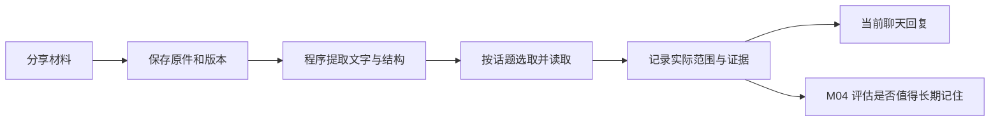

# F11 方案：图片、文章与链接阅读

日期：2026-11-05。代码基线：`f7f3ef8`。状态：**方案待 review，尚未开始实现**。依据：[开发计划 F11](plan.md)、[架构第 6.3 与 11 节](architecture.md)。本文件在功能交付后移除，最终行为与验收另存功能说明。

## 1. 已确认与待确认

用户本轮已确认：

- 上传支持 JPEG、PNG、WebP、TXT、Markdown、文字型 PDF。
- 常分享 B站、知乎、微信公众号及其他网页，验收需包含这些入口。
- 沿用既有要求：大功能先评审方案；聊天和后台分项目，通用 UI 使用 Naive UI；代码直观，显式传 ownerId；开发数据不要求兼容迁移；正式由 PM2 运行。

**用户已确认 B站范围：本轮读取页面图文，字幕和视频理解后续做。** 因此只使用实际取得的页面正文、简介、封面和配图，不把它们当作视频内容。

下文属于待评审设计。格式与站点范围的确认不代表整份实施方案已获准开发。

## 2. 本轮使用效果

| 使用场景                         | 预期行为                                                                                     |
| -------------------------------- | -------------------------------------------------------------------------------------------- |
| 只发一张猫的照片，没有提问       | 结合当前话题看图并自然回应；不要求用户填写分析目标。识别疑问保留，不自动认定是用户养的猫     |
| 分享一篇长文章，说“这个挺有意思” | 先获取结构和有限概览，再读与当前话题有关的部分；不默认启动全文深度分析                       |
| 问“第 8 页这段是什么意思”        | 读取对应页及必要上下文，可回查引用位置；不会只凭整篇摘要作答                                 |
| 要求全文总结                     | 创建有实际覆盖记录的分批阅读任务。完成前显示进度；失败或有未读部分时只交付明确标为部分的结果 |
| 分享带视频的网页                 | 正文、图片、视频分别显示状态。只取得简介或封面时不声称看过视频                               |
| 说“照片里不是我的猫，是朋友家的” | 本轮立即采用明确纠正，随后自主修订相关观察和记忆；不要求用户去后台编辑                       |

聊天端显示简洁材料卡片：名称或标题、缩略图、处理状态、查看内容和失败重试。页数、已读片段和未读原因在展开后显示，日常聊天不展示模型调用参数。后台在既有任务和来源入口补充诊断与追溯。

**解析完成不等于伴侣已经读完。** 提取了 100 页文字、把 3 页送入模型、完成了某个问题的回答，是三种不同状态。阅读范围表示实际输入并得到有效结果的范围，不保证模型理解了每个细节。

## 3. 首版范围

### 包含

- 私聊中的文件选择、拖拽及粘贴图片；允许只发送材料，不必附带一句文字。文字消息原有限制不因附件扩大。
- 原件独立持久化、材料版本、消息关联、按页/段落/图片区域定位；刷新和重启可继续读取。
- TXT/Markdown 结构提取、PDF 文字层按页提取；网页正文及相关图片的获取与解析。
- 图片概览与针对问题的局部补读。长截图保留区域位置，不能只缩成低清缩略图后宣称已读全部小字。
- 有界概览、局部问答、明确请求后的分批全文文字总结，以及已读范围和中断恢复。
- 材料依据进入聊天、记忆整理、来源回查和现有删除流程。原件、解析结果、伴侣观察与长期记忆分开保存。

### 不包含或有明确限制

- Word、扫描型 PDF 的批量 OCR 不在已选格式内。**上传的截图或扫描图片仍属于图片输入**，可以视觉读取。
- 文字型 PDF 首先读取文字层；图表、插图、没有提取到文字的页面单独标明。文字总结不能声称已完整理解全部图表；需要细节时可发送截图。本轮不承诺复杂表格、公式和多栏排版无损还原。
- 不登录第三方账号、不导入用户 Cookie、不跨越验证码或付费访问限制。受限页面返回具体取得范围和原因，可改为粘贴正文或上传材料。
- 不实现整站爬取、持续网页监控、自动屏幕采集、语音和游戏接入；视频理解按已确认安排后续扩展。
- F11 只提供材料处理与阅读任务；长期创作、跨目标重规划、跨终端工具和主动联系分别归 F12/F13/F19。

## 4. 技术选择及依据

继续使用 Node 22、NestJS、MySQL、已有持久任务和文件目录。**推荐组合：受限网页获取 + Readability/jsdom，PDF.js 提取文字，已有 sharp 处理图片，已有模型入口增加视觉输入。** 不另建一套记忆引擎或通用文档代理框架。

以下事实来自 2026-11-05 核对的官方资料；集成成本为结合本仓库的判断，尚无吞吐或准确率实测。

| 方案                     | 官方能力与接入                                                                                                                                                                                                                                                  | 成本、退出与限制                                                                                                                                                                            | 本项目结论                                                       |
| ------------------------ | --------------------------------------------------------------------------------------------------------------------------------------------------------------------------------------------------------------------------------------------------------------- | ------------------------------------------------------------------------------------------------------------------------------------------------------------------------------------------- | ---------------------------------------------------------------- |
| Node 中组合成熟解析库    | [Readability](https://github.com/mozilla/readability) 提取正文；官方给出 jsdom 用法，两者不替代网页获取。[PDF.js Node 示例](https://github.com/mozilla/pdf.js/blob/master/examples/node/getinfo.mjs) 可逐页获取文字和布局信息；Readability/PDF.js 为 Apache-2.0 | 主要成本是现有服务器与模型调用；原件及结构化结果自管。普通获取不能解决登录、验证码和所有动态站点；中文排版需样本验证                                                                        | **首选**，接入职责清楚，匹配现有 TypeScript/PM2 工程             |
| Docling 解析服务         | [官方项目](https://github.com/docling-project/docling) 支持多种文档、布局、OCR及结构化导出；代码 MIT，模型许可另计                                                                                                                                              | Python 服务和解析模型增加部署及资源维护；JSON/Markdown 可导出。仍需网页访问与本项目权限、阅读记录、记忆集成                                                                                 | 以后扫描 PDF、复杂文档成为重点时再评估                           |
| Firecrawl Cloud / 自托管 | [Scrape](https://docs.firecrawl.dev/features/scrape) 提供网页、动态内容及 Markdown 等输出；[官方对比](https://docs.firecrawl.dev/contributing/open-source-or-cloud) 区分云端和自托管能力                                                                        | 云端有计划/用量成本且材料经过第三方；自托管增加服务运维。核心[许可证](https://github.com/mendableai/firecrawl/blob/main/LICENSE)为 AGPL-3.0，云服务另有条款；输出可保存，但抓取服务仍有依赖 | 可作为之后的可选网页读取提供方，本轮不默认增加订阅或部署整套服务 |
| 只允许手动粘贴文字       | 复用当前文字聊天                                                                                                                                                                                                                                                | 改动小，但长材料来源、图片和链接阅读无法满足；退出成本低                                                                                                                                    | 可保留为访问失败时的替代入口，不作为 F11 的实现方案              |

依赖版本在实现前验证并锁入 lockfile，不直接追最新主分支。PDF.js [当前源码的 Node 要求](https://github.com/mozilla/pdf.js/blob/master/package.json)与项目最低版本未完全相同，不能据此直接安装最新版；须验证发布版对 Node 22.20 与推荐版本的兼容性。若需要变更最低 Node 版本，先说明差异，不暗中提升。

解析采用可终止、限并发的独立工作线程或子进程，避免大文件阻塞 HTTP；与 Nest 处在同一部署中，任务状态仍由现有 MySQL 任务模块负责。是否需要 PDF 的额外原生依赖在首个验证任务中确认。

## 5. 网页怎么读取

| 网站/材料      | 本轮处理                                            | 验收必须说明                                                       |
| -------------- | --------------------------------------------------- | ------------------------------------------------------------------ |
| 普通网页、博客 | 取得 HTML，提取标题、正文结构、配图和可识别媒体引用 | 获取成功也可能只有页面壳；提取失败不能退化成把标题当正文           |
| 微信公众号     | 对公开响应中的正文及懒加载配图做针对性提取          | 被限制、要求验证或部分图片不可取时保留原因，不保证任意文章都能打开 |
| 知乎           | 处理实际取得的公开文章/回答，保留作者和对应内容范围 | 登录提示、折叠内容和动态缺失分别识别；不能把问题页当作全部回答     |
| B站            | 处理实际取得的公开专栏、动态文字或视频页面简介/封面 | 视频本体与页面信息区分；本轮不获取字幕或读取视频                   |

只获取用户分享的页面及预算内相关媒体，不沿所有外链递归。第一版不常驻浏览器；若真实目标站点普遍无法取得正文，在验证任务中报告样本覆盖，再讨论独立浏览器读取或第三方服务，不能用仅成功的普通博客代表四类网站全部可用。

服务端获取只允许 HTTP(S)，检查解析地址及每次重定向，拒绝回环、内网、链路本地及云元数据地址；连接时绑定已验证地址以避免 DNS 重绑定。限制跳转、响应体、解压后大小和耗时。HTML 不执行脚本或自动加载资源，配图统一走同样的受限获取路径。前端展示提取后的结构化内容，不直接渲染外部原始 HTML，也不直接加载第三方图片。

保存原始 URL、取得时间、实际响应版本/哈希以及已保存的正文和媒体。对同一链接的再次分享重新核对可取得内容：未变化可复用解析，变化生成新材料版本；旧消息继续指向原版本。刷新失败保留旧快照并显示其取得时间，不标为最新。

## 6. 数据与代码如何保持简单

建议新增 **4 张职责明确的表**，不按文件格式或每一种处理阶段分别建表。实现时先验证必要查询和删除路径，再固定字段。

| 表                  | 保存什么                                                                                                                                 |
| ------------------- | ---------------------------------------------------------------------------------------------------------------------------------------- |
| `material_versions` | 一个不可变材料版本：ownerId、逻辑材料 ID、来源、原件引用/校验值、大小、取得时间、解析状态和失效状态。不再另建一张只有名称的 materials 表 |
| `material_parts`    | 该版本的有序页/段/图片区域：位置、文字或文件引用、提取状态及原因。支持按材料和位置分页                                                   |
| `message_materials` | 哪条已发布消息分享了哪个版本，包含准确的消息版本、材料次序和范围。上传成功但未发送，不等于伴侣已经收到                                   |
| `material_readings` | 某伴侣、人生代次、会话实际读取的有界批次，包含来源消息、片段/区域、任务/模型调用、问题用途、观察/摘要和纠正依据。A 的读取不替代 B 的读取 |

文件放在 `DATA_DIR/materials`，数据库不存 base64。核对实际文件类型、体积与解码结果，不仅信任文件名和上传头；图片区域与旋转/缩放后的坐标保留映射。文件与引用使用服务端 ID，写完并校验后才发布引用；临时文件失败可回收，不能删到尚在上传或仍有有效引用的文件。首版不做跨用户文件去重；同一原件可复用确定性的解析，重复分享仍保存新的交流事件。

将现有记忆证据扩展为有限的来源类型：聊天原文、材料文字片段、图像观察。材料证据保留材料版本、位置及对应分享消息；图片识别结果注明它是观察而非原图里的文字原文。继续复用 F08 的整理、F09 的记忆检索、F10 的来源/图谱，不另建平行记忆表。

代码集中到 `modules/materials`，按实际职责分为接收/查询、文件、解析/网页获取、阅读执行；一个模块 Repository 处理确有复用的查询。服务显式传 `ownerId`，常规操作使用现有基础方法，复杂查询直接 Drizzle，跨表写入使用现有事务回调。不开新的隐式身份上下文、不做多层通用工厂。

本轮会改变表结构和来源契约。按开发阶段既有授权更新初始化基线，不制作旧开发数据转换程序；实现交付时明确停止服务、`pnpm db:reset` 及文件/向量清理范围。本次方案提交不执行任何清空或迁移。

## 7. 从发送到回复

1. **保存**：上传取得临时材料 ID；发送消息时原子关联已完成上传的版本并登记任务。不能伪造别人的材料 ID。纯链接也先保存原消息，再进行获取。
2. **解析**：程序提取文字与结构，不让模型逐字搬运整篇文章；只发布实际成功的片段，分页保存检查点。
3. **选取**：优先处理当前分享或明确指向的材料。页码/标题定位、关键词及前后文先行；不每次扫描全库，也不为整份文件自动付费生成向量。F09 继续检索既有记忆，材料片段的全量向量索引留到检索维护阶段评估。
4. **读取**：局部问题和普通分享有每轮片段、图片及模型往返上限。定位不足时可由模型提出有界补读请求，服务端校验位置、权限、版本与预算；不能以“没搜到”为依据断言材料没有相关内容。
5. **回复**：只把用户要求、材料引用、覆盖状态、选中原文/图像观察及必要历史放入聊天输入。没有读取能力时说明实际状态，不生成虚假的看图或读文结果。
6. **复用与记忆**：后续问题复用适用的观察，再补读所需细节。材料中人物的说法保留“文章写道”等归属，不自动变成用户事实；值得记住的内容才交给 F08 整理。

全文文字总结以固定材料版本和要求范围建立阅读任务，逐批覆盖后汇总。不能取前几个片段就报告完成；某批失败时保留可复用结果和未读范围。任务不长期占住聊天执行位置，期间可正常闲聊。

短读取在当前回复准备阶段完成；长读取在材料卡片显示真实进度和结果。完成时如果原聊天轮仍有效，可以继续原轮回复；用户已经插话使原轮失效时，结果留在原材料卡片供后续使用，不向新轮插入迟到发言。明确取消会停止后续派发；单次聊天被打断不自动清空已完成的有效阅读。复用 F04 的暂停、重试与恢复机制，不新增通用持续活动系统。

## 8. 模型与集中配置

现有 adapter 仅有 `inputText`，供应商能力查询明确为 `vision: false`；图片上传接口本身不会使模型获得视觉能力。

- 增加 `perception` 模型用途及明确的图像输入能力。配置进入现有开发/正式模型 JSON，供应商可以与聊天共用；部署检查验证模型能力和价格/预算。
- 更新开发/正式示例与 JSON Schema；开发的 test adapter 仅用于流程验收，正式新用途默认不启用，不因升级程序就自动开始付费调用。
- 首版图片优先由该用途返回带区域和不确定性的结构化观察，再由聊天复用。通常首次必要看图比普通聊天增加一次视觉调用，局部补读可能增加调用；不会每轮重新看全部图片。普通文字聊天不增加感知调用。
- 视觉输入在服务端从已授权的固定材料版本构造；不把客户端任意 URL、文件路径或完整原件混入提示词。模型调用身份包含材料版本、区域、预处理及问题用途，不能只按用户文字去重。
- 图片费用不能只按 URL 或 base64 字符数估算。为实际供应商实现图像预算估算/保守上界，配置不完整则不启用视觉；用量缺失保留预留，失败和重试沿用 F03 计量。
- 材料限制集中在 `MATERIAL_CONFIG_JSON`，由现有配置入口一次加载，默认值只在材料配置模块维护；不新增配置框架。模型预算和供应商配置仍只有模型 JSON 一处来源。

以下为**建议初始限制，不是已测容量**；性能验证后可调整并记录理由：

| 参数                         | 初始建议                                                                                 |
| ---------------------------- | ---------------------------------------------------------------------------------------- |
| 每条消息附件数 / 每文件体积  | 4 个 / 20 MiB；网页配图合计另受每材料总预算限制                                          |
| 图片解码像素                 | 40 MP；模型输入另按分辨率/区域预算处理                                                   |
| PDF 页数 / 单材料提取文字    | 100 页 / 500,000 字符；超过上限明确提示，不静默丢尾部                                    |
| 网页响应体 / 获取时间 / 跳转 | 解压后 5 MiB / 15 秒 / 最多 3 次，每次仍复查地址                                         |
| 并发解析 / 普通一轮补读      | 部署级 1 个 / 最多 3 批；每批仍服从实际模型输入限制                                      |
| 原件保留                     | 已发送材料随有效来源保留，不自动按天清除；未发送且无活动任务的临时上传超过 24 小时可回收 |

总存储额度及剩余空间检查集中配置，额度不足时拒绝新上传并给出可操作提示，不偷偷删除旧材料来腾空间。真实模型效果需在用户已配置并启用的供应商上验证，确定性测试不能证明识别准确率。

## 9. 来源纠正、删除与恢复

- 读取文件、派发模型、缓存命中、提交观察/记忆及发布回复时，均核对 owner、伴侣、人生代次、会话成员、分享消息和材料版本状态。上传 ID、文件哈希或阅读记录本身不授予访问权限。
- 删除来源先使相关读取与复用失效，再由 F07 清理原件引用、片段、观察、摘要、模型候选、记忆及其向量。物理文件只在没有仍合法的引用后删除；重置 A 不误删 B 仍可读取的共享原件或独立经历。
- 同一文件反复分享的清理范围按既有来源关系与有效引用计算，不按 URL 或哈希直接跨会话删除。仅被禁用来源支持的缓存不得借另一条无关引用复活。
- 明确纠正先进入本轮上下文；已确认错误观察停止复用，后台按真实依赖修订，不全量重算，也不改写原始聊天记录。正文更新生成新版本，不覆盖当时已读的旧证据。
- 中断后只复用完整落盘、版本一致且仍有权限的结果；模型调用结果未知仍遵守现有未知状态，不能默认重发。网页重新获取得到新内容时按新版本处理，不冒充恢复了旧页面。

## 10. 功能拆分与优先级

此处 P0/P1 是 **F11 内部实施顺序**，下列条目均属于本轮范围；不以 P1 名义省略已接受需求。每项在开发获准后按行为逐步实现，完成后更新勾选。

| 任务                         | 优先级 / 依赖                            | 具体交付与验收                                                                                                      |
| ---------------------------- | ---------------------------------------- | ------------------------------------------------------------------------------------------------------------------- |
| [ ] T01 解析与目标站点验证   | P0 / 无                                  | 在 Node 最低与推荐版本核对依赖；中文长文、长截图、文字 PDF、四类站点样本形成实际能力表。确认格式/网站限制和资源消耗 |
| [ ] T02 材料来源与持久保存   | P0 / T01                                 | 最小四表、文件保存、发送关联、权限与幂等；上传重试不重复，未发送材料不算经历，文件丢失不报告 ready                  |
| [ ] T03 文档与网页解析       | P0 / T02                                 | 文本/PDF 分段、图文关联、网页版本、获取限制、解析检查点；空白、乱码、受限网页和混合 PDF 有真实状态                  |
| [ ] T04 视觉能力与预算       | P0 / T02                                 | 模型 JSON、图像输入、结构化观察、输入身份和计费；不支持视觉时拒绝虚假识图，额度不足不派发                           |
| [ ] T05 有界读取与聊天       | P0 / T03、T04                            | 普通分享、局部补读、只发材料、分批全文文字总结；聊天打断、进度和旧结果处理保持正确                                  |
| [ ] T06 记忆、纠正与生命周期 | P0 / T05                                 | 材料证据进入整理/回查/图谱，补读不依赖等待整理；删来源、重置和多实例共享引用不串数据                                |
| [ ] T07 两端界面             | P1 / T02 起按契约接入，完成依赖 T05、T06 | 聊天 Naive UI 材料卡/上传/阅读范围，后台来源和处理诊断；桌面与手机流程，维持星空与后台各自风格                      |
| [ ] T08 集成验收与交付       | P0 / 全部                                | 独立数据验收命令、故障恢复、生产包/PM2 配置接线、运行步骤及固定 commit；提交推送 dev，交用户 review                 |

不承诺未经验证的工期或网站成功率。T01 若显示首选路径无法覆盖主要材料，先把实际样本结果及替代方案交用户评审，不在实现中静默扩大依赖或缩小功能。

## 11. 公共接口与验收方式

方案评审覆盖的测试入口：**两端 UI、公开 HTTP/SSE、部署配置/启动以及受控外部网页和模型协议**。使用真实隔离 MySQL/Qdrant/Redis、持久文件和可强制结束的工作进程；不测试私有方法调用次数，不通过直接灌业务表代替使用流程。本轮尚未编写测试。

拟定公开接口：材料上传/链接接收、状态与分页片段查询、已认证原件读取、阅读任务创建/状态，以及聊天消息的材料引用；沿用数字 `{code,data,message}`、Zod ValidationPipe、SSE 和任务控制。原件下载属于二进制响应。最终路径与错误码在契约任务确定，不新增整套 API 版本号。

用户可按这五组场景 review：

1. **图片与纠错**：发猫图、长截图和图片小字问题；纠正主体后立即追问；查看观察与记忆来源，不再引用已知错误。
2. **长文与范围**：发文字 PDF，先问第 8 页，再要求全文文字总结；中途闲聊/暂停/重启，进度恢复，未读图表有明确提示。
3. **四类链接**：普通图文、公众号、知乎和 B站各选公开样本；成功、仅部分内容、要求登录、视频未读均展示实情。同 URL 更新后旧消息仍保留旧版本。
4. **即时使用与记忆**：新地址出现在刚发的图片/文章中，尚未整理就询问；先读必要材料再回答。文章举例中的地址不自动覆盖用户自己的地址。
5. **权限与清理**：删除来源、重置 A、另一伴侣 B 仍有合法共享来源；旧页面/迟到任务不能恢复已删内容，文件、记忆与索引清理状态一致。

自动验收额外覆盖损坏/超大文件、解析超时、恶意跳转与内部地址、模型额度不足或结果未知、重复分享/重试及文件已落盘但数据库未提交时的恢复。固定语料验证位置与覆盖；真实模型另评估中文图片、小字、排版和跨段理解，不把协议 fixture 的通过当作语义准确率。

## 12. 开发前的确认点

- [x] 上传格式：图片 + TXT/Markdown + 文字型 PDF。
- [x] 常用站点：B站、知乎、公众号、其他网页。
- [x] B站本轮读取页面图文，字幕和视频理解后续做。
- [ ] 用户 review 本文中的范围、处理方式、初始限制及公共验收入口，并明确同意进入开发。

当前阶段只交付此方案，所有实现任务保持未完成。
